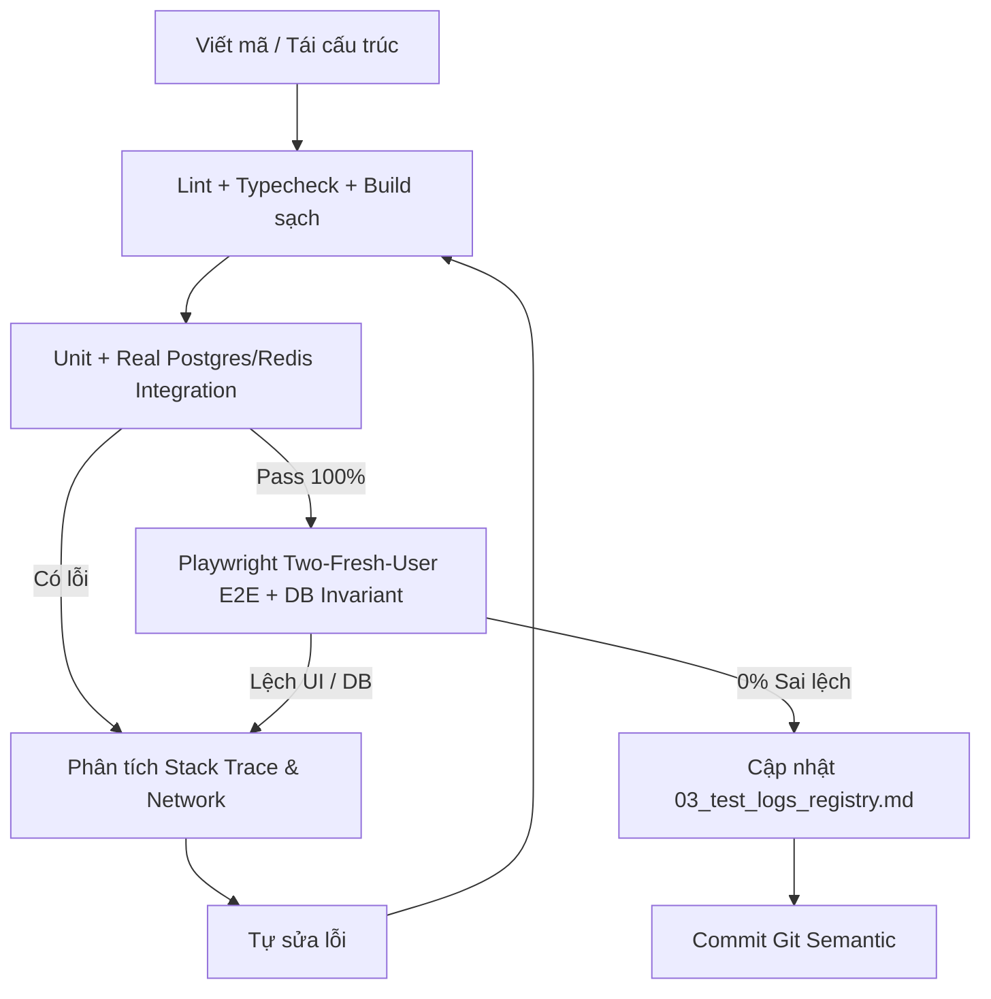

# Cẩm Nang Chỉ Dẫn Vận Hành AI Agent (AGENT.md)

> **Dự án:** Acad DevOps Fullstack Monorepo (**SYNAPSE Engine**)  
> **Phiên bản:** `v3.0.0` (Tái thiết Sạch trên Nền Tảng Hạ Tầng `deploy/` 000007 & Tài Liệu SAD Đã Chuẩn Hóa)  
> **Trạng thái thực tế:** **Kho lưu trữ v2.1.0 đã khóa + Git Tag `v2.1.0-e2e-verified` — Sẵn sàng triển khai v3 từ Phase B0**  
> **Kho lưu trữ lịch sử:**  
> - Mã nguồn v2.1.0 (đã qua E2E): [`archive/v2_codebase_20261112/`](file:///home/debv/Documents/100_academy/acad_it_devOps/acad_devOps_project/archive/v2_codebase_20261112) & [`archive/codebase_snapshots/acad_devops_codebase_v2.1.0_20261112.tar.gz`](file:///home/debv/Documents/100_academy/acad_it_devOps/acad_devOps_project/archive/codebase_snapshots/acad_devops_codebase_v2.1.0_20261112.tar.gz)  
> - Mã nguồn v1 lịch sử: [`archive/legacy_codebase/`](file:///home/debv/Documents/100_academy/acad_it_devOps/acad_devOps_project/archive/legacy_codebase)  
> **Tài liệu đặc tả chủ đạo:** [`docs/README.md`](file:///home/debv/Documents/100_academy/acad_it_devOps/acad_devOps_project/docs/README.md), [`docs/SYSTEM ANALYSIS & DESIGN LIFECYCLE FRAMEWORK.md`](file:///home/debv/Documents/100_academy/acad_it_devOps/acad_devOps_project/docs/SYSTEM%20ANALYSIS%20%26%20DESIGN%20LIFECYCLE%20FRAMEWORK.md), các phân hệ [`docs/02_core_engines/`](file:///home/debv/Documents/100_academy/acad_it_devOps/acad_devOps_project/docs/02_core_engines) và hợp đồng API [`docs/03_standards_and_contracts/01_api_contracts_openapi.md`](file:///home/debv/Documents/100_academy/acad_it_devOps/acad_devOps_project/docs/03_standards_and_contracts/01_api_contracts_openapi.md)  
> **Skill nghiệm thu bắt buộc:** [`.agents/skills/real-user-e2e-verification/SKILL.md`](file:///home/debv/Documents/100_academy/acad_it_devOps/acad_devOps_project/.agents/skills/real-user-e2e-verification/SKILL.md)  
> **Phạm vi áp dụng:** Bắt buộc tuân thủ đối với mọi AI Agent (Antigravity) và Kỹ sư tham gia phát triển.

---

## 1. VAI TRÒ, TÔN CHỈ & BỐI CẢNH TÁI THIẾT V3 (DEPLOY-ANCHORED REBUILD)

1. **Vai trò của Agent:** Agent đóng vai trò là **Lead Architect, Senior Fullstack & DevOps Engineer**, chịu trách nhiệm toàn diện từ hợp đồng dữ liệu, lập trình nghiệp vụ backend, kiểm thử tải/DB thật, tới giao diện người dùng và kiểm định E2E trên trình duyệt thật.
2. **Bối cảnh Tái thiết Sạch trên Nền Deploy & DB Chuẩn (`deploy/`):**
   - Toàn bộ hạ tầng cơ sở dữ liệu [`deploy/migrations/`](file:///home/debv/Documents/100_academy/acad_it_devOps/acad_devOps_project/deploy/migrations) (`000001` $\rightarrow$ `000007`), dữ liệu mẫu 0% số ảo [`deploy/seeds/`](file:///home/debv/Documents/100_academy/acad_it_devOps/acad_devOps_project/deploy/seeds), Lua script [`deploy/redis/execute_vote.lua`](file:///home/debv/Documents/100_academy/acad_it_devOps/acad_devOps_project/deploy/redis/execute_vote.lua), Docker/Render configs và [`scripts/manage-homelab.sh`](file:///home/debv/Documents/100_academy/acad_it_devOps/acad_devOps_project/scripts/manage-homelab.sh) **đã hoàn chỉnh và được giữ nguyên**.
   - Mã nguồn ứng dụng v2.1.0 đã được đóng băng tại `archive/v2_codebase_20261112/` và tag `v2.1.0-e2e-verified`.
   - **Nguyên tắc kế thừa có kỷ luật:** Agent được tham khảo các giải pháp đã nghiệm thu trong `archive/v2_codebase_20261112/` (như Base36 `ltree`, Redis Lua FSM, SSE RFC 8895, Read-Through Redis Overlay), nhưng mọi module v3 được tái lập mới trên nền tảng vững hơn — khắc phục ngay 5 điểm yếu đã rút kinh nghiệm từ v2 (Project References `composite`, tách Rate Limit cho `/login|/register|/refresh`, Read-Through Redis Overlay mặc định, Token Resilience khi `429/5xx`, UX `Explore`/`Topics`/Chat username search).

---

## 2. NGUYÊN TẮC CHIẾN LƯỢC: BACKEND-FIRST TUYỆT ĐỐI

```mermaid
flowchart LR
    B0["Phase B0<br/>Monorepo Scaffolding"] --> B1["Phase B1<br/>Identity & Sessions"]
    B1 --> B2["Phase B2<br/>Spaces & Ltree Comments"]
    B2 --> B3["Phase B3<br/>Atomic Lua Voting & Feeds"]
    B3 --> B4["Phase B4<br/>Reddit Realtime Chat"]
    B4 --> B5["Phase B5<br/>Admin Hub & Moderation"]
    B5 --> VitestK6["QA Gate: 100% Tests Pass<br/>k6 Stress Test 5,000 RPS"]
    VitestK6 --> F1_F4["Stream F (F1-F4)<br/>Frontend Web Client"]
    F1_F4 --> D1_D2["Stream D (D1-D2)<br/>Production Deploy & Launch"]
```

- **Quy tắc bất biến:** **Không chạm vào bất kỳ dòng mã giao diện Frontend nào (Stream F) cho đến khi Stream B (Phases B0 $\rightarrow$ B5) hoàn thành 100%, vượt qua toàn bộ test suites và đạt chỉ số kiểm thử tải k6.**
- Việc phát triển Backend hoàn chỉnh từ cơ sở dữ liệu, Zod contracts, logic an ninh tới REST endpoints trước giúp bảo đảm tính toàn vẹn dữ liệu, triệt tiêu race conditions và loại bỏ hoàn toàn việc phải đập đi sửa lại API khi tích hợp client.

---

## 3. 4 BẤT BIẾN KIẾN TRÚC BẮT BUỘC (ARCHITECTURAL INVARIANTS)

Mọi dòng mã do Agent sinh ra phải tuân thủ nghiêm ngặt 4 bất biến sau:

### ⚡ Bất Biến 1: Phát Triển Dựa Trên Khế Ước (Contract-First Architecture)
- Mọi API endpoint, payload yêu cầu, phản hồi dữ liệu và mã lỗi phải được định nghĩa bằng **Zod Schemas** và **OpenAPI 3.1.0 specification** tại package tập trung `packages/contracts` trước khi lập trình router hay service.
- Phản hồi báo lỗi bắt buộc tuân thủ chuẩn **RFC 7807 Problem Details** (chứa các trường `type`, `title`, `status`, `detail`, `code`, `instance`).
- Phân trang danh sách động bắt buộc sử dụng **Con trỏ Base64 tổng hợp**:
  $$\text{Cursor} = \text{base64}(\text{sort\_score} : \text{timestamp} : \text{item\_id})$$
  Tuyệt đối không dùng `offset/limit` trên các danh sách bảng tin và bình luận.

### ⚡ Bất Biến 2: Ranh Giới Độc Lập Monorepo (Workspace Boundary Invariant)
Hệ thống tổ chức theo cấu trúc phân tầng nghiêm ngặt:
- `packages/*`: Chứa thư viện tiện ích, tokens, thuật toán, khế ước dùng chung (`contracts`, `ui-tokens`, `tree-virtualizer`, `auth-client`). **Các packages độc lập tuyệt đối, không bao giờ được import từ `services/*` hay `apps/*`.**
- `services/*`: Chứa logic nghiệp vụ lõi (`services/auth`, `services/community`). Chỉ được phụ thuộc vào `packages/*` và driver CSDL; không phụ thuộc vào `apps/*`.
- `apps/*`: Chứa ứng dụng đầu cuối (`apps/api`, `apps/web`). `apps/api` đóng vai trò là **API Gateway Facade** (Routing, Rate Limit, CORS, Healthcheck), điều hướng yêu cầu tới các `services/*`, **tuyệt đối không thực hiện truy vấn thô (raw SQL) trực tiếp vào CSDL bên trong API Gateway**.

### ⚡ Bất Biến 3: TypeScript Strict & Node.js ESM Hiện Đại
- Cấu hình TypeScript: Bắt buộc `strict: true`, `noImplicitAny: true`, `exactOptionalPropertyTypes: true`. Tuyệt đối không dùng kiểu `any` bừa bãi (sử dụng `unknown` kèm Type Guards).
- Module Resolution: Chuẩn **NodeNext / ESM**. Mọi câu lệnh import tương đối bắt buộc có đuôi mở rộng `.js` rõ ràng (ví dụ: `import { userSchema } from './user-schema.js';`).
- Bộ công cụ Linter & Formatter: Sử dụng **Biome** (`biome.json`), định dạng 2 spaces, dấu nháy đơn `'`, thời gian thực thi kiểm tra toàn bộ workspace $< 0.5$ giây.

### ⚡ Bất Biến 4: Hạ Tầng Thực Tế Thay Vì Giả Lập (Zero In-Memory Fallbacks in Production)
- **Cấm hoàn toàn:** Không được tái tạo bất kỳ cơ chế giả lập mảng RAM (`InMemoryUserRepository`) trong môi trường production.
- **Nguyên lý Fail-Fast & Resilient Retry:**
  - Nếu CSDL PostgreSQL hoặc Redis bị ngắt kết nối, API Gateway lập tức phản hồi mã lỗi HTTP `503 Service Unavailable` RFC 7807 kèm header `Retry-After: 5`.
  - Tiến trình backend tự động kích hoạt cơ chế thử lại lũy tiến (Exponential Backoff Connection Retry: 1s, 2s, 4s, 8s, tối đa 30s) kết nối tới Supavisor Connection Pooler hoặc Redis Cluster để phục hồi dịch vụ mà không làm sập container.

---

## 4. QUY CHUẨN THIẾT KẾ & BÀI HỌC GIA CỐ NỀN TẢNG V3

### 4.1. Design System (Slate-Champagne & CSS Semantic Tokens)
Khi bước vào Stream F (Frontend), Agent phải áp dụng nhất quán hệ thống Design Tokens từ [`docs/01_architecture_and_data/05_frontend_design_system_and_ux_guidelines.md`](file:///home/debv/Documents/100_academy/acad_it_devOps/acad_devOps_project/docs/01_architecture_and_data/05_frontend_design_system_and_ux_guidelines.md) và [`docs/03_standards_and_contracts/04_minimalist_brutalist_tokens.md`](file:///home/debv/Documents/100_academy/acad_it_devOps/acad_devOps_project/docs/03_standards_and_contracts/04_minimalist_brutalist_tokens.md), bảo đảm hỗ trợ Dark/Light mode thông qua CSS variables (`--bg-canvas`, `--bg-surface`, `--bg-input`, `--color-brand`, `--text-primary`, `--border-subtle`) và **không tạo nút/link giả `showToast(...)`**.

### 4.2. 5 Ràng Buộc Kỹ Thuật Bắt Buộc Cho Nền Tảng v3
1. **TypeScript Project References (`composite: true`):** Luôn build theo chuỗi phụ thuộc (`packages/*` $\rightarrow$ `services/*` $\rightarrow$ `apps/*`) trước khi `typecheck` để không đọc nhầm `dist/*.d.ts` cũ.
2. **Phân tầng Rate Limiter theo ngữ nghĩa:** Tách `authRateLimiter` (`max: 10/60s`) chỉ áp cho `POST /login`, `/register`, `/refresh`; các API đọc/tìm kiếm (`GET /me`, `GET /users/search`, `GET /sessions`) chạy qua `globalRateLimiter`.
3. **Read-Through Redis Counter Overlay:** Mọi endpoint đọc thread/feed (`GET /threads/:id`, `/feed/*`, `/spaces/:slug/threads`) phải hợp nhất live counter từ Redis (`target:{id}:counters`) trước khi trả về client để loại bỏ độ trễ xả queue 5s của `VoteFlushWorker`.
4. **Resilient Session Lifecycle ở Client SDK:** Chỉ thu hồi `localStorage` tokens và đăng xuất khi server trả `401/403` thực sự hoặc phát hiện Reuse Attack; lỗi tạm thời (`429`, `503`, timeout) không được xóa phiên đăng nhập.
5. **Tách biệt Empty-State & User Discovery:** Người dùng trắng mới (0 space, 0 kênh chat) phải thao tác trọn vẹn từ rỗng (`Home` $\rightarrow$ CTA `/explore` $\rightarrow$ lọc `Topics` $\rightarrow$ Join; `Chat` $\rightarrow$ `Create Chat / Search by username` $\rightarrow$ Sent/Incoming Requests $\rightarrow$ Accept $\rightarrow$ SSE Real-time).

---

## 5. LỘ TRÌNH THỰC THI CHI TIẾT V3 (ĐỐI CHIẾU `deploy/` HIỆN HỮU)

> Lưu ý: Schema `deploy/migrations/000001..000007`, `deploy/seeds/` và `deploy/redis/execute_vote.lua` **đã sẵn sàng**. Mỗi Phase chỉ kiểm chứng trực tiếp trên schema + Redis thật, không tự ý bơm số giả lập vào seed.

Agent phải thực hiện lần lượt từng Phase theo thứ tự tuyến tính, cập nhật tài liệu và bảng kiểm sau mỗi Phase:

### [Phase B0] Monorepo Foundation & Tooling (Khởi Đầu Sạch)
1. Khởi tạo `pnpm-workspace.yaml`, cấu hình `package.json` gốc, kích hoạt engine `node: ">=22"`, `pnpm: ">=9"`.
2. Thiết lập Biome linter & formatter (`biome.json`).
3. Thiết lập `tsconfig.base.json` chuẩn TypeScript 5.9 NodeNext ESM.
4. Thiết lập `docker-compose.dev.yml` khởi chạy PostgreSQL 16 (4 extensions: `uuid-ossp`, `pgcrypto`, `ltree`, `pg_trgm`) và Redis 7 Alpine cục bộ.
5. Khởi tạo `packages/contracts` chứa Zod schemas và cấu trúc OpenAPI 3.1.

### [Phase B1] Identity, Cryptographic Engine & Session Shield
1. Tạo DDL bảng `users` và `user_sessions` với ràng buộc độc bản `LOWER()`.
2. Lập trình module mật mã: Argon2id (64MB RAM, timeCost 3, parallelism 4) và `crypto.timingSafeEqual`.
3. Lập trình Token Rotation: Access Token (15m JWT HS256) + Refresh Token (7d CSPRNG 64 bytes).
4. Thiết lập cửa sổ ân hạn 30 giây (30s Grace Period) trên Redis Hash `session:{userId}:{sessionId}`.
5. Triển khai cơ chế phát hiện xâm nhập Token Reuse Attack $\rightarrow$ Hủy toàn bộ cụm phiên của tài khoản.
6. Xây dựng package `@acad/auth-client` với Mutex Lock Interceptor chống bão yêu cầu 401 (Thundering Herd).
7. Thiết lập router xác thực trong `apps/api` (`/register`, `/login`, `/refresh`, `/logout`, `/healthz`).

### [Phase B2] Spaces, CMS & Nested Comments Ltree Engine
1. DDL bảng `spaces`, `space_memberships`, `space_flairs`, `threads`, `comments`.
2. Tạo module cấp phát Presigned PUT URL S3/Cloudflare R2 (thời hạn 5 phút) cho tải ảnh Zero-hop.
3. Tái lập thuật toán sinh mã `ltree` Base36 4 ký tự mỗi tầng.
4. Lập trình cơ chế Capped Depth 8: Khi bình luận đạt cấp thứ 8, tự động chuyển sang Flat Reply kèm `@mention` tác giả để chống vỡ giao diện.
5. Tạo chỉ mục GiST trên trường `path` của bảng `comments` để truy vấn cây con $< 1.2\text{ms}$.

### [Phase B3] Atomic Lua Voting, Feeds & Search Engine
1. Triển khai kịch bản Redis Lua nguyên tử `execute_vote.lua` (+1, -1, +2, -2, unvote) không race condition.
2. Thiết lập tập hợp `dirty:votes` và Background Worker 5 giây xả dữ liệu dồn về PostgreSQL.
3. Cấu hình bảng `thread_counters` với `WITH (fillfactor = 70)` để tối ưu hóa Heap-Only Tuples (HOT) update.
4. Lập trình thuật toán Hacker News Gravity Decay Engine:
   $$HotScore = \frac{NetScore}{(AgeHours + 2.0)^{1.8}}$$
5. Lập trình thuật toán Wilson Score Confidence Interval ("Best", $z = 1.96$):
   $$\hat{p} = \frac{Upvotes}{TotalVotes}, \quad Score = \frac{\hat{p} + \frac{z^2}{2n} - z \sqrt{\frac{\hat{p}(1-\hat{p})}{n} + \frac{z^2}{4n^2}}}{1 + \frac{z^2}{n}}$$
6. Xây dựng bộ lọc tìm kiếm toàn văn bản trong không gian (In-Space Scoped Search) qua `pg_trgm`.

### [Phase B4] Reddit Realtime Chat Engine & Queue
1. DDL bảng `chat_channels`, `chat_members`, `chat_messages`, `chat_requests`.
2. Thiết lập hàng đợi kiểm duyệt tin nhắn lạ (Chat Requests Queue): Trạng thái `PENDING`, `ACCEPTED`, `IGNORED`, `BLOCKED`.
3. Lập trình phân nhánh trao đổi Chat Threads qua trường `parent_message_id`.
4. Xây dựng cổng Server-Sent Events (SSE) với nhịp tim Heartbeat ping 15s.
5. Quản lý trạng thái trực tuyến (Presence) `chat:online_users` và typing indicators trên Redis.

### [Phase B5] Moderation & Admin Hub
1. Middleware RBAC Admin Guard (`role === 'ADMIN'`), trả về 401/403 tuyệt đối.
2. DDL bảng `reports` (Mod Queue cho Space Moderators) và cơ chế cấm ngầm (Shadowban: `user_status = 'SHADOWBANNED'`).
3. DDL bảng `audit_logs` lưu vết toàn bộ thao tác quản trị an ninh hệ thống.
4. API Quản trị: Thống kê số lượng theo thời gian thực (`/stats`), danh sách người dùng kèm `threadsCount`, ghim bài, khóa comment, xóa space cascade.

### [Stream F & Stream D] Frontend, QA & Triển Khai
- Sau khi hoàn thành B0 $\rightarrow$ B5, thực thi k6 stress test 5,000 RPS.
- Triển khai Stream F (Phases F1 $\rightarrow$ F4) với Next.js 15 App Router, React Server Components và Virtualized Ltree.
- Triển khai Stream D (Phases D1 $\rightarrow$ D2) với Docker Alpine, Supabase Migration và Render Cloud Uptime.

---

## 6. VÒNG LẶP KIỂM THỬ KHÉP KÍN, REAL-USER E2E & 5 CHIẾN THUẬT VẬN HÀNH

Theo quy chuẩn tại [`.agents/skills/real-user-e2e-verification/SKILL.md`](file:///home/debv/Documents/100_academy/acad_it_devOps/acad_devOps_project/.agents/skills/real-user-e2e-verification/SKILL.md) và [`docs/05_guides_and_verification/`](file:///home/debv/Documents/100_academy/acad_it_devOps/acad_devOps_project/docs/05_guides_and_verification), Agent **tuyệt đối không** nghiệm thu chỉ bằng `HTTP 200` SSR rỗng hoặc tài khoản seed `admin_pro`. Mọi tính năng, module phải trải qua vòng lặp thực tế khép kín:

### 6.1. Quy Trình 4 Bước Kiểm Thử API Thực Tế (API-First Testing Protocol)
1. **Khởi chạy môi trường dịch vụ (Service Spin-up):** Đảm bảo backend API và dependencies (PostgreSQL 16, Redis 7) đang hoạt động cục bộ hoặc container sẵn sàng tiếp nhận request.
2. **Thực thi lệnh gọi API thực tế:** Dùng `curl`, script bash tự động với headers chuẩn: `Content-Type: application/json`, `Accept: application/json`, và `Authorization: Bearer <token>` nếu có auth.
3. **Ghi nhận Log & Kiểm tra đầu ra (Output & Response Verification):**
   - **Kiểm tra mã trạng thái HTTP:**
     - Happy Path: `200 OK`, `201 Created`, `204 No Content`.
     - Negative Path: `400 Bad Request`, `401 Unauthorized`, `403 Forbidden`, `404 Not Found`, `409 Conflict`, `422 Unprocessable Entity`.
     - **Tuyệt đối cấm xuất hiện `500 Internal Server Error`:** Mọi lỗi 500 đều là vi phạm nghiêm trọng cần tra cứu stack trace và xử lý ngay lập tức.
   - **Kiểm tra Schema & Payload:** Phản hồi lỗi phải tuân thủ chuẩn **RFC 7807 Problem Details**, không trả về HTML rác hoặc chuỗi thô.
4. **Xác thực biến đổi ngầm (Side-Effect Verification):** Sau các request thay đổi trạng thái (POST, PUT, PATCH, DELETE), phải truy vấn lại bằng API GET hoặc chạy câu lệnh SQL trực tiếp vào CSDL để xác thực dữ liệu đã được lưu chính xác.

### 6.2. 5 Chiến Thuật Vận Hành Sống Còn Dành Cho Agent (Critical Agent Tactics)
1. **Lập kế hoạch theo Phân tầng MECE:** Phân rã bài toán theo đúng thứ tự 5 tầng:
   $$\text{Contracts / Schemas} \longrightarrow \text{DB Migrations / Repositories} \longrightarrow \text{Business Services} \longrightarrow \text{Transport Controllers} \longrightarrow \text{Middlewares \& Filters}$$
2. **Quản lý Dữ liệu Kiểm thử Độc lập & Tính Lặp lại (Seed Isolation & Idempotency):** Chuẩn bị tập dữ liệu kiểm thử tối thiểu (Minimum Viable Test Dataset) trước khi chạy API test. Các kịch bản kiểm thử phải có khả năng chạy lại vô hạn lần mà không lỗi do trùng lặp Unique Key.
3. **Quản lý Ngân sách Ngữ cảnh (Context Budgeting & Token Economy):** Tra cứu đúng trọng tâm (Just-In-Time Retrieval), đọc chính xác tệp tin cần xử lý, không đọc duyệt toàn bộ thư mục lớn gây cạn kiệt context window.
4. **Lập trình Phòng thủ (Defensive Engineering):**
   - **Không nuốt ngoại lệ (No Silent Failures):** Cấm tuyệt đối khối `try-catch` rỗng hoặc bỏ qua lỗi.
   - **Xác thực dữ liệu biên:** Kiểm tra chuỗi rỗng `""`, chuỗi quá dài, số âm, mảng rỗng `[]`, `null`, injection payloads.
5. **Commit Nguyên Tử & Bằng Chứng Nghiệm Thu (Atomic Commits & Proof of Work):** Mỗi commit giải quyết trọn vẹn 1 mục tiêu kỹ thuật, kèm theo kịch bản cURL mẫu và cập nhật biên bản kiểm thử trong `docs/05_guides_and_verification/03_test_logs_registry.md`.

---

## 7. 5 CỔNG KIỂM ĐỊNH TỰ ĐỘNG (CI/E2E GATES) & CHECKLIST ĐỊNH NGHĨA HOÀN THÀNH (DOD)

### 7.1. 5 Cổng Kiểm Định Bắt Buộc
Trước khi xác nhận hoàn thành bất kỳ Phase hay tính năng nào trên v3, Agent **bắt buộc phải chạy và đạt 100% các cổng sau**:

1. **Cổng 1 (Linting):** `pnpm run lint` (Biome check, 0 errors).
2. **Cổng 2 (Build & Strict Typecheck):** `pnpm run typecheck` (`tsc -b` / workspace builds trước khi check).
3. **Cổng 3 (Unit & Real DB Integration):** `pnpm test && pnpm run test:integration` (trên PostgreSQL 16 + Redis 7 thật).
4. **Cổng 4 (Real-User Playwright E2E):** `pnpm run test:e2e` chạy kịch bản 2 tài khoản trắng mới trên trình duyệt Chromium Headless.
5. **Cổng 5 (DB Counter Invariant & Homelab Ops):** Chạy `./scripts/manage-homelab.sh qa` và `SELECT * FROM reconcile_platform_counters();` bảo đảm 0% sai lệch `thread_counters`/`thread_votes`/`comments`/`spaces`.

### 7.2. Checklist Định Nghĩa Hoàn Thành (Definition of Done - DoD 8 Tiêu Chí)
- [ ] **1. Compile & Lint sạch:** `biome check` + `typecheck` + `build` đạt 0 errors.
- [ ] **2. Khởi chạy Homelab thực tế:** `./scripts/manage-homelab.sh restart && ./scripts/manage-homelab.sh test` (PostgreSQL, Redis, API :10000, Web :3000 đều xanh).
- [ ] **3. Happy Path & Two-Fresh-User E2E:** Tài khoản trắng mới (`fresh_a`, `fresh_b`) đi trọn luồng từ trạng thái rỗng (`Explore`, `Home`, `Vote/Comment`, `Chat username search -> Request -> Accept -> SSE`) qua Playwright thật.
- [ ] **4. Negative Path thực tế:** Dữ liệu sai/quyền hạn sai bị chặn bằng HTTP 400/401/403/404/409/422 RFC 7807, tuyệt đối không trả HTTP 500 và không để `authRateLimiter` khóa nhầm `GET /auth/me`.
- [ ] **5. Nhật ký sạch:** `journalctl --user -u acad-api.service` & browser console không có ngoại lệ ẩn.
- [ ] **6. Đối soát Side-effect & Zero Fake Data:** Dữ liệu trong `PostgreSQL` & `Redis` khớp 100% (`vote_mismatches = 0`, `comment_mismatches = 0`, `PG = REDIS`).
- [ ] **7. Cập nhật Biên bản & Tài liệu:** Cập nhật [`docs/05_guides_and_verification/03_test_logs_registry.md`](file:///home/debv/Documents/100_academy/acad_it_devOps/acad_devOps_project/docs/05_guides_and_verification/03_test_logs_registry.md) và ma trận tiến độ bằng đúng số đo thực tế sau lần sửa cuối.
- [ ] **8. Commit Semantic:** Commit rõ ràng sau khi đã qua đầy đủ các cổng trên.

---

## 8. QUY CHUẨN GIT, NHẬT KÝ KIỂM THỬ & HƯỚNG DẪN NGƯỜI DÙNG

1. **Quy chuẩn Git Commit & Auto-Deploy:**
   - Sử dụng định dạng **Semantic Commits**:
     - `feat:` Thêm tính năng mới (theo từng Phase).
     - `fix:` Sửa lỗi logic hoặc an ninh.
     - `test:` Bổ sung hoặc cập nhật test suites.
     - `docs:` Bổ sung, cập nhật tài liệu kỹ thuật hoặc bảng kiểm.
     - `chore:` Cấu hình tooling, docker, workspace.
     - `refactor:` Tái cấu trúc mã nguồn mà không đổi hành vi.
   - Khi commit và push lên nhánh `main` (`git@github.com:mjjyv/acad_devOps-project.git`), hệ thống Render Cloud sẽ tự động kích hoạt webhook triển khai cho Core API và Web Client.
2. **Ghi Nhật Ký Kiểm Thử (Test Logs Registry):**
   - Sau mỗi lần kiểm thử hoàn tất một Phase hoặc tính năng trọng yếu, Agent phải ghi lại kết quả kiểm định vào [`docs/05_guides_and_verification/03_test_logs_registry.md`](file:///home/debv/Documents/100_academy/acad_it_devOps/acad_devOps_project/docs/05_guides_and_verification/03_test_logs_registry.md).
   - Nội dung log gồm: Thời gian thực hiện, commit hash, danh sách test suites đã chạy, số test pass/fail, thời gian thực thi.
3. **Cập Nhật Hướng Dẫn Kiểm Thử Cho Người Dùng (cURL Guides):**
   - Sau khi hoàn thành mỗi module backend, Agent phải bổ sung kịch bản `curl` mẫu có thể copy-paste chạy ngay trên terminal của người dùng vào [`docs/05_guides_and_verification/01_backend_testing_curl_guide.md`](file:///home/debv/Documents/100_academy/acad_it_devOps/acad_devOps_project/docs/05_guides_and_verification/01_backend_testing_curl_guide.md).
   - Kịch bản phải kèm giải thích mã HTTP status code kỳ vọng và cấu trúc JSON trả về.
4. **Cập Nhật Đồng Bộ Tiến Độ (Roadmap Checklist):**
   - Sau mỗi Phase hoàn thành, Agent cập nhật trạng thái `[x]` tương ứng trong [`docs/06_roadmap_and_kpis/01_backend_first_roadmap.md`](file:///home/debv/Documents/100_academy/acad_it_devOps/acad_devOps_project/docs/06_roadmap_and_kpis/01_backend_first_roadmap.md), [`02_modules_matrix_checklist.md`](file:///home/debv/Documents/100_academy/acad_it_devOps/acad_devOps_project/docs/06_roadmap_and_kpis/02_modules_matrix_checklist.md), và [`03_progress_checklist.md`](file:///home/debv/Documents/100_academy/acad_it_devOps/acad_devOps_project/docs/06_roadmap_and_kpis/03_progress_checklist.md).

---

## 9. TƯƠNG THÍCH MÔI TRƯỜNG HỆ ĐIỀU HÀNH (DEBIAN 13 TRIXIE AWARENESS)

Môi trường máy phát triển và máy chủ của người dùng:
- **Hệ điều hành:** Debian GNU/Linux 13 (trixie) x86_64, Linux Kernel 6.12.
- **Shell:** GNU bash 5.2.37.
- **Phần cứng:** Intel Core i3-12100F (8 threads), 16GB RAM, NVIDIA GTX 1050 Ti.
- **Quy chuẩn bắt buộc:**
  - Mọi kịch bản bash shell, lệnh hướng dẫn trong tài liệu phải **100% tương thích với Debian 13 bash / POSIX**.
  - Sử dụng các công cụ chuẩn Linux: `apt`, `curl`, `jq`, `psql`, `docker compose`, `git`.
  - Tuyệt đối không sử dụng các lệnh hay đường dẫn đặc thù của macOS (`brew`, `sed -i ''`), Windows (`powershell`, backslashes `\`).
  - Hướng dẫn thiết lập môi trường chi tiết tại [`docs/04_deployment_and_devops/01_debian13_developer_setup.md`](file:///home/debv/Documents/100_academy/acad_it_devOps/acad_devOps_project/docs/04_deployment_and_devops/01_debian13_developer_setup.md).
