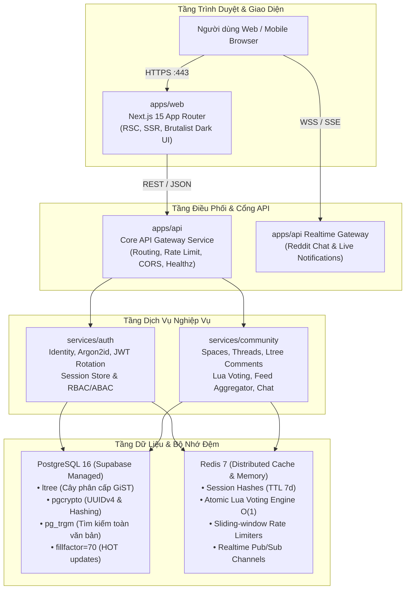

# Kiến Trúc Hệ Thống & Địa Hình Phân Tầng (System Topology)

> **Mã tài liệu:** `ARCH-SYSTEM-TOPOLOGY`  
> **Dự án:** Acad DevOps Fullstack Monorepo  
> **Kiến trúc:** Layered Microservices Monorepo (`pnpm workspace`)

---

## 1. MÔ HÌNH KIẾN TRÚC TỔNG THỂ (TOPOLOGY OVERVIEW)

Hệ thống được thiết kế theo mô hình kiến trúc phân tầng độc lập:
- **Tầng Ứng Dụng (Apps):** Điểm vào chính của người dùng và các dịch vụ cổng (Gateway).
- **Tầng Dịch Vụ Nghiệp Vụ (Services):** Chứa đựng toàn bộ logic nghiệp vụ, kho dữ liệu và động cơ xử lý.
- **Tầng Thư Viện Dùng Chung (Packages):** Khế ước OpenAPI, kiểu dữ liệu Zod, thuật toán dùng chung và Design tokens.
- **Tầng Hạ Tầng (Infrastructure):** Docker Compose, Kubernetes manifests, kịch bản di chuyển Supabase và bản thiết kế đám mây Render.



---

## 2. NGUYÊN TẮC PHÂN CHIA RANH GIỚI SERVER - CLIENT (RSC BOUNDARIES)

Ứng dụng Web `apps/web` áp dụng triệt để nguyên tắc **Server Component First**:
- **Mặc định 100% tệp là React Server Component (RSC):** Không gửi JavaScript mã nguồn của trang về phía client, tối ưu hóa kích thước gói bundle xuống mức tối thiểu (0KB JS tĩnh cho các trang xem bài viết và tài liệu).
- **Chỉ sử dụng Client Component (`'use client'`) tại các nút lá tương tác sâu nhất:**
  - Nút bấm biểu quyết Upvote/Downvote (kèm máy trạng thái FSM cập nhật lạc quan).
  - Khung soạn thảo bình luận và trả lời phân nhánh.
  - Hộp thoại tin nhắn tức thời và widget Reddit Chat nổi.
  - Thanh tìm kiếm tương tác với phím tắt `/` hoặc `Ctrl + K`.

---

## 3. KHẾ ƯỚC PHỤ THUỘC GIỮA CÁC WORKSPACE (DEPENDENCY GRAPH)

```text
packages/contracts  (OpenAPI 3.1, Zod Schemas, Shared Types)
  ▲          ▲          ▲          ▲
  │          │          │          │
packages/  packages/  services/  services/
ui-tokens  tree-virt    auth     community
  ▲          ▲          ▲          ▲
  │          │          │          │
  └──────────┼──────────┴──────────┘
             │
         apps/web  ◄──  apps/api
```

- **Quy tắc bất biến:** Các gói thư viện `packages/*` không bao giờ phụ thuộc ngược lại vào `services/*` hoặc `apps/*`.
- `apps/api` chỉ đóng vai trò là tầng chuyển tiếp (Gateway Facade), không chứa logic thao tác CSDL trực tiếp mà ủy quyền hoàn toàn cho `services/auth` và `services/community`.
