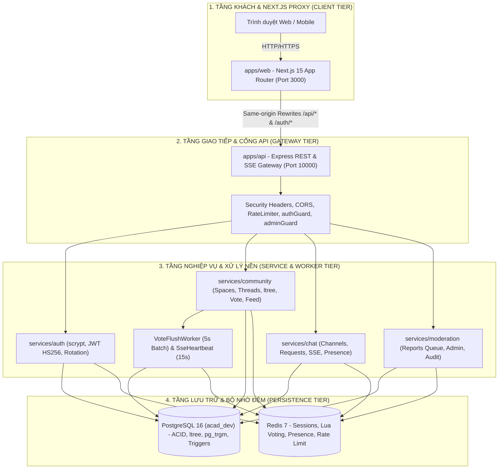

# Giai Đoạn 3: Kiến Trúc Tổng Thể, Hạ Tầng & Bảo Mật (System Architecture v2.2)

> **Mã tài liệu:** `ARCH-SYSTEM-TOPOLOGY`  
> **Dự án:** Acad DevOps Fullstack Monorepo (**SYNAPSE Engine**)  
> **Khung chuẩn:** Giai đoạn 3 trong [`SYSTEM ANALYSIS & DESIGN LIFECYCLE FRAMEWORK.md`](file:///home/debv/Documents/100_academy/acad_it_devOps/acad_devOps_project/docs/SYSTEM%20ANALYSIS%20%26%20DESIGN%20LIFECYCLE%20FRAMEWORK.md)

---

## 1. KIẾN TRÚC PHÂN TẦNG HỆ THỐNG (MULTI-TIER ARCHITECTURE)



### Trách nhiệm từng tầng
1. **Tầng Khách (`apps/web` + `@acad/auth-client`):** Render giao diện Next.js 15 App Router theo bảng màu Slate Indigo (`#30364F / #ACBAC4 / #E1D9BC / #F0F0DB`), giữ Mutex Lock chống bão 401 khi refresh token, thực hiện Optimistic UI an toàn và kết nối SSE same-origin qua rewrite `/api/:path*`.
2. **Tầng Giao tiếp (`apps/api`):** Định tuyến `/auth`, `/api/v1/*`, `/healthz`; áp dụng Universal Security Shield, Correlation ID, Request Timeout 25s, chuẩn lỗi RFC 7807 `ProblemDetails`.
3. **Tầng Nghiệp vụ (`services/*`):** Đóng gói toàn bộ logic miền và Repository SQL/Redis độc lập với Express để test đơn vị và tích hợp trực tiếp.
4. **Tầng Lưu trữ (`PostgreSQL 16` + `Redis 7`):** Chạy qua Podman Rootless (hoặc Docker/CI), bảo đảm ACID và tự động duy trì bộ đếm qua Trigger PostgreSQL + trạng thái tốc độ cao trên Redis.

---

## 2. MA TRẬN QUYẾT ĐỊNH NGĂN XẾP CÔNG NGHỆ (TECH STACK DECISION MATRIX)

| Phân vùng kiến trúc | Công nghệ lựa chọn | Công nghệ thay thế cân nhắc | Lập luận kỹ thuật & Đánh đổi |
| :--- | :--- | :--- | :--- |
| **Password KDF** | Node.js `crypto.scrypt` (`N=16384,r=8,p=1`) | `Argon2id` native C++ addon | Không cần biên dịch native addon khi deploy trên nhiều distro Linux/container, vẫn kháng tấn công phần cứng memory-hard và so khớp hằng thời gian `timingSafeEqual`. |
| **Giao thức Realtime** | **Server-Sent Events (SSE RFC 8895)** + REST POST | WebSocket / Socket.IO | Chat & notification phần lớn là server-push 1 chiều; SSE chạy thuần HTTP/1.1 & HTTP/2, đi xuyên Cloudflare Tunnel & Next.js rewrite ổn định hơn, tự reconnect natively. |
| **Cây Bình luận** | **PostgreSQL `ltree` Base36 + GiST** | Recursive CTE / Closure Table | Đọc toàn bộ nhánh con bằng 1 query `path <@ '...'` < 2ms, giữ thứ tự cây tự nhiên và hỗ trợ Capped Depth 8 Flat Reply đơn giản. |
| **Phân trang Feed** | **Keyset Cursor Base64** (`score:ts:id`) | `OFFSET / LIMIT` truyền thống | Không bị nhảy/trùng bài khi có bài viết mới đẩy vào đầu danh sách, tận dụng Composite Index O(log N). |
| **Biểu quyết** | **Redis Lua (`execute_vote.lua`) + 5s Flush + `fillfactor=70`** | `UPDATE` SQL trực tiếp mỗi click | Triệt tiêu row lock & race condition FSM Unvote/Switch (`+2/-2`) trên Redis, cập nhật DB theo lô qua PostgreSQL HOT updates. |

---

## 3. CẤU TRÚC GIẢI PHÁP MONOREPO (SOLUTION STRUCTURAL BLUEPRINT)

```text
acad_devOps_project/
├── apps/
│   ├── api/                 # Express Gateway, Security Shield, Routers, VoteFlushWorker
│   └── web/                 # Next.js 15 App Router Web Client & Rewrites
├── packages/
│   ├── contracts/           # OpenAPI YAML & Zod Schemas, Shared DTOs
│   └── auth-client/         # AcadClient (Bearer + Refresh Rotation Mutex Lock)
├── services/
│   ├── auth/                # scrypt, JWT HS256, PostgresUserRepository, RedisSessionStore
│   ├── community/           # Spaces, Threads, Comments ltree, LuaVoteEngine, FeedService
│   ├── chat/                # ChatService, PostgresChatRepository, SseManager, PresenceManager
│   └── moderation/          # ModerationService, PostgresModerationRepository, AuditLogs
├── deploy/
│   ├── migrations/          # 000001..000006 (và 000007 ở Giai đoạn B)
│   ├── seeds/               # Modular PostgreSQL + Redis seeds (0% fake data)
│   ├── redis/               # execute_vote.lua
│   └── docker/              # Dockerfiles & docker-compose / init-db.sql
└── .agents/skills/          # real-user-e2e-verification anti-slop skill
```

---

## 4. KIẾN TRÚC PHÒNG THỦ ĐA LỚP & VÒNG ĐỜI DỮ LIỆU (DEFENSE-IN-DEPTH)

### 4.1. Phòng thủ 3 lớp
1. **Lớp 1 – Kiểm thực & Làm sạch Đầu vào:** Mọi payload REST đều qua Zod validation (`@acad/contracts` trả HTTP 400 RFC 7807 `invalidParams`); Markdown link/image kiểm tra whitelist protocol (`http`/`https`/relative) chống `javascript:` XSS; [`SsrfGuard`](file:///home/debv/Documents/100_academy/acad_it_devOps/acad_devOps_project/apps/api/src/security/ssrf-guard.ts) chặn IP nội bộ/metadata cloud; [`file-guard.ts`](file:///home/debv/Documents/100_academy/acad_it_devOps/acad_devOps_project/apps/api/src/security/file-guard.ts) kiểm tra phần mở rộng/MIME trước khi cấp Presigned URL.
2. **Lớp 2 – Cô lập & Bảo mật Phiên:** `CSP` (`object-src 'none'; frame-ancestors 'none'`), `X-Frame-Options: DENY`, `nosniff`, CORS whitelist, JWT HS256 (15m) + Refresh Token SHA-256 hash Rotation (7d) kèm phát hiện Reuse Attack, RBAC `authGuard` + `adminGuard` + kiểm tra quyền Space Private 403.
3. **Lớp 3 – Giới hạn Lưu lượng & Kiểm toán Bất biến:** `RateLimiter` Redis 3 tầng (`auth`, `interaction`, `general`) trả RFC 7807 HTTP 429 kèm `Retry-After`; mọi thao tác quản trị ghi vào `audit_logs` được bảo vệ bởi trigger `BEFORE UPDATE OR DELETE`.

### 4.2. Vòng đời dữ liệu tạm thời (Ephemeral vs Persistent Data)
- **Redis Ephemeral Keys:** `typing:{channelId}:{userId}` (TTL 5s), `presence:online:{userId}` (TTL 15s), `session_lookup:{previousTokenHash}` (TTL 35s cho 30s Grace), `ratelimit:*` (TTL theo cửa sổ), `target:{id}:*` (TTL 30 ngày, đồng bộ xuống Postgres mỗi 5s qua `dirty:votes`).
- **PostgreSQL Persistent ACID:** `users`, `user_sessions`, `spaces`, `threads`, `comments`, `thread_votes`, `thread_counters`, `chat_*`, `reports`, `audit_logs`.
