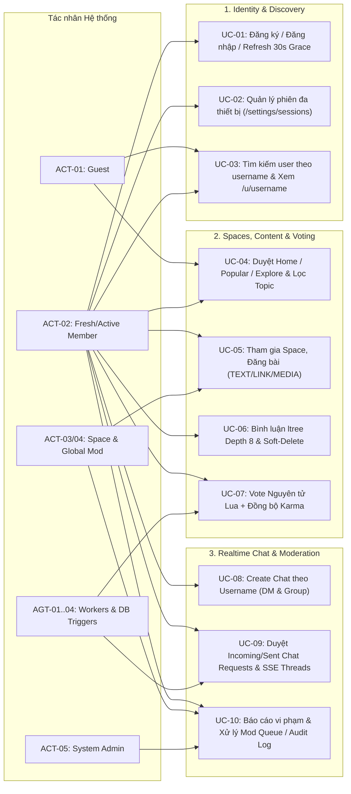

# Giai Đoạn 4.1: Mô Hình Hóa Ca Sử Dụng & Bản Đồ Tính Năng (Use Case Spec v2.2)

> **Mã tài liệu:** `SPEC-REDDIT-INTEGRATION`  
> **Dự án:** Acad DevOps Fullstack Monorepo (**SYNAPSE Engine**)  
> **Khung chuẩn:** Giai đoạn 4 (Mục 1: Use Case Modeling) trong [`SYSTEM ANALYSIS & DESIGN LIFECYCLE FRAMEWORK.md`](file:///home/debv/Documents/100_academy/acad_it_devOps/acad_devOps_project/docs/SYSTEM%20ANALYSIS%20%26%20DESIGN%20LIFECYCLE%20FRAMEWORK.md)

---

## 1. BIỂU ĐỒ USE CASE TỔNG THỂ (OVERALL USE CASE DIAGRAM)

---

## 2. ĐẶC TẢ CHI TIẾT CÁC CA SỬ DỤNG THEN CHỐT (KEY USE CASE SPECS)

### UC-SPEC-01: Khởi Tạo Khám Phá Cộng Đồng Với Tài Khoản Mới (`Home` vs `Popular` vs `Explore`)

| Thuộc tính | Nội dung đặc tả |
| :--- | :--- |
| **Mã & Tên Use Case** | `UC-SPEC-01`: Tài khoản mới khám phá cộng đồng và chuyển đổi bảng tin |
| **Tác nhân chính** | `ACT-02` (Fresh Member mới đăng ký, chưa tham gia Space nào) |
| **Điều kiện tiên quyết** | Đã đăng nhập thành công (`isAuthenticated = true`), `space_memberships` = 0 bản ghi |
| **Luồng sự kiện chính** | 1. Người dùng truy cập `Home` (`/?tab=following`). 2. Hệ thống gọi `GET /api/v1/feed/home?strict=true` trả về danh sách rỗng + hiển thị CTA dẫn sang `/explore`. 3. Người dùng bấm `Explore` (`/explore`) hoặc chọn 1 `Topic` ở thanh bên. 4. Hệ thống lọc danh sách `spaces` theo `topic` từ DB; người dùng bấm `Join` trên `s/devops-arch`. 5. Trigger DB tăng `member_count` (+1); quay lại `Home`, bảng tin hiển thị ngay bài viết của `s/devops-arch`. 6. Bấm `Popular` (`/?tab=for_you&sort=hot`), hệ thống hiển thị toàn bộ bài viết công khai xếp theo `hot_score`. |
| **Luồng ngoại lệ** | *E1 (Space riêng tư `is_private = TRUE`):* Trả HTTP 403 nếu chưa là thành viên. *E2 (Chưa đăng nhập bấm Home/Following):* Hiển thị thẻ mời đăng nhập + nút chuyển qua `Popular`. |
| **Hậu điều kiện** | `Home` và `Popular` trả tập bài viết phân biệt rõ ràng; `spaces.member_count` khớp 100% số dòng `space_memberships`. |

### UC-SPEC-02: Khởi Tạo Trò Chuyện Theo Username Với Tài Khoản Trắng (`Create Chat -> Search`)

| Thuộc tính | Nội dung đặc tả |
| :--- | :--- |
| **Mã & Tên Use Case** | `UC-SPEC-02`: Người dùng mới A tìm người dùng B theo username và nhắn tin thời gian thực |
| **Tác nhân chính** | `ACT-02` (`fresh_a` và `fresh_b`, chưa từng có kênh chat chung) |
| **Điều kiện tiên quyết** | Cả hai tài khoản `ACTIVE`; `fresh_a` mở Chat (`Direct (0)`, `Groups (0)`, `Requests (0)`) |
| **Luồng sự kiện chính** | 1. `fresh_a` bấm **+ New Chat** (hoặc **Create Chat**) trong `FloatingChatWidget` / `/chat`. 2. Nhập từ khóa tên `fresh_b` vào ô *"Search for people by username to chat with them"* -> Client gọi `GET /api/v1/auth/users/search?q=fresh_b`. 3. Chọn `u/fresh_b`, nhập tin nhắn đầu tiên -> `POST /api/v1/chat/channels/direct`. 4. Backend tạo `chat_requests` (`PENDING`), phát SSE `chat_request:new` tới `fresh_b`; bên phía `fresh_a` hiển thị mục **Đã gửi (Pending)**. 5. `fresh_b` mở tab **Requests**, bấm **Accept** -> `PATCH /api/v1/chat/requests/:id { status: "ACCEPTED" }`. 6. Backend tạo `chat_channels` (`DIRECT`), thêm 2 thành viên vào `chat_members`, chèn tin nhắn đầu tiên và phát SSE `channel:created` cho cả 2. 7. Hai bên nhắn tin qua lại và trả lời nhánh con (`parentMessageId`) tức thì qua SSE `message:new`. |
| **Luồng ngoại lệ** | *E1 (Đã có kênh DIRECT giữa A và B):* Không tạo Request trùng; gửi thẳng tin nhắn và trả `isRequest: false`. *E2 (B bấm Block):* Request chuyển `BLOCKED`, mọi lần gửi lại của A bị chặn HTTP `403`. *E3 (Tạo Group chỉ có 1 mình):* Validation từ chối HTTP `400`, buộc có ít nhất 1 thành viên khác creator. |
| **Hậu điều kiện** | Toàn bộ kênh, thành viên, tin nhắn và con trỏ đọc `last_read_message_id` được lưu bền trên PostgreSQL & đồng bộ SSE. |

### UC-SPEC-03: Bầu Chọn Nguyên Tử & Đối Soát Karma Không Dữ Liệu Ảo

| Thuộc tính | Nội dung đặc tả |
| :--- | :--- |
| **Mã & Tên Use Case** | `UC-SPEC-03`: Vote Up/Down/Unvote đồng bộ tức thì và đối soát DB |
| **Tác nhân chính** | `ACT-02` (Member), `AGT-01` (`VoteFlushWorker`), `AGT-02` (Karma Trigger) |
| **Luồng sự kiện chính** | 1. Member bấm Upvote -> UI cập nhật lạc quan +1; API gọi Redis `execute_vote.lua` (+1 & đánh dấu `dirty:votes`) và ghi bền bảng `thread_votes`. 2. Trigger `trg_maintain_thread_karma` tự động cộng +1 vào `users.karma_score` của tác giả. 3. Bấm lại Upvote -> FSM chuyển về `0` (Unvote, xóa khỏi `thread_votes`, trừ karma -1). 4. Mỗi 5 giây `VoteFlushWorker` xả `dirty:votes` vào `thread_counters` (`hot_score`, `wilson_score`). |
| **Hậu điều kiện** | Ở trạng thái ổn định sau flush: `thread_counters.upvotes == COUNT(thread_votes WHERE direction=1)`, không tồn tại số liệu bơm khống vượt quá tổng số user thật. |
