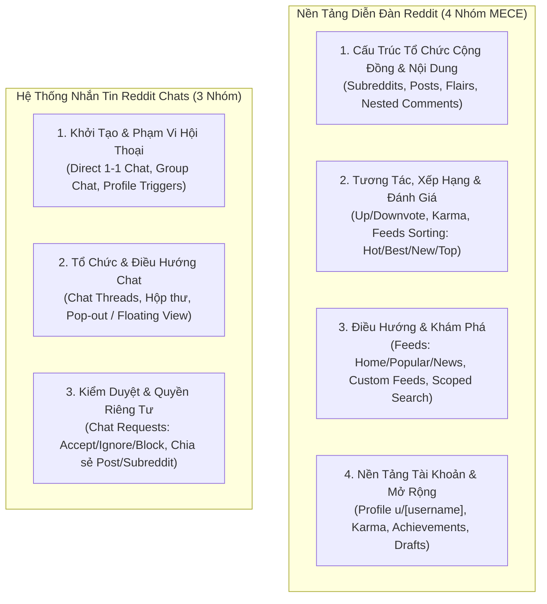

# Phân Tích Chức Năng Reddit & Kế Hoạch Tích Hợp Cốt Lõi (Reddit Functional Specification)

> **Mã tài liệu:** `SPEC-REDDIT-INTEGRATION`  
> **Tài liệu tham chiếu gốc:** [`docs/reddit.md`](file:///home/debv/Documents/100_academy/acad_it_devOps/acad_devOps_project/docs/reddit.md)  
> **Mục tiêu:** Nhận diện toàn bộ 4 nhóm chức năng nền tảng và 3 nhóm chức năng nhắn tin tức thời của Reddit; xác lập bản đồ ánh xạ (Feature Mapping) sang kiến trúc Acad DevOps Fullstack Monorepo; hoạch định kế hoạch tích hợp theo phương châm **Backend-First**.

---

## 1. BẢN ĐỒ NHẬN DIỆN CHỨC NĂNG TỪ `docs/reddit.md`

Tài liệu `docs/reddit.md` phân tích toàn bộ kiến trúc sản phẩm Reddit theo nguyên tắc MECE thành 2 phân khu lớn: **Nền tảng Diễn đàn Reddit** (4 nhóm chức năng) và **Hệ thống Nhắn tin Reddit Chats** (3 nhóm chức năng).



---

## 2. MA TRẬN ÁNH XẠ CHỨC NĂNG SANG ACAD DEVOPS PLATFORM

Bảng dưới đây xác định rõ: chức năng tương đương trong hệ thống Acad DevOps, trạng thái triển khai thực tế, và kế hoạch hoàn thiện:

| Nhóm chức năng Reddit (`docs/reddit.md`) | Chức năng tương ứng tại Acad DevOps Monorepo | Trạng thái hiện tại | Kế hoạch tích hợp cốt lõi (Backend-First) |
| :--- | :--- | :---: | :--- |
| **Subreddit (`r/[tên_cộng_đồng]`)** | **Không gian (`/s/[slug]`)**: rules, admin/moderator, highlights, membership | **Đã hoàn thành 85%** | Bổ sung Post Flairs theo Space, ghim thông báo (Highlights), API quản lý Wiki/FAQ. |
| **Định dạng Bài đăng (Posts)** | **Threads (`/threads/[slug]`)**: Text, Link, Media presigned upload | **Đã hoàn thành 70%** | Tích hợp Post Flairs (*DevOps*, *SecOps*, *SystemArch*, *Incident*); API Presigned URL Cloudflare R2 / S3. |
| **Bình luận phân nhánh (Nested Comments)** | **Comments `ltree` Base36 4 ký tự**: Phân cấp vô hạn, GiST index, Capped Depth 8 | **Đã hoàn thành 85%** | Đã có thuật toán $\mathcal{O}(N)$ `@acad/tree-virtualizer`; hoàn thiện gắn vào UI chi tiết bài viết. |
| **Upvote / Downvote & Karma** | **Redis Lua Atomic Voting**: `execute_vote.lua`, HOT update PostgreSQL, Karma score | **Đã hoàn thành 75%** | Bổ sung Worker 5s flush dồn từ Redis về DB, công thức tính Karma tác giả đa chiều. |
| **Sắp xếp Feed (Hot/Best/New/Top)** | **Gravity Decay Ranking**: $HotScore = \frac{NetScore}{(AgeHours + 2.0)^{1.8}}$, New, Top | **Đã hoàn thành 80%** | Bổ sung thuật toán sắp xếp `best` (Wilson score interval) và bộ lọc Top theo mốc thời gian (day/week/month/year). |
| **Điều hướng Feeds (Home / Popular)** | **Feed Aggregator API**: Timeline cá nhân và Bảng tin toàn sàn | **Đã hoàn thành 60%** | Xây dựng API `/api/v1/feed/home` (các Spaces đã Join) và `/api/v1/feed/popular` (toàn cầu). |
| **Tìm kiếm (Global & In-Space Search)** | **Fulltext Search Engine**: Tham số `q`, lọc ILIKE, pg_trgm GIN index | **Đã hoàn thành 70%** | Bổ sung tham số `spaceId` vào search query để hỗ trợ tìm kiếm có giới hạn phạm vi (In-Space Search). |
| **Hồ sơ Cá nhân (`u/[username]`)** | **User Profile Engine**: Xem bài viết, bình luận, điểm Karma, quản lý phiên | **Đã hoàn thành 75%** | Bổ sung tab bản nháp (Drafts) và trang `/u/[username]` công khai hiển thị thành tựu/karma. |
| **Reddit Chats (1-1 Direct & Group Chat)** | **Realtime Chat Subsystem**: WebSocket/SSE gateway, kênh chat 1-1 và group | **Kế hoạch Phase B4** | Triển khai Backend Message Store, Chat Requests queue (Accept/Ignore/Block), Read receipts. |

---

## 3. CHIẾN LƯỢC TÍCH HỢP CỐT LÕI (CORE INTEGRATION STRATEGY)

Để đảm bảo hệ thống đạt độ ổn định cao nhất, quá trình tích hợp áp dụng quy tắc **Backend-First (Hạ Tầng Backend Đi Trước $\rightarrow$ Giao Diện Frontend Theo Sau)**:

```
[BƯỚC 1: BACKEND DATA & CONTRACTS]
  ├── Mở rộng PostgreSQL DDL (Bổ sung bảng Flairs, Chat Channels, Messages, Chat Requests)
  ├── Viết Zod Schemas & OpenAPI 3.1 contracts trong packages/contracts
  └── Viết Unit & Integration Tests trong services/ và apps/api

[BƯỚC 2: BACKEND LOGIC & ENGINES]
  ├── Cài đặt Service Layer xử lý nghiệp vụ Flairs, Custom Feeds, và Chat Requests
  ├── Tích hợp Redis Pub/Sub và WebSocket / SSE Gateway phục vụ Realtime
  └── Hoàn thiện bộ kiểm thử tự động với Vitest (Đạt 100% test pass)

[BƯỚC 3: FRONTEND CLIENT INTEGRATION]
  ├── Nâng cấp Web Client Next.js 15 kết nối API qua Client SDK (@acad/auth-client)
  ├── Thiết kế giao diện Minimalist Brutalism Dark Mode cho các tính năng mới
  └── Tích hợp DOM ảo hóa @acad/tree-virtualizer và Floating Chat Widget
```

---

## 4. ĐẶC TẢ CHI TIẾT 3 TÍNH NĂNG ĐỘT PHÁ CẦN TÍCH HỢP TỪ REDDIT

### 4.1. Hệ Thống Nhãn Bài Viết (Post Flairs) Trong Từng Không Gian
- **Mục đích:** Giúp phân loại nội dung chính xác trong các không gian kỹ thuật lớn.
- **Danh mục Flairs chuẩn:**
  - `[DevOps]` / `[CI/CD]` / `[Kubernetes]` / `[Docker]`
  - `[SecOps]` / `[Zero-Trust]` / `[Vulnerability]`
  - `[Architecture]` / `[Database]` / `[High-Throughput]`
  - `[Incident Report]` (Báo cáo sự cố hệ thống thực tế)
  - `[Discussion]` / `[Question]` (Hỏi đáp chuyên môn)
- **Lược đồ dữ liệu:**
  ```sql
  CREATE TABLE IF NOT EXISTS space_flairs (
      id UUID PRIMARY KEY DEFAULT gen_random_uuid(),
      space_id UUID NOT NULL REFERENCES spaces(id) ON DELETE CASCADE,
      name VARCHAR(50) NOT NULL,
      slug VARCHAR(50) NOT NULL,
      color_hex VARCHAR(7) NOT NULL DEFAULT '#DFD0B8',
      background_hex VARCHAR(7) NOT NULL DEFAULT '#393E46',
      created_at TIMESTAMPTZ NOT NULL DEFAULT NOW()
  );
  ALTER TABLE threads ADD COLUMN IF NOT EXISTS flair_id UUID REFERENCES space_flairs(id);
  ```

### 4.2. Bộ Lọc Feed Mở Rộng (Wilson Score "Best" & Top Theo Thời Gian)
- **Thuật toán "Best" (Wilson Score Confidence Interval):**
  Xếp hạng bài viết dựa trên xác suất bình chọn tích cực với độ tin cậy $95\%$:
  $$\hat{p} = \frac{Upvotes}{TotalVotes}, \quad Score = \frac{\hat{p} + \frac{z^2}{2n} - z \sqrt{\frac{\hat{p}(1-\hat{p})}{n} + \frac{z^2}{4n^2}}}{1 + \frac{z^2}{n}}$$
  Giúp các bài viết ít vote nhưng có tỷ lệ upvote 100% không bị áp đảo bởi các bài viết có lượng vote lớn nhưng gây nhiều tranh cãi.
- **Khoảng thời gian xếp hạng Top:** Hỗ trợ query `t=day | week | month | year | all`.

### 4.3. Phân Hệ Reddit Chats: Nhắn Tin Tức Thời & Kiểm Duyệt Tin Nhắn Lạ
- **Kiến trúc Nhắn tin Bảo mật:**
  - Không gửi tin nhắn thẳng vào hộp thư nếu hai người chưa từng tương tác.
  - Người lạ gửi tin nhắn $\rightarrow$ Hệ thống tạo bản ghi trong bảng `chat_requests` với trạng thái `PENDING`.
  - Người nhận có 3 lựa chọn:
    1. **Accept:** Chuyển cuộc hội thoại thành kênh chính thức (Active Channel), kích hoạt thông báo đầy đủ.
    2. **Ignore:** Đánh dấu bỏ qua, không hiển thị huy hiệu thông báo chưa đọc.
    3. **Block / Report:** Khóa tài khoản gửi, thêm vào danh sách chặn của cá nhân và gửi báo cáo về Mod Queue.
- **Hỗ trợ Chat Threads & Pop-out:**
  - Hỗ trợ tạo luồng thảo luận con (Thread) bên trong một tin nhắn của Group Chat.
  - Giao diện hỗ trợ mở rộng thành cửa sổ pop-out độc lập hoặc thu nhỏ xuống thanh taskbar góc dưới bên phải màn hình.
