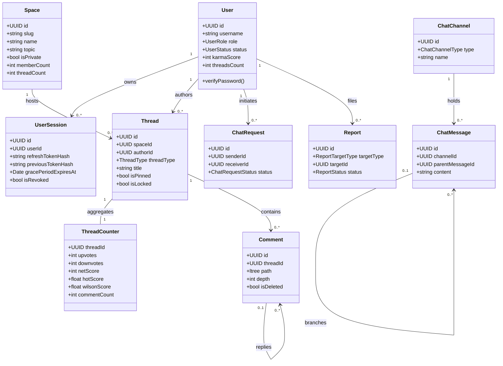
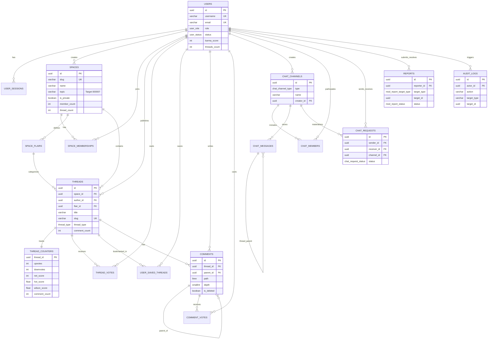

# Thiết Kế Lược Đồ Cơ Sở Dữ Liệu PostgreSQL 16 (Database Schema v2.1)

> **Mã tài liệu:** `DATA-POSTGRES-SCHEMA`  
> **Dự án:** Acad DevOps Fullstack Monorepo (**SYNAPSE Engine**)  
> **Nguồn chân lý DDL (Single Source of Truth):** [`deploy/migrations/000001`](file:///home/debv/Documents/100_academy/acad_it_devOps/acad_devOps_project/deploy/migrations/000001_create_auth_schema.up.sql) $\rightarrow$ [`000006_harmonize_schema_triggers.up.sql`](file:///home/debv/Documents/100_academy/acad_it_devOps/acad_devOps_project/deploy/migrations/000006_harmonize_schema_triggers.up.sql)  
> **Extensions:** `uuid-ossp`, `pgcrypto`, `ltree`, `pg_trgm`

---

## 1. TỔNG QUAN LƯỢC ĐỒ HIỆN HÀNH (14 BẢNG, 5 ENUMS, 2 HÀM, 11 TRIGGERS)

| Phân hệ | Bảng (`public.*`) | Vai trò chính | Triggers gắn kèm |
| :--- | :--- | :--- | :--- |
| **1. Auth & Sessions** | `users`, `user_sessions` | Định danh, `scrypt` password hash, Karma, đa phiên refresh rotation | `trg_users_updated_at`, `trg_user_sessions_updated_at` |
| **2. Spaces & Content** | `spaces`, `space_memberships`, `space_flairs`, `threads`, `comments` | Cộng đồng `/s/[slug]`, vai trò, flairs (`#30364F`/`#E1D9BC`), bài viết, cây `ltree` | `trg_spaces_updated_at`, `trg_threads_updated_at`, `trg_comments_updated_at`, `trg_space_members_count`, `trg_threads_counter_maintenance`, `trg_comments_counter_maintenance` |
| **3. Voting & Feeds** | `thread_counters`, `thread_votes`, `comment_votes`, `user_saved_threads` | Bộ đếm `fillfactor=70` (HOT updates), vote 1/-1, bookmarks, Karma triggers | `trg_init_thread_counters`, `trg_sync_comment_counter`, `trg_maintain_thread_karma`, `trg_maintain_comment_karma` |
| **4. Realtime Chat** | `chat_channels`, `chat_members`, `chat_messages`, `chat_requests` | Kênh `DIRECT`/`GROUP`, thành viên & con trỏ đọc, Chat Threads (`parent_message_id`), hàng đợi người lạ | `trg_chat_channels_updated_at`, `trg_chat_requests_updated_at`, `trg_touch_chat_channel` |
| **5. Moderation & Audit** | `reports`, `audit_logs` | Hàng đợi báo cáo chống trùng `PENDING`, nhật ký kiểm toán append-only bất biến | `trg_audit_logs_immutability` |

---

## 2. EXTENSIONS & KIỂU DỮ LIỆU ENUM (TỔNG HỢP TỪ `000001`–`000005`)

```sql
CREATE EXTENSION IF NOT EXISTS "uuid-ossp";
CREATE EXTENSION IF NOT EXISTS "pgcrypto";
CREATE EXTENSION IF NOT EXISTS "ltree";
CREATE EXTENSION IF NOT EXISTS "pg_trgm";

CREATE TYPE user_role AS ENUM ('GUEST', 'USER', 'SPACE_MOD', 'GLOBAL_MOD', 'ADMIN');
CREATE TYPE user_status AS ENUM ('ACTIVE', 'SUSPENDED', 'SHADOWBANNED', 'DELETED');
CREATE TYPE space_role AS ENUM ('MEMBER', 'MODERATOR', 'CREATOR');
CREATE TYPE thread_type AS ENUM ('TEXT', 'LINK', 'MEDIA');
CREATE TYPE chat_channel_type AS ENUM ('DIRECT', 'GROUP');
CREATE TYPE chat_request_status AS ENUM ('PENDING', 'ACCEPTED', 'IGNORED', 'BLOCKED');
CREATE TYPE mod_report_status AS ENUM ('PENDING', 'RESOLVED', 'DISMISSED');
CREATE TYPE mod_report_target_type AS ENUM ('THREAD', 'COMMENT');
```

---

## 3. DDL CHUẨN HÓA THEO TỪNG PHÂN HỆ

### 3.1. Phân hệ 1: Identity & Multi-Device Sessions (`000001`)

- **`users`**:
  - Khóa & định danh: `id UUID PK`, `username VARCHAR(32) NOT NULL`, `email VARCHAR(255) NOT NULL`, `password_hash VARCHAR(255) NOT NULL`.
  - Phân quyền & trạng thái: `role user_role DEFAULT 'USER'`, `status user_status DEFAULT 'ACTIVE'`.
  - Bộ đếm & hồ sơ: `karma_score INTEGER DEFAULT 0` (`chk_karma_not_null`), `threads_count INTEGER DEFAULT 0`, `avatar_url TEXT`, `bio TEXT`, `created_at`, `updated_at`.
  - Constraints & Indexes: `chk_username_length (char_length(username) >= 3)`, Unique Indexes case-insensitive `idx_users_username_lower`, `idx_users_email_lower`, `idx_users_role_status`, `idx_users_karma_score`.
- **`user_sessions`**:
  - Trường: `id UUID PK`, `user_id UUID FK -> users(id) ON DELETE CASCADE`, `refresh_token_hash VARCHAR(64) NOT NULL`, `previous_token_hash VARCHAR(64)`, `grace_period_expires_at TIMESTAMPTZ`, `device_fingerprint VARCHAR(255)`, `ip_address INET`, `user_agent TEXT`, `is_revoked BOOLEAN DEFAULT FALSE`, `expires_at TIMESTAMPTZ NOT NULL`, `created_at`, `updated_at`.
  - Indexes: `idx_sessions_user_active` (Partial `WHERE NOT is_revoked`), `idx_sessions_token_hash`, `idx_sessions_prev_token_hash` (Partial), `idx_sessions_expires_at`.
- **Triggers:** `update_timestamp_column()` trên `users` và `user_sessions`.

### 3.2. Phân hệ 2: Spaces, Flairs, Threads & Nested Comments (`000002` + `000006`)

- **`spaces`**:
  - `id UUID PK`, `name VARCHAR(64) NOT NULL`, `slug VARCHAR(64) NOT NULL`, `description TEXT`, `icon_url TEXT`, `banner_url TEXT`, `rules JSONB NOT NULL DEFAULT '[]'::jsonb`, `is_private BOOLEAN DEFAULT FALSE`, `creator_id UUID NOT NULL REFERENCES users(id) ON DELETE RESTRICT`, `member_count INTEGER DEFAULT 0`, `thread_count INTEGER DEFAULT 0`, `created_at`, `updated_at`.
  - Constraints & Indexes: `chk_spaces_slug_format` (`^[a-z0-9_-]+$`), `chk_spaces_name_len` (`>= 2`), `idx_spaces_slug_lower` (Unique), `idx_spaces_name_trgm` (GIN Trigram), `idx_spaces_member_count`, `idx_spaces_creator_id`.
- **`space_memberships`**:
  - `PRIMARY KEY (space_id, user_id)`, `role space_role DEFAULT 'MEMBER'`, `joined_at TIMESTAMPTZ DEFAULT NOW()`.
  - Trigger `trg_space_members_count` tự tăng/giảm `spaces.member_count`.
- **`space_flairs`**:
  - `id UUID PK`, `space_id UUID FK ON DELETE CASCADE`, `name VARCHAR(50)`, `slug VARCHAR(50)`, `color_hex VARCHAR(7) DEFAULT '#E1D9BC'`, `background_hex VARCHAR(7) DEFAULT '#30364F'`, `created_at`.
  - Constraints: `uq_space_flair_slug UNIQUE (space_id, slug)`, Regex `#RRGGBB` cho `color_hex` và `background_hex`.
- **`threads`**:
  - `id UUID PK`, `space_id UUID FK ON DELETE CASCADE`, `author_id UUID FK ON DELETE CASCADE`, `flair_id UUID FK ON DELETE SET NULL`, `title VARCHAR(300)` (`>= 5` chars), `slug VARCHAR(350)` (`uq_threads_slug`), `content TEXT`, `link_url TEXT`, `thread_type thread_type DEFAULT 'TEXT'`, `upvotes_count INTEGER DEFAULT 0`, `downvotes_count INTEGER DEFAULT 0`, `comment_count INTEGER DEFAULT 0`, `is_pinned BOOLEAN DEFAULT FALSE`, `is_locked BOOLEAN DEFAULT FALSE`, `created_at`, `updated_at`.
  - Indexes: `idx_threads_space_created (space_id, is_pinned DESC, created_at DESC)`, `idx_threads_author`, `idx_threads_flair` (Partial), `idx_threads_title_trgm` (GIN Trigram), `idx_threads_slug`, `idx_threads_created_at`.
  - Trigger `trg_threads_counter_maintenance` tự đồng bộ `spaces.thread_count` và `users.threads_count`.
- **`comments`**:
  - `id UUID PK`, `thread_id UUID FK ON DELETE CASCADE`, `author_id UUID FK ON DELETE CASCADE`, `parent_id UUID FK -> comments(id) ON DELETE CASCADE`, `path LTREE NOT NULL`, `depth SMALLINT DEFAULT 1` (`chk_comments_depth`: 1..20), `content TEXT NOT NULL`, `reply_to_user_id UUID FK ON DELETE SET NULL`, `upvotes_count INTEGER DEFAULT 0`, `downvotes_count INTEGER DEFAULT 0`, `is_deleted BOOLEAN DEFAULT FALSE`, `created_at`, `updated_at`.
  - Indexes: `idx_comments_path_gist` (GiST), `idx_comments_thread_path`, `idx_comments_parent` (Partial), `idx_comments_author`.
  - Triggers: `trg_comments_counter_maintenance` cập nhật `threads.comment_count` khi `INSERT`/`DELETE`.

### 3.3. Phân hệ 3: Atomic Voting, Ranking Counters & Bookmarks (`000003` + `000006`)

- **Hàm SQL Xếp Hạng:**
  - `calculate_hot_score(p_net_score, p_created_at, p_now)` $\rightarrow \text{ROUND}(NetScore / (AgeHours + 2.0)^{1.8}, 4)$
  - `calculate_wilson_score(p_upvotes, p_downvotes)` $\rightarrow$ cận dưới khoảng tin cậy Wilson 95% ($z = 1.96$)
- **`thread_counters` (`WITH (fillfactor = 70)` cho HOT updates):**
  - `thread_id UUID PK FK ON DELETE CASCADE`, `upvotes`, `downvotes`, `net_score`, `hot_score DOUBLE PRECISION`, `wilson_score DOUBLE PRECISION`, `comment_count`, `created_at`, `updated_at`.
  - Composite Keyset Feed Indexes: `idx_thread_counters_hot_feed`, `idx_thread_counters_best_feed`, `idx_thread_counters_top_feed`, `idx_thread_counters_new_feed`.
  - Triggers: `trg_init_thread_counters` (AFTER INSERT trên `threads`), `trg_sync_comment_counter` (AFTER INSERT OR DELETE trên `comments`).
- **`thread_votes` & `comment_votes`**:
  - `PRIMARY KEY (thread_id, user_id)` / `PRIMARY KEY (comment_id, user_id)`, `direction SMALLINT CHECK (direction IN (-1, 1))`, `created_at`, `updated_at`.
  - Triggers `trg_maintain_thread_karma` và `trg_maintain_comment_karma`: Tự động cộng/trừ `users.karma_score` của tác giả bài viết/bình luận khi vote được thêm, đảo chiều hay hủy.
- **`user_saved_threads`**:
  - `PRIMARY KEY (user_id, thread_id)`, index `idx_saved_threads_user_created (user_id, created_at DESC)`.

### 3.4. Phân hệ 4: Realtime Chat & Requests (`000004` + `000006`)

- **`chat_channels`**: `id UUID PK`, `type chat_channel_type DEFAULT 'DIRECT'`, `name VARCHAR(128)`, `creator_id UUID FK ON DELETE CASCADE`, `created_at`, `updated_at`. Constraint `chk_group_channel_name` yêu cầu tên nhóm `>= 2` ký tự khi `type = 'GROUP'`.
- **`chat_members`**: `PRIMARY KEY (channel_id, user_id)`, `last_read_message_id UUID FK -> chat_messages(id) ON DELETE SET NULL`, `joined_at`.
- **`chat_messages`**: `id UUID PK`, `channel_id UUID FK`, `sender_id UUID FK`, `parent_message_id UUID FK -> chat_messages(id) ON DELETE CASCADE` (Chat Threads), `content TEXT`, `attachments JSONB DEFAULT '[]'::jsonb`, `is_deleted BOOLEAN DEFAULT FALSE`, `created_at`. Constraint `chk_chat_message_content_not_empty`. Trigger `trg_touch_chat_channel` cập nhật `chat_channels.updated_at` khi có tin nhắn mới.
- **`chat_requests`**: `id UUID PK`, `sender_id UUID FK`, `receiver_id UUID FK`, `channel_id UUID FK ON DELETE SET NULL`, `initial_message TEXT`, `status chat_request_status DEFAULT 'PENDING'`, `created_at`, `updated_at`. Constraints: `uq_chat_requests_pair UNIQUE (sender_id, receiver_id)`, `chk_chat_requests_no_self_chat (sender_id <> receiver_id)`, `chk_chat_requests_msg_len`. Indexes: `idx_chat_requests_receiver_status`, `idx_chat_requests_sender`.

### 3.5. Phân hệ 5: Moderation Queue & Immutable Audit Logs (`000005` + `000006`)

- **`reports`**: `id UUID PK`, `reporter_id UUID FK`, `target_type mod_report_target_type`, `target_id UUID`, `reason VARCHAR(255)`, `status mod_report_status DEFAULT 'PENDING'`, `resolved_by UUID FK ON DELETE SET NULL`, `resolved_at TIMESTAMPTZ`, `resolution_note VARCHAR(255)`, `created_at`.
  - Anti-spam Partial Unique Index: `uq_pending_report_per_user_target ON reports (reporter_id, target_type, target_id) WHERE status = 'PENDING'`.
  - Check Constraint `chk_report_resolution` buộc `resolved_at IS NOT NULL` khi `RESOLVED`/`DISMISSED`.
- **`audit_logs`**: `id UUID PK`, `actor_id UUID FK ON DELETE RESTRICT`, `action VARCHAR(64)`, `target_type VARCHAR(32)`, `target_id UUID`, `metadata JSONB DEFAULT '{}'::jsonb`, `ip_address VARCHAR(45)`, `user_agent TEXT`, `created_at`.
  - Trigger bất biến `trg_audit_logs_immutability` (`BEFORE UPDATE OR DELETE`) chặn vĩnh viễn mọi thao tác sửa/xóa log kiểm toán.

---

## 4. CHIẾN LƯỢC ĐA MÔ HÌNH, BIỂU ĐỒ LỚP MIỀN & ERD TỔNG THỂ (FRAMEWORK GIAI ĐOẠN 5)

### 4.1. Ma trận Phân bổ Động cơ Lưu trữ (Multi-Model Storage Matrix)

| Loại dữ liệu | Động cơ lưu trữ | Mô hình nhất quán | Mục đích & Đặc thù truy vấn |
| :--- | :--- | :--- | :--- |
| **Giao dịch ACID & Cây phân cấp** | **PostgreSQL 16** (`ltree`, `pg_trgm`) | Strong Consistency (ACID) | Định danh, không gian, bài viết, bình luận `ltree` GiST, chat, reports, `audit_logs` bất biến |
| **Bộ đếm tốc độ cao (Votes)** | **Redis 7 (`execute_vote.lua`)** $\rightarrow$ `thread_counters` (`fillfactor=70`) | Atomic In-Memory + 5s Flush | Xử lý Unvote/Switch O(1) không tranh chấp lock, xả dồn vào Postgres qua HOT updates |
| **Phiên, Trực tuyến & Chống Brute-force** | **Redis 7** (Hash/String TTL) + In-Memory Fallback | Ephemeral (TTL 5s–7d) | `session:{userId}:{id}`, `presence:online:{userId}`, `typing:{channelId}:{id}`, `ratelimit:*` |
| **Đa phương tiện (Ảnh bài viết)** | **S3 / Cloudflare R2** (Zero-Hop Presigned PUT) | Object Storage + URL lưu DB | Trình duyệt tải ảnh trực tiếp qua Presigned URL, `threads.link_url` chỉ giữ URL đã kiểm duyệt SSRF |

### 4.2. Biểu đồ Lớp Tầng Miền (Domain Class Diagram)



### 4.3. Lược đồ Quan hệ Tổng thể (Full Relational ERD - 14 Bảng + Cập nhật Suy xuất `000007`)



---

## 5. CÁC CẬP NHẬT DATABASE SUY XUẤT TỪ SƠ ĐỒ MODULE (CHO MIGRATION `000007` & SEEDS SẠCH)

1. **Bổ sung `spaces.topic` (`VARCHAR(64) NOT NULL DEFAULT 'DevOps & SRE'`) + `idx_spaces_topic`:** Suy ra từ luồng **Explore & Topics** (`02_spaces_and_content_engine.md`) để loại bỏ Toast giả ở Sidebar.
2. **Bổ sung `idx_users_username_trgm` (`GIN gin_trgm_ops`):** Suy ra từ luồng **Create Chat — Search by username** (`06_realtime_chat_engine.md`) để tìm kiếm gợi ý user đang `ACTIVE` trong $\mathcal{O}(\log N)$.
3. **Sửa Trigger đếm bình luận khi Soft-Delete (`AFTER INSERT OR DELETE OR UPDATE OF is_deleted ON comments`):** Suy ra từ luồng **Comment Lifecycle** (`03_nested_comments_ltree.md`), bảo đảm `threads.comment_count` và `thread_counters.comment_count` luôn phản ánh đúng số bình luận chưa xóa.
4. **Bổ sung `idx_chat_requests_sender_status (sender_id, status, created_at DESC)`:** Suy ra từ luồng **Sent Requests** (`06_realtime_chat_engine.md`) giúp người gửi nhìn thấy trạng thái lời mời đã gửi.
5. **Hàm đối soát `reconcile_platform_counters()` & Triệt tiêu dữ liệu giả lập:** Xóa hoàn toàn các con số đếm khống (`562 upvotes` trong `003_voting_feed_seed.sql` / `003_voting_redis_seed.sh`), tính lại 100% từ dữ liệu phiếu bầu & bình luận thật của các tài khoản thật.

