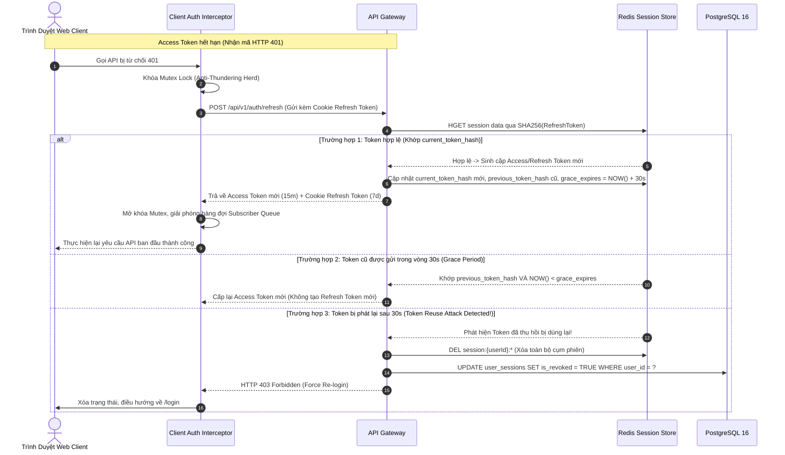
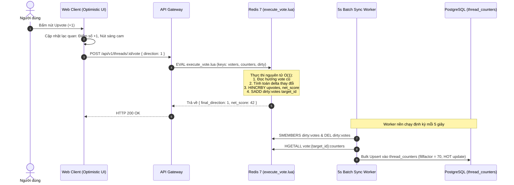
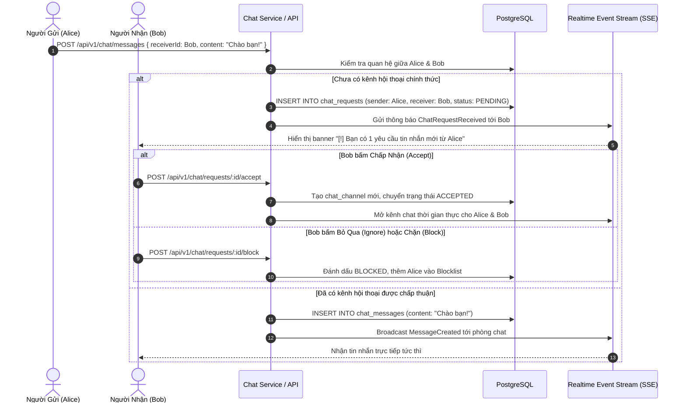

# Sơ Đồ Luồng Dữ Liệu & Chuỗi Xử Lý (Data Flows & Sequence Diagrams)

> **Mã tài liệu:** `DATA-FLOWS-DAG`  
> **Dự án:** Acad DevOps Fullstack Monorepo

---

## 1. LUỒNG XOAY VÒNG TOKEN, 30S GRACE PERIOD & PHÁT HIỆN TÁI SỬ DỤNG (AUTH SEQUENCE)

---

## 2. LUỒNG BỎ PHIẾU NGUYÊN TỬ QUA REDIS LUA (ATOMIC VOTING SEQUENCE)

---

## 3. LUỒNG NHẮN TIN TỨC THỜI & DUYỆT TIN NHẮN LẠ (REDDIT CHAT REQUEST FLOW)

