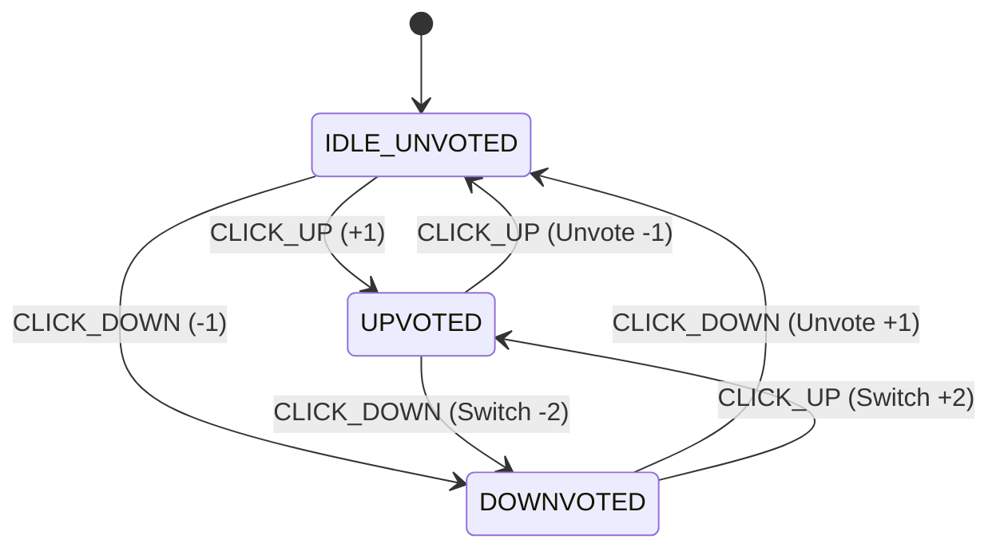
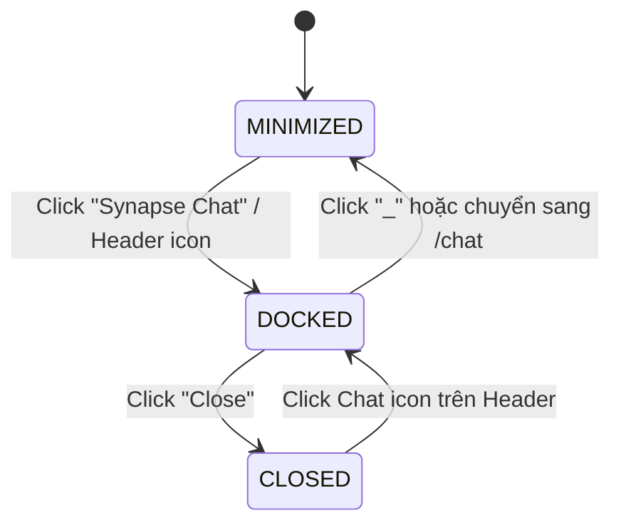

# Kiến Trúc Giao Diện & Quản Lý Trạng Thái 3 Tầng (Frontend State Architecture v2.1)

> **Mã tài liệu:** `ARCH-FRONTEND-STATE`  
> **Dự án:** Acad DevOps Fullstack Monorepo (**SYNAPSE Engine**)  
> **Mã nguồn thực tế:** [`apps/web/src/lib/store/ui-context.tsx`](file:///home/debv/Documents/100_academy/acad_it_devOps/acad_devOps_project/apps/web/src/lib/store/ui-context.tsx), [`apps/web/src/lib/auth/auth-context.tsx`](file:///home/debv/Documents/100_academy/acad_it_devOps/acad_devOps_project/apps/web/src/lib/auth/auth-context.tsx), [`apps/web/src/lib/hooks/use-realtime-chat.ts`](file:///home/debv/Documents/100_academy/acad_it_devOps/acad_devOps_project/apps/web/src/lib/hooks/use-realtime-chat.ts)

---

## 1. MÔ HÌNH PHÂN TẦNG TRẠNG THÁI THỰC TẾ (3-LAYER STATE)

| Tầng State | Cơ chế triển khai hiện tại | Dữ liệu & Trách nhiệm |
| :--- | :--- | :--- |
| **1. Server & Auth State** | `AcadClient` (`@acad/auth-client`) + `AuthContext` + `localStorage` (`acad_access_token`, `acad_refresh_token`) | Phiên người dùng hiện tại, Mutex Lock chống bão 401 khi xoay vòng Refresh Token, `requireAuth()` mở modal đăng nhập |
| **2. Global UI State** | `UIProvider` (`UIContext`) + `localStorage` (`acad_recent_posts_v1`) | Đóng/mở `LeftSidebar`, `chatWidgetState` (`minimized` \| `docked` \| `closed`), `viewMode` (`card` \| `compact`), `recentPosts`, Toast |
| **3. URL Query & Feature State** | `window.location.search` / Next.js Router (`?tab=&sort=&q=`) + Component/Hook State (`useRealtimeChat`, `CommentTree`) | Trạng thái bảng tin (`for_you` \| `following`, `hot` \| `new` \| `top` \| `best`), con trỏ phân trang `nextCursor`, cây bình luận thu gọn, SSE chat & typing |

> **Lưu ý đồng bộ (Mục tiêu Giai đoạn C):** `HomePage` cần lắng nghe URL query reactively (qua `useSearchParams` bọc `<Suspense>`) để khi người dùng bấm `Home` / `Popular` trên `LeftSidebar` ngay khi đang ở `/`, trạng thái tab/sort cập nhật tức thì thay vì chỉ đọc 1 lần lúc mount.

---

## 2. MÁY TRẠNG THÁI BẦU CHỌN (VOTE ACTION FSM)

- Khi API trả lỗi (mạng/401/403), UI hoàn tác (`rollback`) đúng `userVote` và `netScore` trước đó kèm thông báo lỗi.

---

## 3. MÁY TRẠNG THÁI WIDGET CHAT (`ChatWidgetState`)

- **Quy tắc chuyển Tab bắt buộc:** Khi chuyển giữa `Direct`, `Groups`, `Requests`, phải lọc/reset `selectedChannelId` khớp đúng loại kênh của tab đó để tránh hiển thị nhầm tin nhắn Group trong tab `Direct` khi user chưa có kênh 1-1 nào.
- **SSE & Reconnect:** Kết nối `EventSource` tại `/api/v1/chat/events?token=...` luôn lấy token mới nhất khi mở lại kết nối sau khi Refresh Token xoay vòng.
