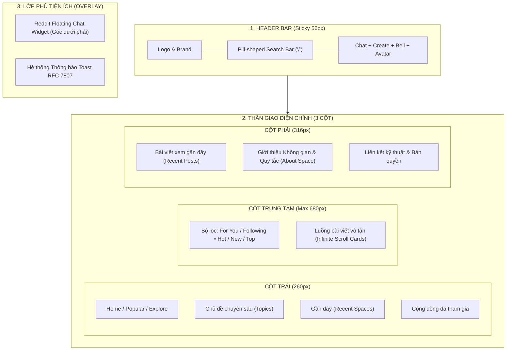
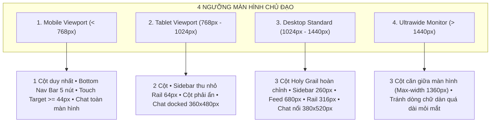

# Cẩm Nang Hệ Thống Thiết Kế Giao Diện, Trải Nghiệm Người Dùng & Đáp Ứng Đa Nền Tảng (Frontend Design System & UX Guidelines)

> **Mã tài liệu:** `DESIGN-SYSTEM-FRONTEND-UX`  
> **Dự án:** Acad DevOps Fullstack Monorepo v2.0  
> **Nền tảng công nghệ:** Next.js 15 (App Router, Server Components), React 19, Tailwind CSS v4, `@acad/ui-tokens`  
> **Hình ảnh đối chiếu chuẩn:** [`docs/reddit.png`](file:///home/debv/Documents/100_academy/acad_it_devOps/acad_devOps_project/docs/reddit.png)  
> **Phiên bản:** 2.0.0 (Production Blueprint)

---

## 1. TRIẾT LÝ THIẾT KẾ: TỐI GIẢN, NỘI DUNG LÀ TRỌNG TÂM (CONTENT-FIRST)

Lấy cảm hứng trực tiếp từ kiến trúc giao diện người dùng hiện đại của Reddit ([`docs/reddit.png`](file:///home/debv/Documents/100_academy/acad_it_devOps/acad_devOps_project/docs/reddit.png)), tầng giao diện của nền tảng Acad DevOps được xây dựng dựa trên 4 nguyên lý cốt lõi:

1. **Nội dung là trung tâm (Content-First):** Giao diện triệt tiêu tối đa các đường viền nặng nề, bóng đổ lòe loẹt hay các hiệu ứng hoạt họa không cần thiết. Trọng tâm tuyệt đối là bài viết kỹ thuật, hình ảnh minh họa, đoạn mã nguồn và chuỗi phản hồi thảo luận.
2. **Tốc độ phản hồi tức thì (Instantaneous Feedback):**
   - Mọi thao tác tương tác vi mô (Bỏ phiếu Up/Downvote, Lưu bài, Tham gia không gian) áp dụng cơ chế **Optimistic UI Mutation**, cập nhật số liệu và đổi màu nút trong $0\text{ms}$.
   - Tận dụng tối đa **React Server Components (RSC)** để phân phối trang đọc bài với 0KB JavaScript tĩnh, giảm thời gian tải trang ban đầu ($LCP < 1.2\text{s}$).
3. **Màu tối sâu, bảo vệ thị giác (Modern Reddit Dark Theme):** Nền tảng được tối ưu hóa cho môi trường làm việc của kỹ sư lập trình và quản trị hệ thống, sử dụng bảng màu tối sâu (`#0e1113`) tương phản nhẹ nhàng, không gây mỏi mắt khi đọc thảo luận lâu dài.
4. **Bảo tồn tính năng toàn diện (Full Reddit Experience):** Kế thừa trọn vẹn bố cục 3 cột kinh điển, thanh tìm kiếm thông minh dạng viên con nhộng (`Pill-shaped`), hệ thống cây bình luận đa tầng ảo hóa và cửa sổ chat thời gian thực nổi.

---

## 2. HỆ THỐNG DESIGN TOKENS & BẢNG MÃ MÀU CHUẨN

```
┌────────────────────────────────────────────────────────────────────────┐
│                   HỆ THỐNG MÀU SẮC CHỦ ĐẠO (REDDIT DARK PALETTE)       │
├──────────────────────┬──────────────────────┬──────────────────────────┤
│ NỀN & BỀ MẶT         │ VIỀN & PHÂN CÁCH     │ MÀU NHẤN ĐẶC TRƯNG       │
├──────────────────────┼──────────────────────┼──────────────────────────┤
│ Canvas:   #0e1113    │ Subtle:   #272729    │ Upvote:    #ff4500 (Cam) │
│ Surface:  #1a1a1b    │ Strong:   #3e3e40    │ Downvote:  #7193ff (Lam) │
│ Hover:    #272729    │ Focus:    #ff4500    │ Online:    #22c55e (Lục) │
│ Subtle:   #121213    │ Divider:  #1e1f20    │ Danger:    #ef4444 (Đỏ)  │
└──────────────────────┴──────────────────────┴──────────────────────────┘
```

### 2.1. Bảng Biến CSS Biểu Trưng (CSS Custom Properties)
Được định nghĩa tại `apps/web/src/app/globals.css`:

```css
:root {
  /* 1. Bề mặt và Nền tảng (Canvas & Surfaces) */
  --bg-canvas: #0e1113;        /* Nền tổng thể toàn trang */
  --bg-surface: #1a1a1b;       /* Nền Card bài viết, Header, Widget */
  --bg-surface-hover: #272729; /* Trạng thái Hover của Card/Nút */
  --bg-subtle: #121213;        /* Nền thanh Sidebar thu nhỏ */
  --bg-input: #272729;         /* Nền thanh tìm kiếm & ô nhập liệu */
  --bg-badge: #2a2a2c;         /* Nền nhãn Flair, thẻ tag */

  /* 2. Đường kẻ và Viền (Borders & Dividers) */
  --border-subtle: #272729;    /* Viền ngăn cách card bài viết */
  --border-strong: #3e3e40;    /* Viền khi focus ô tìm kiếm */
  --border-divider: #1e1f20;   /* Đường phân cách mục trong sidebar */

  /* 3. Màu chữ & Tương phản (Typography Hierarchy) */
  --text-primary: #f2f4f5;     /* Tiêu đề chính, nội dung bài viết */
  --text-secondary: #a8aaab;   /* Tên không gian, tên tác giả, thời gian */
  --text-muted: #737577;       /* Placeholder, chú thích mờ */
  --text-inverse: #0e1113;     /* Chữ trên nút nhấn màu cam */

  /* 4. Gam màu Điểm nhấn Đặc trưng (Brand & Functional Accents) */
  --color-upvote: #ff4500;     /* Cam rực rỡ khi người dùng Upvote */
  --color-downvote: #7193ff;   /* Lam tím khi người dùng Downvote */
  --color-brand: #ff4500;      /* Màu thương hiệu đại diện */
  --color-brand-hover: #e03d00;
  --color-success: #22c55e;    /* Chấm xanh trạng thái Online Presence */
  --color-danger: #ef4444;     /* Cảnh báo xóa bài, báo cáo vi phạm */
  --color-mod: #22c55e;        /* Huy hiệu Moderator, Admin */

  /* 5. Bán kính Bo tròn (Border Radii) */
  --radius-sm: 4px;            /* Nhãn bài viết, tooltip */
  --radius-md: 8px;            /* Nút tác vụ, menu dropdown */
  --radius-lg: 12px;           /* Thẻ Card bài viết, hình ảnh media */
  --radius-xl: 16px;           /* Khung chat nổi, Modal dialog */
  --radius-full: 9999px;       /* Nút con nhộng (Pill button), Avatar tròn */

  /* 6. Bóng đổ tinh tế (Subtle Shadows) */
  --shadow-sm: 0 1px 2px rgba(0, 0, 0, 0.4);
  --shadow-dropdown: 0 4px 16px rgba(0, 0, 0, 0.6);
  --shadow-floating: 0 8px 32px rgba(0, 0, 0, 0.75);
}
```

### 2.2. Thang Đo Khoảng Cách (Spacing Scale - Bội số 4px)
- `2px` (0.5), `4px` (1), `8px` (2), `12px` (3), `16px` (4): Khoảng đệm nội bộ thẻ, khoảng cách giữa các icon.
- `20px` (5), `24px` (6), `32px` (8): Khoảng cách giữa các bài viết trong feed và khoảng đệm khung nhìn.
- `48px` (12), `56px` (14): Chiều cao của Header bar và thanh công cụ.

### 2.3. Thang Kiểu Chữ (Typography Hierarchy)
Sử dụng phông chữ không chân hiện đại: `Inter, -apple-system, BlinkMacSystemFont, "Segoe UI", Roboto, sans-serif`.

| Cấp bậc kiểu chữ | Kích thước | Trọng lượng | Line Height | Ứng dụng thực tế |
| :--- | :--- | :--- | :--- | :--- |
| **Display Title** | $28\text{px}$ (1.75rem) | 800 (Bold) | $34\text{px}$ | Tiêu đề trang Không gian, Banner |
| **Post Title** | $18\text{px}$ (1.125rem) | 600 (Semibold) | $24\text{px}$ | Tiêu đề bài viết trong bảng tin |
| **Body Text** | $14\text{px}$ (0.875rem) | 400 (Regular) | $21\text{px}$ | Nội dung bài đăng, đoạn văn bình luận |
| **Metadata / Caption** | $12\text{px}$ (0.75rem) | 500 (Medium) | $16\text{px}$ | Tên cộng đồng, thời gian, số lượng vote |
| **Code Snippet** | $13\text{px}$ (0.8125rem) | 400 (JetBrains Mono) | $18\text{px}$ | Mã nguồn cú pháp, logs, lệnh terminal |

---

## 3. CẤU TRÚC BỐ CỤC 3 CỘT (HOLY GRAIL LAYOUT ARCHITECTURE)

Khung nhìn tổng thể trên màn hình máy tính được tổ chức thành 3 cột cố định chuẩn mực:



### 3.1. Chi Tiết Từng Khối Bố Cục

#### A. Thanh Điều Hướng Cố Định (Header Bar - $56\text{px}$)
- Cố định trên đỉnh màn hình (`sticky top-0 z-50`), nền kính mờ nhẹ (`backdrop-blur-md bg-[#1a1a1b]/95`), viền dưới mờ `border-b border-[#272729]`.
- **Thanh tìm kiếm con nhộng (Pill Search Bar):** Nằm chính giữa, bo tròn hoàn toàn (`rounded-full`), có biểu tượng kính lúp và phím tắt bấm nhanh `/`. Khi người dùng gõ, xuất hiện menu thả xuống hiển thị lịch sử tìm kiếm, gợi ý Space và bài viết nổi bật.
- **Cụm tác vụ nhanh:** Nút `+ Create` nổi bật màu cam, biểu tượng Chat `💬` kèm chấm đỏ số tin chưa đọc, biểu tượng thông báo `🔔` và ảnh đại diện kèm menu cá nhân.

#### B. Cột Trái: Bảng Điều Hướng & Danh Mục Không Gian ($260\text{px}$)
- Cố định khi cuộn trang (`sticky top-[56px] h-[calc(100vh-56px)] overflow-y-auto`).
- Phân nhóm rõ ràng theo dạng danh mục có thể đóng/mở (Collapsible Accordion):
  - **FEEDS:** `Home`, `Popular`, `Explore`.
  - **ACTION:** `+ Start a community` (Nút tạo space có icon nổi bật).
  - **TOPICS:** Danh mục chủ đề DevOps, Kubernetes, Phân tán, v.v.
  - **RECENT:** Các không gian vừa duyệt qua, kèm avatar tròn và tên thu gọn.
  - **COMMUNITIES:** Danh sách không gian người dùng đã bấm tham gia (`Joined`).

#### C. Cột Trung Tâm: Luồng Bảng Tin Vô Tận (Tối đa $680\text{px}$)
- **Thanh chuyển đổi tab:** Cho phép chuyển giữa `For You` (Được gợi ý theo thuật toán Wilson Score) và `Following` (Nội dung từ các Space đã tham gia).
- **Thanh công cụ lọc:** Nút chọn thuật toán sắp xếp (`🔥 Hot`, `✨ New`, `🔝 Top`, `⚡ Best`) và chế độ hiển thị (Card View toàn diện hoặc Compact View tinh gọn).
- **Cấu trúc Thẻ Bài Viết (Post Card):**
  - **Header:** Avatar tròn ($24\text{px}$) + Tên Space (`r/devops`) đậm + Mốc thời gian tương đối (`6 hours ago`) + Nút `Join` nhỏ gọn + Nút menu ba chấm (`•••`).
  - **Title:** Tiêu đề bài viết kích thước $18\text{px}$, font-weight 600, khoảng cách dòng thoáng đãng.
  - **Nội dung / Hình ảnh:** Đoạn trích văn bản cắt gọn 3 dòng kèm hiệu ứng mờ dần, hoặc hình ảnh toàn rộng bo góc $12\text{px}$ với `next/image` chống vỡ tỷ lệ khung hình.
  - **Footer Action Bar (Các nút con nhộng):**
    - Cụm Bỏ phiếu: `[ ⇧ | Điểm số | ⇩ ]` bo tròn, nền `#272729`, hiệu ứng đổi màu cam/lam ngay lập tức khi bấm.
    - Bình luận: `[ 💬 Số bình luận ]`.
    - Chia sẻ: `[ ➦ Share ]` (Tự động sao chép link và bật Toast).
    - Lưu bài: `[ 🔖 Bookmark ]`.

#### D. Cột Phải: Bảng Tiện Ích & Ngữ Cảnh ($316\text{px}$)
- **Recent Posts Widget:** Hiển thị 5 bài viết vừa xem, kèm hình ảnh thu nhỏ ($48\text{px} \times 48\text{px}$) và nút `Clear`.
- **About Space Widget (Khi đang xem một Không gian):** Banner, Avatar, Mô tả cộng đồng, Ngày thành lập, Số thành viên, Trạng thái online, Danh sách Nội quy (Rules) và Danh sách Moderator.

#### E. Widget Chat Thời Gian Thực Nổi (Floating Chat Widget)
- Nằm cố định ở góc dưới bên phải màn hình (`fixed bottom-0 right-6 z-40`).
- Hỗ trợ 3 trạng thái chuyển đổi linh hoạt:
  1. **Minimized:** Thanh ngang bo tròn $240\text{px} \times 40\text{px}$ ghi "💬 Chat (3)" kèm số lượng tin nhắn chưa đọc.
  2. **Docked Expanded:** Khung chat kích thước $380\text{px} \times 520\text{px}$ bo góc $16\text{px}$, cho phép duyệt bài viết vừa nhắn tin trực tiếp.
  3. **Pop-out Window:** Bấm biểu tượng `↗` để mở chat sang một tab trình duyệt độc lập toàn màn hình (`/chat`).

---

## 4. CHIẾN LƯỢC TRẢI NGHIỆM NGƯỜI DÙNG (UX) & TỐI ƯU HIỆU NĂNG

### 4.1. Máy Trạng Thái Hữu Hạn Bỏ Phiếu Lạc Quan (Optimistic Voting FSM)
Loại bỏ hoàn toàn độ trễ mạng khi tương tác:

```text
[BẢNG CHUYỂN TRẠNG THÁI VOTE ACTION]:
- Chưa vote + Bấm UP     ---> Trạng thái UP (Điểm +1, Mũi tên sáng cam) [Gọi API POST /votes]
- Chưa vote + Bấm DOWN   ---> Trạng thái DOWN (Điểm -1, Mũi tên sáng lam) [Gọi API POST /votes]
- Đang UP   + Bấm UP     ---> Hủy vote (Điểm -1, Tắt màu) [Gọi API DELETE /votes]
- Đang UP   + Bấm DOWN   ---> Đảo chiều DOWN (Điểm -2, Đổi sang màu lam) [Gọi API POST /votes]
- Đang DOWN + Bấm DOWN   ---> Hủy vote (Điểm +1, Tắt màu) [Gọi API DELETE /votes]
- Đang DOWN + Bấm UP     ---> Đảo chiều UP (Điểm +2, Đổi sang màu cam) [Gọi API POST /votes]
* NẾU API THẤT BẠI:      ---> Tự động hoàn tác về điểm và trạng thái cũ trong 0ms + Bật thông báo Toast RFC 7807
```

### 4.2. Triệt Tiêu Giật Giao Diện (Zero Cumulative Layout Shift - CLS = 0)
- Thiết lập khung xương nạp trước (**Skeleton Loaders**) với đúng chiều cao dự kiến của bài viết trước khi dữ liệu từ máy chủ đổ về.
- Mọi hình ảnh trong bài viết bắt buộc phải có thuộc tính `width`, `height` và `placeholder="blur"` để trình duyệt dành sẵn diện tích hiển thị, loại bỏ hiện tượng nhảy trang khi cuộn.

### 4.3. Ảo Hóa Cây Bình Luận Đa Tầng (`@acad/tree-virtualizer`)
- Cấu trúc cây bình luận `ltree` Base36 được phân rã thành danh sách 1 chiều kèm chỉ số độ sâu (`depth`).
- Trình duyệt chỉ vẽ những bình luận nằm trong vùng nhìn thấy (Windowing Viewport). Khi cuộn qua danh sách 5,000 bình luận, DOM chỉ duy trì khoảng 25-30 phần tử DOM hoạt động, đảm bảo mượt mà 60 FPS trên cả thiết bị di động cấu hình yếu.

### 4.4. Xử Lý Ngưỡng Bình Luận Quá Sâu (Capped Depth 8 & Flat Reply)
- Khi độ sâu của bình luận đạt ngưỡng thứ 8 (hoặc thứ 4 trên màn hình di động nhỏ): Thuật toán tự động kích hoạt chế độ **Flat Reply** (Bình luận phẳng kế thừa lề).
- Tự động chèn tiền tố `@tên_tác_giả_cha` vào nội dung để người đọc nhận biết ngữ cảnh mà không làm thụt lề quá sâu gây tràn màn hình.

---

## 5. MA TRẬN THIẾT KẾ ĐÁP ỨNG ĐA THIẾT BỊ (RESPONSIVE SPECIFICATION)



### 5.1. Quy Chuẩn Chi Tiết Từng Ngưỡng Màn Hình

| Đặc điểm giao diện | Mobile (< 768px) | Tablet (768px - 1024px) | Desktop (1024px - 1440px) | Ultrawide (> 1440px) |
| :--- | :--- | :--- | :--- | :--- |
| **Bố cục chính** | 1 cột đơn duy nhất | 2 cột (Sidebar thu nhỏ + Feed) | 3 cột đầy đủ | 3 cột căn giữa (Max 1360px) |
| **Sidebar Trái** | Ẩn, mở bằng Drawer vuốt | Thu nhỏ thành Icon Rail (64px) | Cố định hiển thị đầy đủ (260px) | Cố định hiển thị đầy đủ (260px) |
| **Cột Bảng Tin** | Chiếm 100% chiều rộng | Mở rộng linh hoạt (Fill) | Cố định tối ưu (Max 680px) | Cố định tối ưu (Max 680px) |
| **Cột Phải (Widgets)** | Ẩn hoàn toàn | Ẩn hoặc mở bằng nút phụ | Cố định hiển thị đầy đủ (316px) | Cố định hiển thị đầy đủ (316px) |
| **Thanh Bottom Nav** | Hiển thị 5 nút chính | Ẩn | Ẩn | Ẩn |
| **Khung Chat nổi** | Mở toàn màn hình (Modal) | Khung nổi vừa ($360\text{px} \times 480\text{px}$) | Khung nổi chuẩn ($380\text{px} \times 520\text{px}$) | Khung nổi chuẩn ($380\text{px} \times 520\text{px}$) |
| **Điểm chạm (Touch)** | Tối thiểu $44\text{px} \times 44\text{px}$ | Chuẩn $36\text{px} - 40\text{px}$ | Chuẩn chuột $32\text{px} - 36\text{px}$ | Chuẩn chuột $32\text{px} - 36\text{px}$ |

### 5.2. Thanh Điều Hướng Dưới Cùng Trên Di Động (Mobile Bottom Nav Bar)
Trên màn hình điện thoại thoại thông minh ($< 768\text{px}$), hệ thống kích hoạt thanh điều hướng cố định dưới đáy màn hình với 5 tab chức năng:
1. **Home:** Bảng tin trang chủ.
2. **Explore:** Khám phá danh mục Space.
3. **+ Create (Nút nổi bật ở giữa):** Mở nhanh giao diện đăng bài viết.
4. **Chat:** Mở hộp thư tin nhắn và duyệt yêu cầu người lạ.
5. **Inbox / Profile:** Thông báo và hồ sơ cá nhân.

---

## 6. LỘ TRÌNH THỰC THI PHÂN KỲ STREAM F (PHASES F0 $\rightarrow$ F5)

| Giai đoạn | Tên phân hệ | Nội dung trọng tâm | Đầu ra kiểm chứng |
| :---: | :--- | :--- | :--- |
| **Phase F0** | **App Shell & Responsive Layout** | Thiết lập Tailwind v4, Design Tokens, Header Sticky, Sidebar Trái đóng mở, Cột Feed giữa, Widget Phải và Bottom Nav di động. | Layout 3 cột hiển thị mượt mà trên mọi kích thước màn hình. |
| **Phase F1** | **Identity & Session Shield** | Giao diện Đăng nhập, Đăng ký, Tích hợp `@acad/auth-client` Mutex Lock chống bão request, Quản lý đa thiết bị phiên làm việc (`/settings/sessions`). | Đăng nhập/Đăng ký an toàn, tự động xoay token ngầm, hủy phiên từ xa. |
| **Phase F2** | **Spaces & Ltree Nested CMS** | Trang chi tiết Không gian (`/s/[slug]`), Trình soạn thảo Tiptap Editor (Rich text, Code, tải ảnh Zero-Hop R2), Cây bình luận ảo hóa ltree Base36. | Đăng bài kèm ảnh, hiển thị cây bình luận đa tầng thu gọn/mở rộng 60 FPS. |
| **Phase F3** | **Feeds & Optimistic Voting** | Nguồn cấp tin phân tầng (For You / Following, Hot / New / Top / Best), Cụm nút bỏ phiếu Optimistic FSM 0ms, Infinite Scroll Keyset cursor. | Bấm Up/Downvote đổi màu số nhảy tức thì, cuộn mượt mà không khựng DOM. |
| **Phase F4** | **Realtime Chat Subsystem** | Khung chat nổi 3 trạng thái (Minimized, Docked, Pop-out), Danh sách hội thoại 1-1 & nhóm, Hàng đợi duyệt Chat Requests, Kết nối SSE Gateway. | Nhắn tin tức thời, nhận diện chấm xanh Online và hiển thị Typing indicators. |
| **Phase F5** | **Mod Hub & Admin Console** | Bảng điều khiển quản trị `/admin`: Mod Queue xử lý báo cáo, Quản lý tài khoản (Shadowban, Khóa, Thu hồi phiên), Bảng vết kiểm toán Audit Logs. | Quản trị viên duyệt báo cáo, xử lý vi phạm và tra cứu audit trail trực quan. |

---

## 7. QUY CHUẨN KIỂM ĐỊNH CHẤT LƯỢNG (DEFINITION OF DONE FOR FRONTEND)

1. **Hiệu năng Core Web Vitals:** Đạt điểm Google Lighthouse $\ge 90$ cho cả Desktop và Mobile; $LCP < 1.2\text{s}$, $CLS = 0$, $INP < 50\text{ms}$.
2. **Khả năng truy cập (Accessibility - WCAG 2.1 AA):** Độ tương phản màu sắc chữ trên nền đạt tối thiểu 4.5:1; hỗ trợ điều hướng toàn diện bằng bàn phím (`Tab`, `Enter`, `/`, `Escape`).
3. **Tính toàn vẹn Dữ liệu Khế ước (Contracts Integrity):** 100% các cuộc gọi API trên Frontend được xác thực kiểu dữ liệu nghiêm ngặt qua Zod Schemas từ `@acad/contracts`.
4. **Chống chịu lỗi mạng (Fault Tolerance):** Mọi lỗi từ máy chủ đều được ánh xạ về chuẩn RFC 7807 và hiển thị thông điệp Toast thân thiện, tự động thử lại khi phục hồi kết nối.
