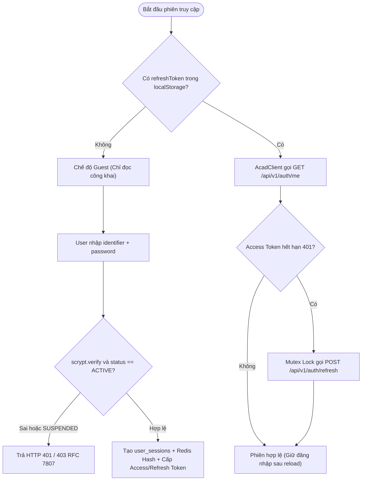
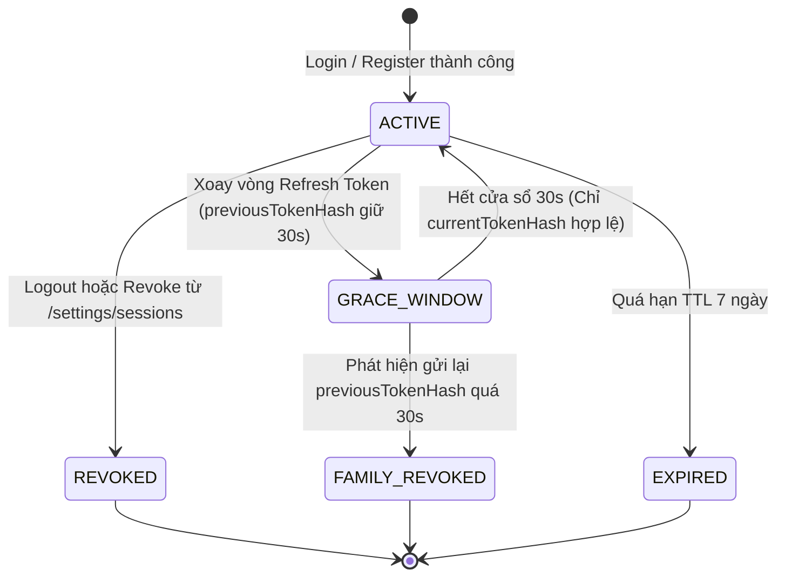
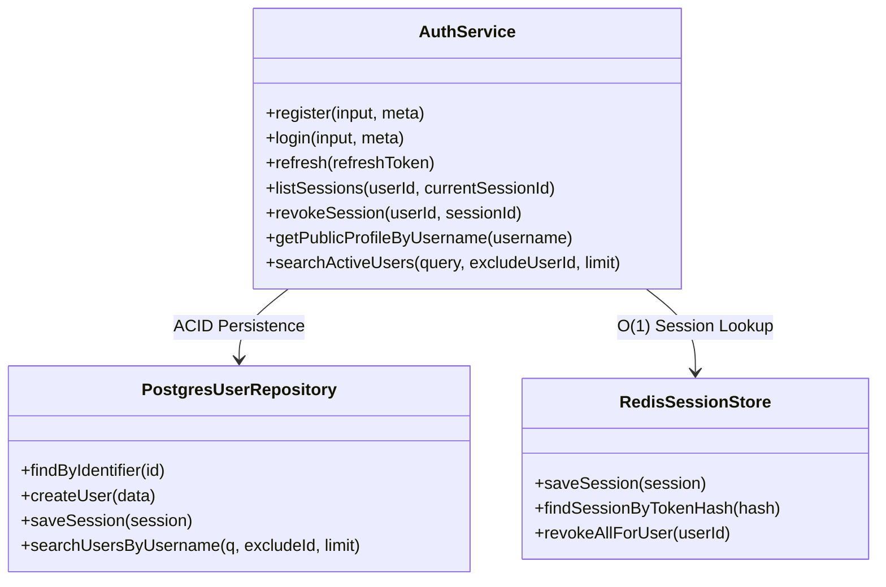

# Module M1: Định Danh, Bảo Mật Phiên & Tìm Kiếm Người Dùng (Auth & Identity v2.2)

> **Mã tài liệu:** `CORE-AUTH-ENGINE`  
> **Khung chuẩn:** Giai đoạn 4 & 5 trong [`SYSTEM ANALYSIS & DESIGN LIFECYCLE FRAMEWORK.md`](file:///home/debv/Documents/100_academy/acad_it_devOps/acad_devOps_project/docs/SYSTEM%20ANALYSIS%20%26%20DESIGN%20LIFECYCLE%20FRAMEWORK.md)  
> **Mã nguồn triển khai:** [`services/auth`](file:///home/debv/Documents/100_academy/acad_it_devOps/acad_devOps_project/services/auth), [`packages/auth-client`](file:///home/debv/Documents/100_academy/acad_it_devOps/acad_devOps_project/packages/auth-client), [`apps/api/src/routes/auth-router.ts`](file:///home/debv/Documents/100_academy/acad_it_devOps/acad_devOps_project/apps/api/src/routes/auth-router.ts)

---

## 1. PHẠM VI, ACTORS & QUY TẮC NGHIỆP VỤ (BUSINESS RULES)

- **Actors:** `ACT-01 Guest` (Đăng ký/Đăng nhập, xem hồ sơ công khai `/u/[username]`), `ACT-02 Member` (Refresh Token, `/settings/sessions`, tìm kiếm username), `ACT-05 Admin` (Thu hồi phiên cưỡng chế).
- **Mật mã học:** Node.js `crypto.scrypt` (`N=16384,r=8,p=1`) lưu dạng `$scrypt$N=16384,r=8,p=1${salt}${hash}` kết hợp `crypto.timingSafeEqual`.
- **Dual-Token Rotation:** Access Token JWT HS256 (15 phút) + Refresh Token CSPRNG (7 ngày, chỉ lưu SHA-256 hash trên Redis & PostgreSQL `user_sessions`).
- **30s Grace Period & Token Reuse Attack:** Giữ `previous_token_hash` trong 30 giây cho đa tab song song; quá 30s mà token cũ vẫn bị gửi lại $\rightarrow$ thu hồi toàn bộ phiên của `user_id` trên Redis (`session:{userId}:*`) và DB (`is_revoked = TRUE`).
- **Bảo vệ PII:** Mọi endpoint công khai (`/auth/users/:username`, `/auth/users/search`) **tuyệt đối loại bỏ** `email` và `passwordHash`.

---

## 2. BIỂU ĐỒ HOẠT ĐỘNG (ACTIVITY DIAGRAM — ĐĂNG NHẬP & TÌM KIẾM USER)



---

## 3. BIỂU ĐỒ TUẦN TỰ (SEQUENCE DIAGRAM — REFRESH 30S GRACE & REUSE ATTACK)

```mermaid
sequenceDiagram
    autonumber
    actor Browser as Web Client (Multi-Tab)
    participant Interceptor as AcadClient Mutex
    participant Gateway as AuthRouter (/api/v1/auth)
    participant Redis as RedisSessionStore
    participant DB as PostgreSQL (user_sessions)

    Browser->>Interceptor: Đồng thời gửi API khi Access Token hết hạn (401)
    Interceptor->>Interceptor: Tab 1 giữ Mutex; Tab 2 chờ subscriberQueue
    Interceptor->>Gateway: POST /api/v1/auth/refresh (refreshToken_1)
    Gateway->>Redis: Lookup session_lookup:{SHA256(token_1)}

    alt Khớp currentTokenHash
        Gateway->>Redis: Xoay hash mới (token_2), giữ previousTokenHash=token_1 (grace=30s)
        Gateway->>DB: UPDATE user_sessions SET refresh_token_hash, previous_token_hash
        Gateway-->>Interceptor: Trả token_2 + accessToken mới
        Interceptor->>Interceptor: Giải phóng Mutex & replay toàn bộ queue
    else Khớp previousTokenHash trong <= 30s
        Gateway-->>Interceptor: Cấp lại accessToken mới (giữ nguyên token_2)
    else Token cũ bị gửi lại sau > 30s (Reuse Attack)
        Gateway->>Redis: DEL toàn bộ session:{userId}:*
        Gateway->>DB: UPDATE user_sessions SET is_revoked = TRUE WHERE user_id = $1
        Gateway-->>Interceptor: HTTP 401 Token Reuse Attack Detected
    end
```

---

## 4. BIỂU ĐỒ TRẠNG THÁI (STATE MACHINE — VÒNG ĐỜI PHIÊN LÀM VIỆC)



---

## 5. BIỂU ĐỒ LỚP MIỀN & CẬP NHẬT DB SUY XUẤT



### Ràng buộc & Cập nhật DB suy xuất cho Giai đoạn B (`000007`)
1. **Bổ sung GIN Trigram Index trên `users.username` (`idx_users_username_trgm`):** Hỗ trợ luồng **Search for people by username** (`GET /api/v1/auth/users/search?q=...`) tìm kiếm gần đúng chỉ trong tập `status = 'ACTIVE'` với tốc độ $\mathcal{O}(\log N)$.
2. **Đếm bài viết chính xác trên hồ sơ công khai:** `users.threads_count` phải đồng bộ qua trigger & `reconcile_platform_counters()`.
