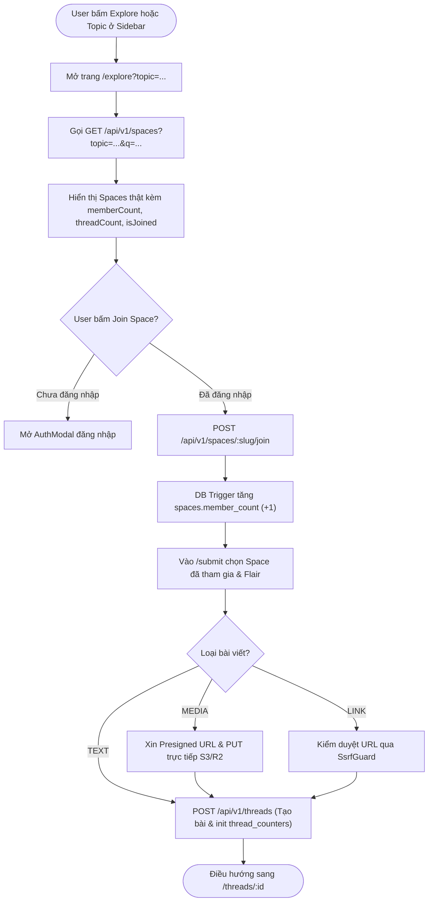
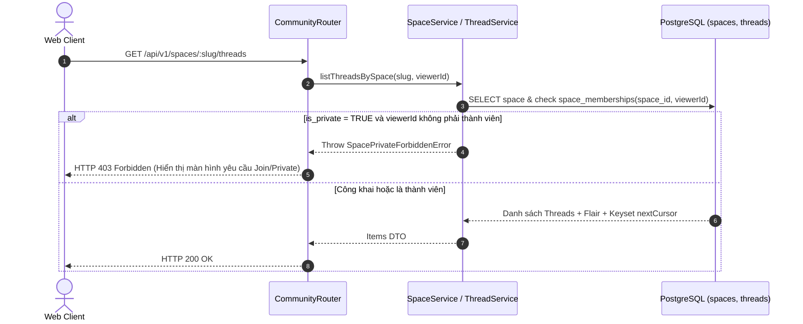
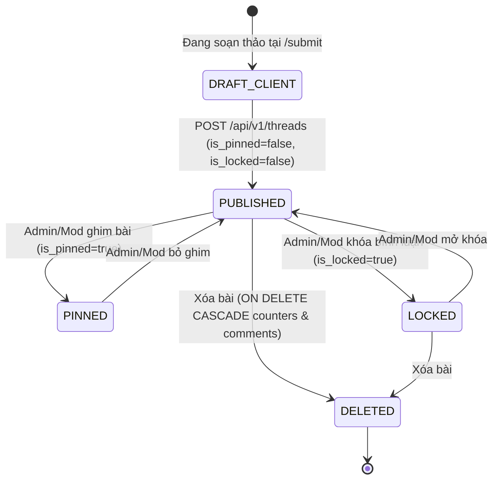
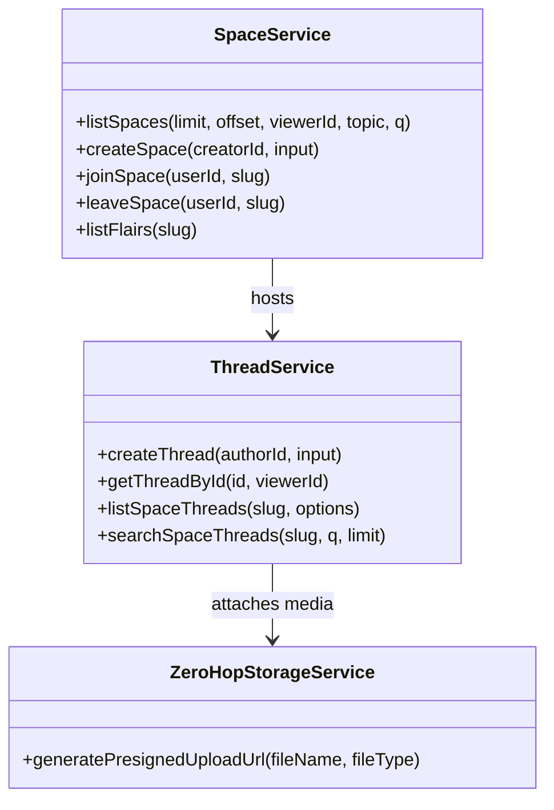

# Module M2: Không Gian Thảo Luận, Chủ Đề, Explore & CMS (Spaces & Content v2.2)

> **Mã tài liệu:** `CORE-SPACES-CMS`  
> **Khung chuẩn:** Giai đoạn 4 & 5 trong [`SYSTEM ANALYSIS & DESIGN LIFECYCLE FRAMEWORK.md`](file:///home/debv/Documents/100_academy/acad_it_devOps/acad_devOps_project/docs/SYSTEM%20ANALYSIS%20%26%20DESIGN%20LIFECYCLE%20FRAMEWORK.md)  
> **Mã nguồn triển khai:** [`services/community`](file:///home/debv/Documents/100_academy/acad_it_devOps/acad_devOps_project/services/community), [`apps/api/src/routes/community-router.ts`](file:///home/debv/Documents/100_academy/acad_it_devOps/acad_devOps_project/apps/api/src/routes/community-router.ts)

---

## 1. PHẠM VI, ACTORS & QUY TẮC NGHIỆP VỤ (BUSINESS RULES)

- **Actors:** `ACT-01 Guest` (xem Space công khai & bài viết), `ACT-02 Member` (Explore/lọc Topic, Join/Leave, tạo Space, đăng bài `TEXT`/`LINK`/`MEDIA` + Flair, upload ảnh Zero-Hop), `ACT-03/05 Mod/Admin` (Pin/Unpin, Lock/Unlock, quản trị Rules/Flairs).
- **Space Riêng Tư (`is_private = TRUE`):** Mọi truy vấn bài viết hoặc bình luận trong Space riêng tư từ người không phải thành viên đều trả **HTTP 403 Forbidden**.
- **Post Flairs:** Gắn màu chuẩn Slate Indigo (`#E1D9BC` trên `#30364F`), mỗi Space có tập `slug` flair duy nhất (`uq_space_flair_slug`).
- **Zero-Hop Media Upload:** Client kiểm tra Magic Bytes/MIME -> xin Presigned PUT URL (`POST /api/v1/media/presigned-url`) -> upload trực tiếp S3/R2 không qua Node.js Gateway -> gắn URL đã qua [`SsrfGuard`](file:///home/debv/Documents/100_academy/acad_it_devOps/acad_devOps_project/apps/api/src/security/ssrf-guard.ts) vào bài viết.

---

## 2. BIỂU ĐỒ HOẠT ĐỘNG (ACTIVITY DIAGRAM — EXPLORE, LỌC TOPIC & ĐĂNG BÀI)

---

## 3. BIỂU ĐỒ TUẦN TỰ (SEQUENCE DIAGRAM — TRUY CẬP SPACE RIÊNG TƯ & ĐĂNG BÀI)

---

## 4. BIỂU ĐỒ TRẠNG THÁI (STATE MACHINE — VÒNG ĐỜI BÀI VIẾT THREAD)

---

## 5. BIỂU ĐỒ LỚP MIỀN & CẬP NHẬT DB SUY XUẤT

### Ràng buộc & Cập nhật DB suy xuất cho Giai đoạn B (`000007`)
1. **Bổ sung cột `spaces.topic` (`VARCHAR(64) NOT NULL DEFAULT 'DevOps & SRE'`) + Index `idx_spaces_topic`:** Bắt buộc để luồng `/explore` và 5 mục `Topics` trên `LeftSidebar` (`DevOps & SRE`, `Kubernetes Architecture`, `PostgreSQL 16 & Redis 7`, `Cloudflare Zero Trust`, `Debian Linux Homelab`) lọc đúng dữ liệu cộng đồng từ DB.
2. **Đảm bảo `spaces.member_count` & `spaces.thread_count`:** Trigger khớp 100% số bản ghi `space_memberships` và `threads` qua `reconcile_platform_counters()`.
