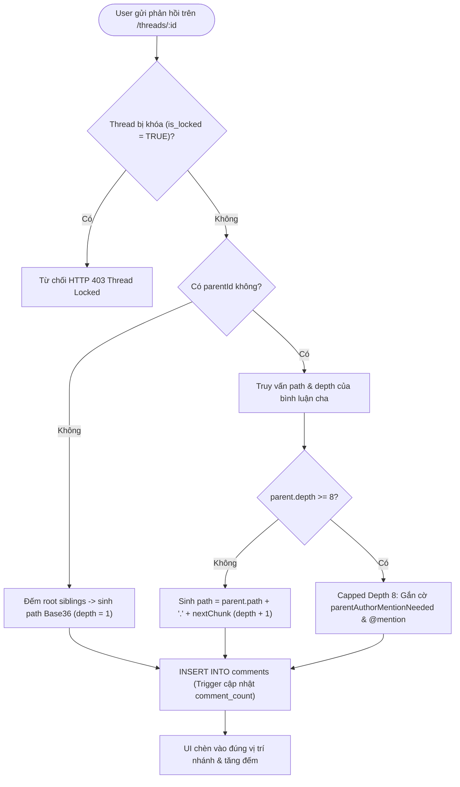
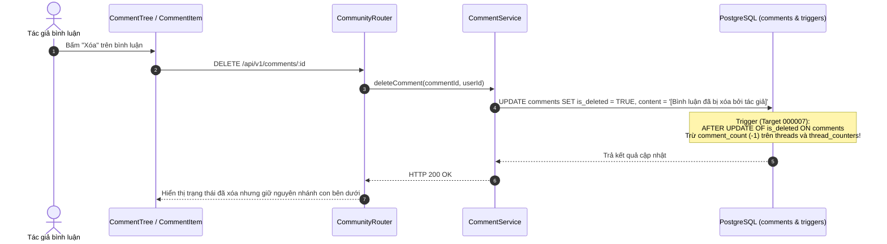
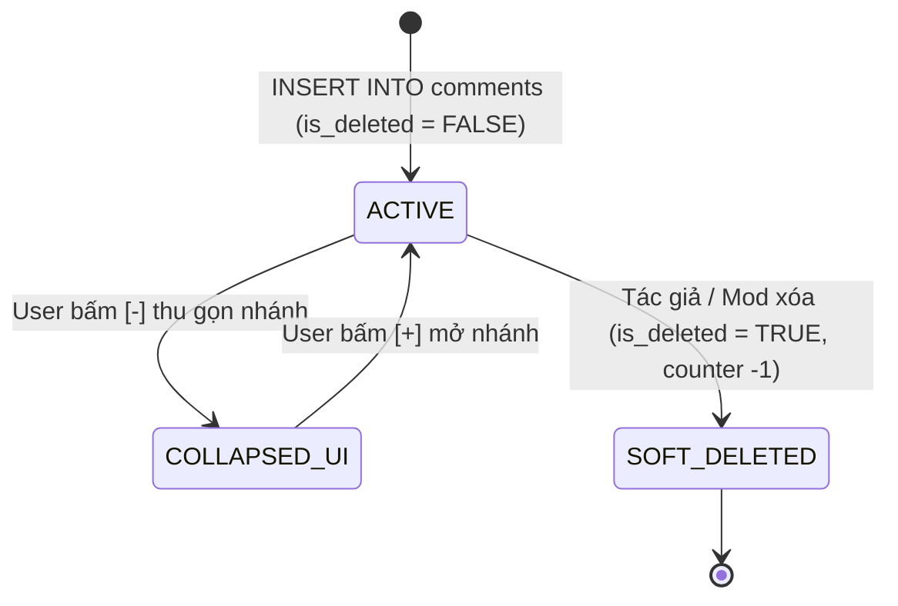
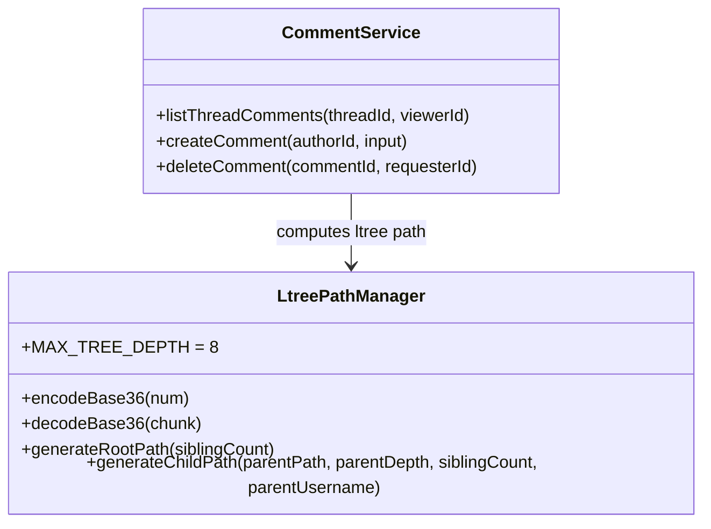

# Module M3: Cây Bình Luận Đa Tầng & Materialized Path `ltree` (Nested Comments v2.2)

> **Mã tài liệu:** `CORE-NESTED-COMMENTS`  
> **Khung chuẩn:** Giai đoạn 4 & 5 trong [`SYSTEM ANALYSIS & DESIGN LIFECYCLE FRAMEWORK.md`](file:///home/debv/Documents/100_academy/acad_it_devOps/acad_devOps_project/docs/SYSTEM%20ANALYSIS%20%26%20DESIGN%20LIFECYCLE%20FRAMEWORK.md)  
> **Mã nguồn triển khai:** [`ltree-path.ts`](file:///home/debv/Documents/100_academy/acad_it_devOps/acad_devOps_project/services/community/src/comments/ltree-path.ts), [`comment-service.ts`](file:///home/debv/Documents/100_academy/acad_it_devOps/acad_devOps_project/services/community/src/services/comment-service.ts), [`comment-tree.tsx`](file:///home/debv/Documents/100_academy/acad_it_devOps/acad_devOps_project/apps/web/src/components/comments/comment-tree.tsx)

---

## 1. PHẠM VI, ACTORS & QUY TẮC NGHIỆP VỤ (BUSINESS RULES)

- **Mô hình Materialized Path `ltree`:** Mỗi tầng mã hóa bằng Base36 4 ký tự (`0000`..`zzzz`, tối đa $36^4 = 1,679,616$ nút con trực tiếp mỗi nhánh), truy vấn toàn cây con trong 1 câu SQL qua chỉ mục GiST (`idx_comments_path_gist`).
- **Capped Depth 8 (`MAX_TREE_DEPTH = 8`):** Bình luận gốc bắt đầu tại `depth = 1`. Khi trả lời bình luận đã ở `depth = 8`, hệ thống tự động giữ nguyên nhánh cấp 8 (hoặc gộp phẳng theo quy tắc Capped Depth) kèm cờ `isCappedAtMaxDepth: true` và `parentAuthorMentionNeeded: true` để chèn `@username` mà không làm vỡ giao diện thụt lề.
- **Sắp xếp & Render Cuốn Chiếu trên UI:** `CommentTree` hỗ trợ 3 chế độ (`Theo nhánh` / `Nổi bật` / `Mới nhất`), thu gọn/mở rộng nhánh theo prefix `path`, và hiển thị cuốn chiếu 80 bình luận mỗi đợt qua `IntersectionObserver`.
- **Soft-Delete toàn vẹn cây:** Khi tác giả xóa bình luận có nhánh con, bản ghi giữ lại với `is_deleted = TRUE` để không làm gãy cấu trúc cây con; nhưng **bộ đếm `comment_count` hiển thị phải phản ánh chính xác số bình luận đang tồn tại thực tế**.

---

## 2. BIỂU ĐỒ HOẠT ĐỘNG (ACTIVITY DIAGRAM — TẠO BÌNH LUẬN & CAPPED DEPTH 8)

---

## 3. BIỂU ĐỒ TUẦN TỰ (SEQUENCE DIAGRAM — SOFT-DELETE & ĐỒNG BỘ COUNTER)

---

## 4. BIỂU ĐỒ TRẠNG THÁI (STATE MACHINE — VÒNG ĐỜI BÌNH LUẬN)

---

## 5. BIỂU ĐỒ LỚP MIỀN & CẬP NHẬT DB SUY XUẤT

### Ràng buộc & Cập nhật DB suy xuất cho Giai đoạn B (`000007`)
- **Phát hiện lỗ hổng Trigger `000002` & `000003`:** Hiện tại `trg_comments_counter_maintenance` và `trg_sync_comment_counter` chỉ kích hoạt trên `AFTER INSERT OR DELETE`, không chạy khi `UPDATE comments SET is_deleted = TRUE`! Điều này làm bài viết có 1 bình luận đã xóa (`d0000000-...0007`) vẫn ghi `comment_count = 1` ở ngoài feed trong khi mở bài viết chỉ thấy `Bình Luận (0)` active.
- **Giải pháp `000007`:** Cập nhật cả 2 trigger thành `AFTER INSERT OR DELETE OR UPDATE OF is_deleted ON comments` tính đúng số lượng `WHERE is_deleted = FALSE` và chạy `reconcile_platform_counters()` để sửa ngay dữ liệu lệch hiện hữu.
