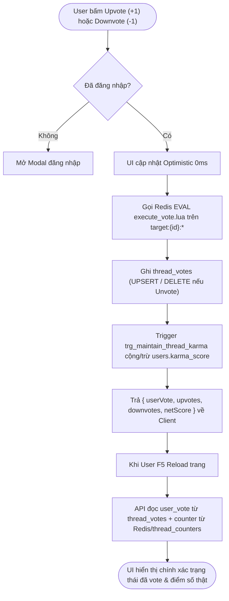
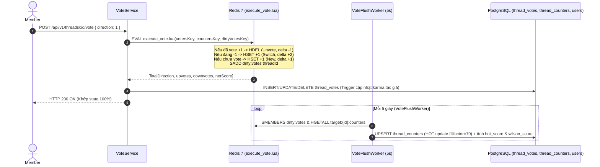
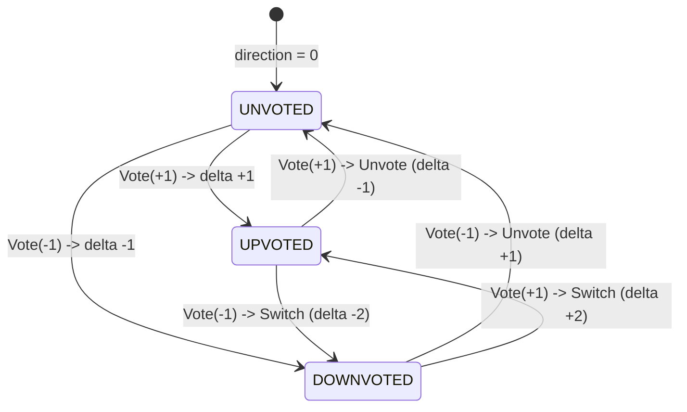

# Module M4: Biểu Quyết Nguyên Tử, Trọng Lực Xếp Hạng & Karma (Voting & Reputation v2.2)

> **Mã tài liệu:** `CORE-VOTING-REPUTATION`  
> **Khung chuẩn:** Giai đoạn 4 & 5 trong [`SYSTEM ANALYSIS & DESIGN LIFECYCLE FRAMEWORK.md`](file:///home/debv/Documents/100_academy/acad_it_devOps/acad_devOps_project/docs/SYSTEM%20ANALYSIS%20%26%20DESIGN%20LIFECYCLE%20FRAMEWORK.md)  
> **Mã nguồn triển khai:** [`execute_vote.lua`](file:///home/debv/Documents/100_academy/acad_it_devOps/acad_devOps_project/deploy/redis/execute_vote.lua), [`services/community/src/voting`](file:///home/debv/Documents/100_academy/acad_it_devOps/acad_devOps_project/services/community/src/voting)

---

## 1. PHẠM VI, QUY TẮC & CÔNG THỨC TOÁN HỌC

- **Gravity Decay (`HotScore`):**
  $$HotScore = \frac{NetScore}{(AgeHours + 2.0)^{1.8}}$$
- **Wilson Score Interval (`Best`, $z = 1.96$):** Bảo vệ bài viết chất lượng ít vote (tỷ lệ đồng thuận cao) không bị chìm trước bài gây tranh cãi nhiều vote.
- **Quy tắc Bất biến Zero-Simulated Data:** Mọi giá trị `upvotes`, `downvotes`, `net_score` trong `thread_counters` và Redis `target:{id}:counters` **chỉ được phép phát sinh từ bản ghi phiếu bầu thật** trong `thread_votes` / `comment_votes` của các tài khoản user thật; nghiêm cấm chèn số đếm khống vượt quá số user thực tế.

---

## 2. BIỂU ĐỒ HOẠT ĐỘNG (ACTIVITY DIAGRAM — QUY TRÌNH VOTE & RELOAD)



---

## 3. BIỂU ĐỒ TUẦN TỰ (SEQUENCE DIAGRAM — LUA ATOMIC & 5S FLUSH WORKER)



---

## 4. BIỂU ĐỒ TRẠNG THÁI (STATE MACHINE — ATOMIC VOTE FSM)



---

## 5. BIỂU ĐỒ LỚP MIỀN & CẬP NHẬT DB SUY XUẤT

```mermaid
classDiagram
    class VoteService {
        +voteThread(threadId, userId, direction)
        +voteComment(commentId, userId, direction)
    }
    class LuaVoteEngine {
        +executeVote(targetId, userId, direction)
        +getTargetCounters(targetId)
        +getUserVotesMap(targetIds, userId)
    }
    class VoteFlushWorker {
        +start()
        +flushOnce()
        +stop()
    }

    VoteService --> LuaVoteEngine : executes Lua O(1)
    VoteFlushWorker --> LuaVoteEngine : drains dirty:votes
```

### Ràng buộc & Cập nhật DB suy xuất cho Giai đoạn B (`000007` + Seeds)
1. **Loại bỏ hoàn toàn dữ liệu bơm khống trong `003_voting_feed_seed.sql` & `003_voting_redis_seed.sh`:**
   - Xóa các hàng ghi đè thủ công `(562, 4)`, `(428, 2)`... vốn không tồn tại phiếu bầu tương ứng.
   - Đồng bộ `thread_counters` và Redis `target:{id}:counters` **bằng đúng `COUNT(*)` từ `thread_votes` thật** (kèm thêm vote thật từ các user thật nếu cần test độ chênh `Hot` / `Top` / `Best`, bảo đảm `upvotes + downvotes <= COUNT(users)`).
2. **Hàm kiểm tra bất biến:** Bổ sung `reconcile_platform_counters()` vào `000007` để mọi bài test SQL luôn chứng minh được `thread_counters == COUNT(thread_votes)`.
