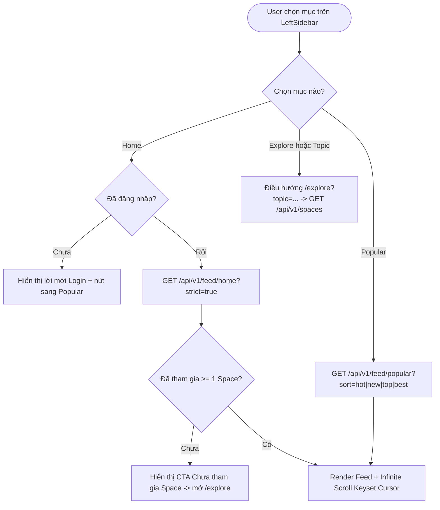
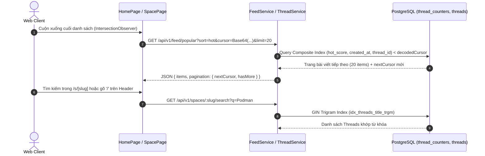
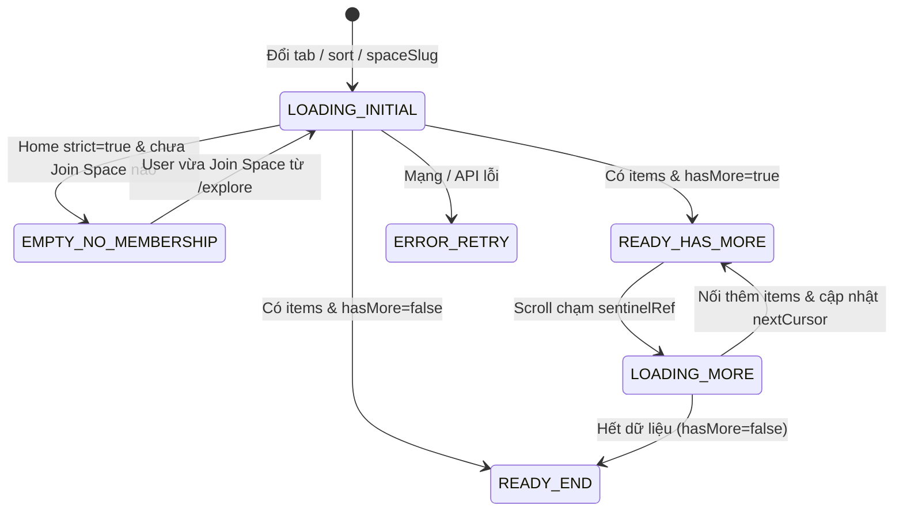
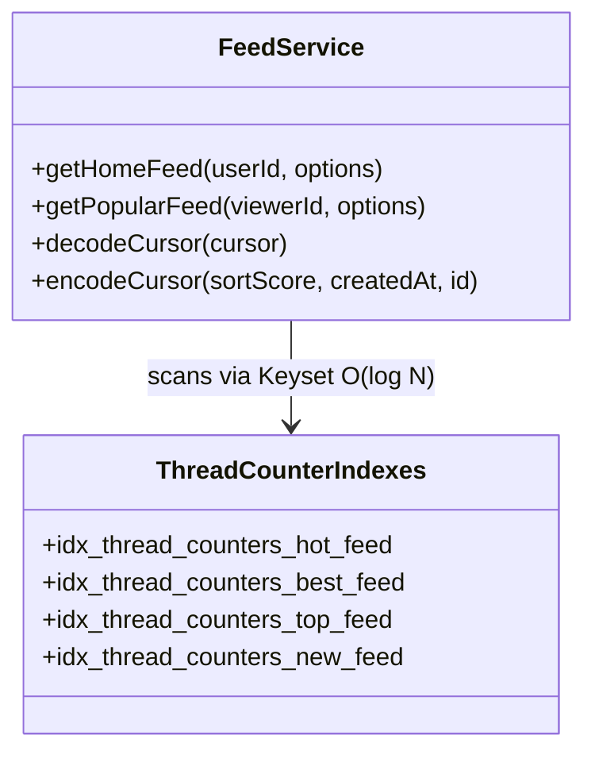

# Module M5: Bảng Tin Đa Thuật Toán, Điều Hướng & Tìm Kiếm (Feeds & Discovery v2.2)

> **Mã tài liệu:** `CORE-FEED-DISCOVERY`  
> **Khung chuẩn:** Giai đoạn 4 & 5 trong [`SYSTEM ANALYSIS & DESIGN LIFECYCLE FRAMEWORK.md`](file:///home/debv/Documents/100_academy/acad_it_devOps/acad_devOps_project/docs/SYSTEM%20ANALYSIS%20%26%20DESIGN%20LIFECYCLE%20FRAMEWORK.md)  
> **Mã nguồn triển khai:** [`feed-service.ts`](file:///home/debv/Documents/100_academy/acad_it_devOps/acad_devOps_project/services/community/src/services/feed-service.ts), [`apps/web/src/app/page.tsx`](file:///home/debv/Documents/100_academy/acad_it_devOps/acad_devOps_project/apps/web/src/app/page.tsx), [`apps/web/src/components/layout/left-sidebar.tsx`](file:///home/debv/Documents/100_academy/acad_it_devOps/acad_devOps_project/apps/web/src/components/layout/left-sidebar.tsx)

---

## 1. PHÂN BIỆT RÀNH MẠCH `HOME` vs `POPULAR` vs `EXPLORE`

- **Home (`/?tab=following`):** Bảng tin cá nhân hóa chỉ tổng hợp bài viết từ các Space người dùng đã Join (`space_memberships`). Nếu tài khoản mới chưa tham gia Space nào $\rightarrow$ hiển thị trạng thái rỗng kèm CTA dẫn tới `/explore`.
- **Popular (`/?tab=for_you&sort=hot`):** Bảng tin thịnh hành toàn sàn (tất cả Space công khai `is_private = FALSE`), sắp xếp mặc định theo `hot_score` (`Hot` / `New` / `Top` / `Best`).
- **Explore (`/explore` & `Topics`):** Trang danh bạ toàn bộ cộng đồng, lọc trực tiếp theo cột `spaces.topic` và tìm kiếm `pg_trgm`, cho phép Join/Leave ngay tại chỗ.
- **Recent Posts (`RightRail`):** Lưu lịch sử bài vừa mở ở trình duyệt và bấm vào phải điều hướng tới `/threads/[id]`.

---

## 2. BIỂU ĐỒ HOẠT ĐỘNG (ACTIVITY DIAGRAM — CHUYỂN ĐỔI BẢNG TIN & TÌM KIẾM)

---

## 3. BIỂU ĐỒ TUẦN TỰ (SEQUENCE DIAGRAM — KEYSET CURSOR & IN-SPACE SEARCH)

---

## 4. BIỂU ĐỒ TRẠNG THÁI (STATE MACHINE — TRẠNG THÁI TẢI BẢNG TIN)

---

## 5. BIỂU ĐỒ LỚP MIỀN & CẬP NHẬT DB SUY XUẤT

### Ràng buộc & Cập nhật DB suy xuất cho Giai đoạn B (`000007`)
1. **Dùng Composite Indexes (`hot_score`, `wilson_score`, `net_score`, `created_at`):** Chỉ có giá trị thật khi `thread_counters` phản ánh đúng `thread_votes` (xóa bỏ seed ảo `562`).
2. **Hỗ trợ lọc Space theo `topic` cho `/explore`:** Kết nối bảng `spaces.topic` mới vào endpoint `GET /api/v1/spaces?topic=...`.
