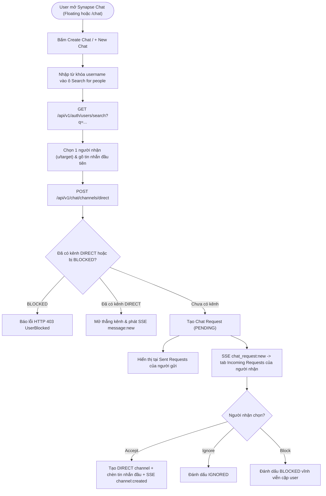
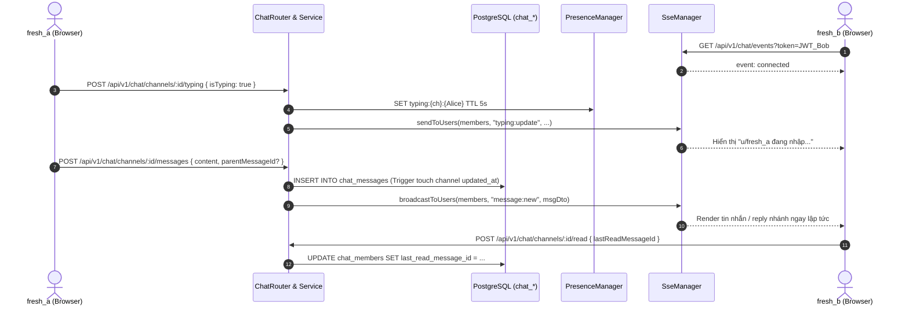
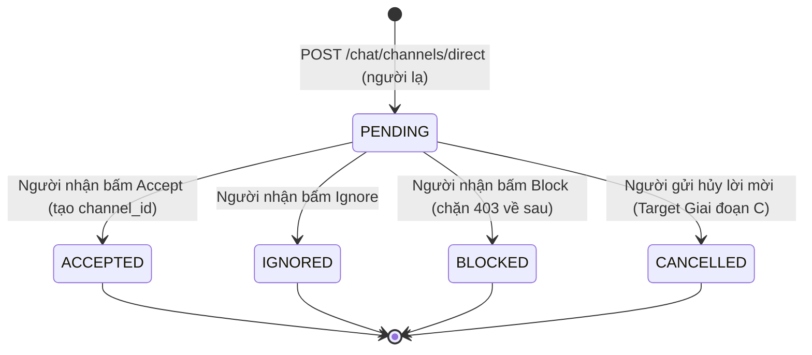
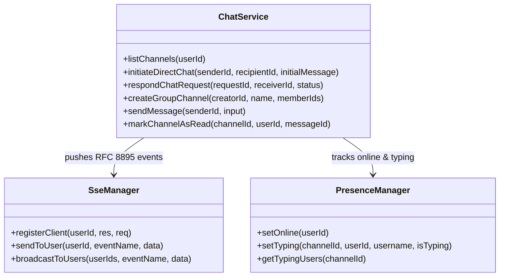

# Module M6: Nhắn Tin Thời Gian Thực, Tìm Kiếm Username & Requests (Realtime Chat v2.2)

> **Mã tài liệu:** `CORE-REALTIME-CHAT`  
> **Khung chuẩn:** Giai đoạn 4 & 5 trong [`SYSTEM ANALYSIS & DESIGN LIFECYCLE FRAMEWORK.md`](file:///home/debv/Documents/100_academy/acad_it_devOps/acad_devOps_project/docs/SYSTEM%20ANALYSIS%20%26%20DESIGN%20LIFECYCLE%20FRAMEWORK.md)  
> **Mã nguồn triển khai:** [`services/chat`](file:///home/debv/Documents/100_academy/acad_it_devOps/acad_devOps_project/services/chat), [`chat-router.ts`](file:///home/debv/Documents/100_academy/acad_it_devOps/acad_devOps_project/apps/api/src/routes/chat-router.ts), [`use-realtime-chat.ts`](file:///home/debv/Documents/100_academy/acad_it_devOps/acad_devOps_project/apps/web/src/lib/hooks/use-realtime-chat.ts), [`floating-chat-widget.tsx`](file:///home/debv/Documents/100_academy/acad_it_devOps/acad_devOps_project/apps/web/src/components/chat/floating-chat-widget.tsx), [`apps/web/src/app/chat/page.tsx`](file:///home/debv/Documents/100_academy/acad_it_devOps/acad_devOps_project/apps/web/src/app/chat/page.tsx)

---

## 1. PHẠM VI, ACTORS & QUY TẮC NGHIỆP VỤ (BUSINESS RULES)

- **Actors:** `ACT-02 Member` (tìm kiếm user theo username để tạo Direct Chat, lập Group Chat, gửi/nhận tin nhánh con `Chat Threads`, xử lý `Requests`), `AGT-03 SseManager`, `AGT-04 PresenceManager`.
- **Luồng Create Chat (Search for people by username):**
  - Tài khoản trắng mới (`Direct (0)`, `Groups (0)`) bắt buộc phải có nút **+ New Chat / Create Chat** ngay trên cả Widget nổi và `/chat`, tích hợp ô tìm kiếm username thời gian thực (`GET /api/v1/auth/users/search?q=...`).
- **Quy tắc Direct Chat & Requests Queue:**
  - Nếu 2 người đã có kênh `DIRECT` $\rightarrow$ mở thẳng kênh & gửi tin nhắn (`isRequest: false`).
  - Nếu chưa có kênh `DIRECT` (hoặc tùy chọn giữ cơ chế chống spam) $\rightarrow$ tạo bản ghi `PENDING` trong `chat_requests`. Bên nhận thấy ở **Incoming Requests** (`Accept` / `Ignore` / `Block`); bên gửi phải thấy được trạng thái trong **Sent Requests** (kèm quyền hủy lời mời `DELETE /api/v1/chat/requests/:id`), tránh cảm giác tin nhắn bị mất vào hố đen.
  - Nếu bị `BLOCKED`, mọi lần gửi tiếp theo bị từ chối **HTTP 403**.
- **Quy tắc Group Chat:** Phải có **tối thiểu 1 thành viên khác `creatorId`** (cấm tạo nhóm tự kỷ chỉ có 1 người).
- **Quy tắc Chuyển Tab & Đọc tin:** Chuyển sang tab rỗng (`Direct` khi 0 kênh) phải xóa `selectedChannelId` khỏi view hiện tại; mở kênh phải gọi cập nhật `chat_members.last_read_message_id` để đồng bộ `unreadCount`.

---

## 2. BIỂU ĐỒ HOẠT ĐỘNG (ACTIVITY DIAGRAM — TÀI KHOẢN MỚI TÌM USER & NHẮN TIN)

---

## 3. BIỂU ĐỒ TUẦN TỰ (SEQUENCE DIAGRAM — REALTIME SSE, TYPING & CHAT THREADS)

---

## 4. BIỂU ĐỒ TRẠNG THÁI (STATE MACHINE — VÒNG ĐỜI CHAT REQUEST)

---

## 5. BIỂU ĐỒ LỚP MIỀN & CẬP NHẬT DB SUY XUẤT

### Ràng buộc & Cập nhật DB suy xuất cho Giai đoạn B (`000007`)
1. **Index tìm kiếm user `idx_users_username_trgm`:** Hỗ trợ chức năng *Search for people by username to chat with them* ở Giai đoạn C.
2. **Index `idx_chat_requests_sender_status (sender_id, status, created_at DESC)`:** Hỗ trợ truy vấn tab **Sent Requests** cho người gửi.
3. **Đồng bộ Mark-As-Read (`chat_members.last_read_message_id`)** & **Validation Group Chat >= 2 distinct members** ở tầng Service/Router.
