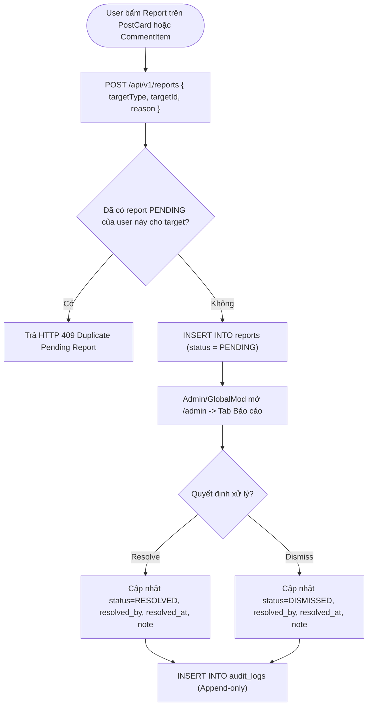
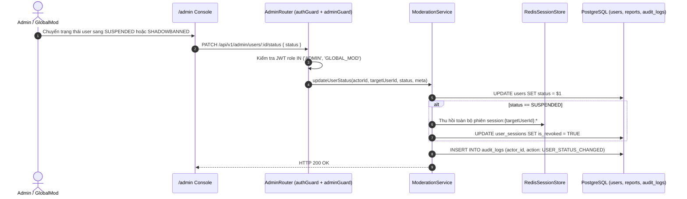
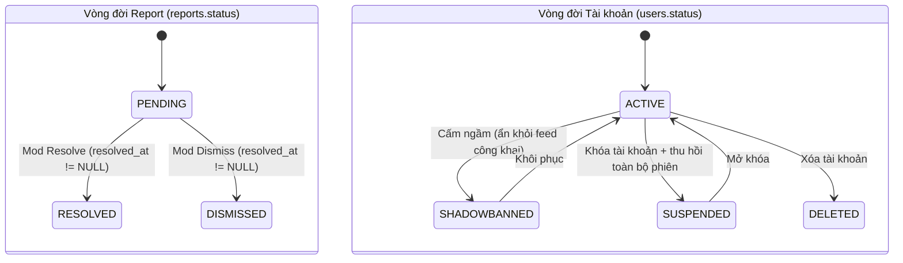
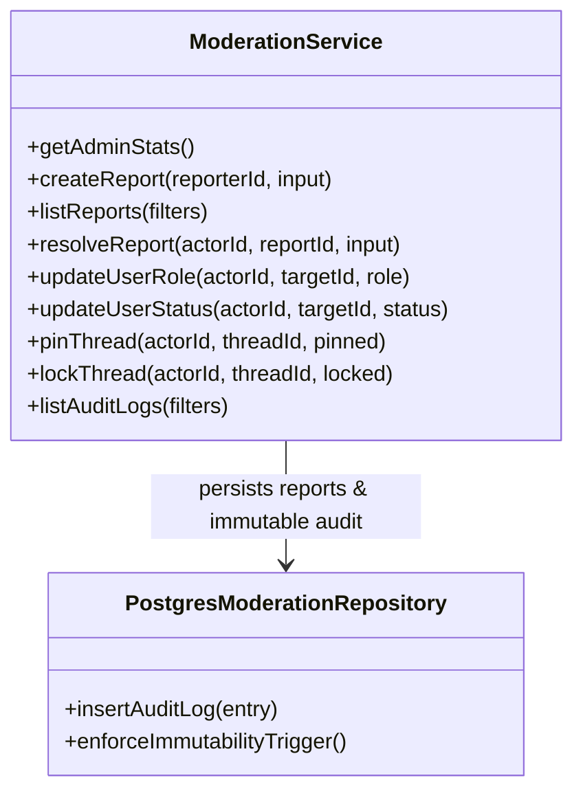

# Module M7: Kiểm Duyệt, Chống Spam & Kiểm Toán Bất Biến (Moderation & Admin Hub v2.2)

> **Mã tài liệu:** `CORE-ADMIN-MODERATION`  
> **Khung chuẩn:** Giai đoạn 4 & 5 trong [`SYSTEM ANALYSIS & DESIGN LIFECYCLE FRAMEWORK.md`](file:///home/debv/Documents/100_academy/acad_it_devOps/acad_devOps_project/docs/SYSTEM%20ANALYSIS%20%26%20DESIGN%20LIFECYCLE%20FRAMEWORK.md)  
> **Mã nguồn triển khai:** [`services/moderation`](file:///home/debv/Documents/100_academy/acad_it_devOps/acad_devOps_project/services/moderation), [`admin-router.ts`](file:///home/debv/Documents/100_academy/acad_it_devOps/acad_devOps_project/apps/api/src/routes/admin-router.ts), [`report-router.ts`](file:///home/debv/Documents/100_academy/acad_it_devOps/acad_devOps_project/apps/api/src/routes/report-router.ts), [`apps/web/src/app/admin/page.tsx`](file:///home/debv/Documents/100_academy/acad_it_devOps/acad_devOps_project/apps/web/src/app/admin/page.tsx)

---

## 1. PHẠM VI, ACTORS & QUY TẮC NGHIỆP VỤ (BUSINESS RULES)

- **Actors:** `ACT-02 Member` (gửi báo cáo vi phạm `THREAD`/`COMMENT` qua `ReportModal`), `ACT-04 GLOBAL_MOD` & `ACT-05 ADMIN` (truy cập `/admin` & `/api/v1/admin/*` qua `adminGuard`).
- **Chống spam Báo cáo:** Partial Unique Index `uq_pending_report_per_user_target` chặn người dùng gửi trùng báo cáo `PENDING` cho cùng một đối tượng (trả HTTP **409 Conflict**).
- **Shadowban (`status = 'SHADOWBANNED'`):** Bài viết/bình luận của tài khoản bị shadowban vẫn hiển thị với chính họ nhưng ẩn khỏi feed người khác.
- **Audit Trail Bất Biến (`audit_logs`):** Trigger `trg_audit_logs_immutability` (`BEFORE UPDATE OR DELETE`) chặn tuyệt đối mọi sửa đổi/xóa log kiểm toán ở tầng nhân CSDL.

---

## 2. BIỂU ĐỒ HOẠT ĐỘNG (ACTIVITY DIAGRAM — BÁO CÁO & XỬ LÝ MOD QUEUE)

---

## 3. BIỂU ĐỒ TUẦN TỰ (SEQUENCE DIAGRAM — KHÓA USER / SHADOWBAN & AUDIT LOG)

---

## 4. BIỂU ĐỒ TRẠNG THÁI (STATE MACHINE — VÒNG ĐỜI REPORT & USER STATUS)

---

## 5. BIỂU ĐỒ LỚP MIỀN & RÀNG BUỘC DB

