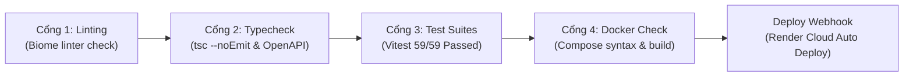

# Quy Trình Git & 4 Cổng Kiểm Định Tự Động (Git Workflow & CI Gates)

> **Mã tài liệu:** `STD-GIT-CI-GATES`  
> **Dự án:** Acad DevOps Fullstack Monorepo  
> **Mã nguồn:** [`.github/workflows/ci.yml`](file:///home/debv/Documents/100_academy/acad_it_devOps/acad_devOps_project/.github/workflows/ci.yml)

---

## 1. MÔ HÌNH TRUNK-BASED DEVELOPMENT & SEMANTIC COMMITS

Dự án áp dụng mô hình phát triển **Trunk-based Development**:
- Nhánh `main` là nguồn sự thật duy nhất (Single Source of Truth), luôn ở trạng thái sẵn sàng phát hành (Production-ready).
- Mọi commit bắt buộc tuân theo quy ước **Semantic Commits**:
  - `feat:` Thêm tính năng mới (ví dụ: `feat(community): implement Wave 2 Core Community Engine`).
  - `fix:` Khắc phục sự cố kỹ thuật (ví dụ: `fix(api): explicitly type userThreadCounts record`).
  - `docs:` Bổ sung hoặc cập nhật tài liệu kỹ thuật (ví dụ: `docs: restructure v2 documentation portal`).
  - `chore:` Nâng cấp công cụ, dependencies, hoặc cấu hình CI.
  - `refactor:` Tái cấu trúc mã nguồn mà không làm đổi logic chức năng.

---

## 2. BỐN CỔNG KIỂM ĐỊNH TỰ ĐỘNG CỦA GITHUB ACTIONS (CI GATES)

Mỗi khi có commit được push lên `main` hoặc `develop`, GitHub Actions tự động kích hoạt pipeline 4 cổng:

1. **Cổng 1 (Lint & Code Formatting):** Kiểm tra chuẩn hóa mã nguồn qua Biome.
2. **Cổng 2 (TypeScript & OpenAPI Validation):** Chạy `pnpm run build:libs` rồi thực thi `pnpm run typecheck` trên toàn bộ 8 packages/services.
3. **Cổng 3 (Unit & Integration Tests):** Chạy toàn bộ các test suites qua Vitest, yêu cầu tỷ lệ đạt 100%.
4. **Cổng 4 (Dockerfiles & Compose Syntax Check):** Kiểm tra tính hợp lệ của tệp [`docker-compose.dev.yml`](file:///home/debv/Documents/100_academy/acad_it_devOps/acad_devOps_project/deploy/docker/docker-compose.dev.yml) và cấu trúc Dockerfile multi-stage.

Sau khi cả 4 Cổng đều xanh (Pass), commit trên `main` sẽ tự động kích hoạt webhook triển khai bản cập nhật tức thời lên **Render Cloud** cho cả Backend API và Frontend Web Client.
