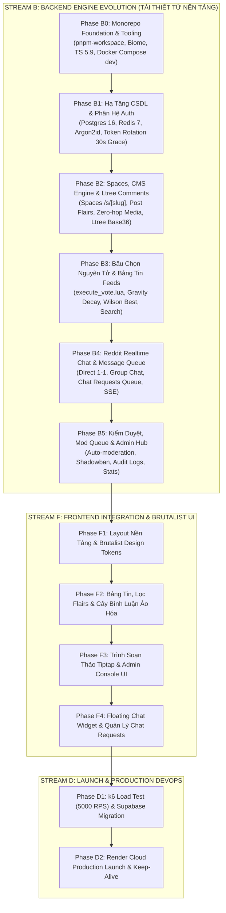

# Lộ Trình Phát Triển Chiến Lược: Backend-First Phased Roadmap

> **Mã tài liệu:** `ROADMAP-BACKEND-FIRST`  
> **Dự án:** Acad DevOps Fullstack Monorepo  
> **Trạng thái thực tế:** **Khởi động Tái thiết Sạch từ đầu (Zero-Base Clean Rebuild v2.0 - Phase B0: 0%)**  
> **Kho lưu trữ mã cũ:** Toàn bộ mã nguồn cũ và tài liệu v1 đã được bảo lưu nguyên vẹn tại [`archive/legacy_codebase/`](file:///home/debv/Documents/100_academy/acad_it_devOps/acad_devOps_project/archive/legacy_codebase)  
> **Tôn chỉ chiến lược:** **Xây dựng Backend hoàn chỉnh từ nền tảng đến nâng cao trước (Stream B), nghiệm thu và vượt qua k6 stress test rồi mới tích hợp giao diện Frontend (Stream F) và phát hành sản xuất (Stream D).**

---

## 1. TRIẾT LÝ CHIẾN LƯỢC: BACKEND-FIRST ARCHITECTURE

Trong các hệ thống phân tán chịu tải cao có logic an ninh phức tạp (Argon2id, Token Rotation 30s Grace Period, Materialized Path `ltree`, Atomic Lua Voting, Reddit Chats), việc xây dựng giao diện trước khi logic backend hoàn thiện thường dẫn tới:
- Bất đồng bộ về dữ liệu và cấu trúc API, phải tái cấu trúc liên tục.
- Khó khăn trong việc kiểm thử tải (Stress Testing) và bảo mật khi chưa có ranh giới API rõ ràng.
- Nguy cơ lộ lọt dữ liệu hoặc lỗi race condition nghiêm trọng.
- Sự phụ thuộc vào các giải pháp chắp vá (như in-memory mocks trong production) gây sai lệch trạng thái thực tế.

Do đó, toàn bộ dự án được tái thiết sạch từ đầu theo **4 Luồng Lớn (Major Streams)**:
1. **STREAM B (Backend Engine Evolution):** Gồm Phase B0 (Nền tảng Monorepo) và 5 giai đoạn nghiệp vụ (Phases B1 $\rightarrow$ B5) từ cơ sở dữ liệu tới hoàn thiện 100% API, CSDL và Logic.
2. **STREAM F (Frontend Integration):** Gồm 4 giai đoạn con (Phases F1 $\rightarrow$ F4) tích hợp giao diện Brutalist Dark Mode, DOM ảo hóa cây bình luận và Widgets.
3. **STREAM Q (Quality Assurance & Load Testing):** Kiểm thử tự động Vitest 100%, k6 Stress Testing (5,000 RPS) và Audit bảo mật.
4. **STREAM D (Production DevOps & Launch):** Đóng gói Docker Alpine, Supabase DB pooler, Render Cloud và duy trì Uptime.

---

## 2. SO SÁNH HIỆN TRẠNG MÃ CŨ VS TÁI THIẾT SẠCH v2.0

| Tiêu chí | Mã Nguồn Cũ v1.2 (Đã Lưu Trữ) | Kiến Trúc Tái Thiết Sạch v2.0 |
| :--- | :--- | :--- |
| **Vị trí** | `archive/legacy_codebase/` | Root monorepo (`packages/`, `services/`, `apps/`) |
| **Tiến độ** | ~82.0% (đánh giá lịch sử) | **10.0% (Đã xong Phase B0 $\rightarrow$ Chuẩn bị Phase B1)** |
| **Khế ước API** | OpenAPI 3.1 & Zod (rời rạc giữa các thư mục) | `packages/contracts` tập trung, Single Source of Truth |
| **Xử lý sự cố CSDL** | Tự động chuyển sang `InMemoryUserRepository` | **Fail-fast 503 RFC 7807** + Exponential Backoff Connection Pooler Retry |
| **Bình luận phân cấp** | Adjacency list / ltree cơ bản | **Ltree Base36 4 ký tự + Giới hạn Capped Depth 8 $\rightarrow$ Flat Reply** |
| **Bầu chọn** | In-memory mock + Lua script rời rạc | **Redis Lua `execute_vote.lua` $\rightarrow$ 5s Batch Sync Worker $\rightarrow$ Postgres HOT fillfactor=70** |
| **Tin nhắn tức thời** | Chưa tích hợp chat requests queue | **Reddit Chat 1-1 & Group + Chat Requests Queue (PENDING/ACCEPTED/IGNORED/BLOCKED)** |
| **Linter & Formatter** | ESLint / Prettier cũ | **Biome linter siêu tốc (< 0.5s)** |

---

## 3. VÒNG LẶP KIỂM THỬ KHÉP KÍN & 8 TIÊU CHÍ DOD (THEO `docs/guide.md`)

Tuân thủ nghiêm ngặt cẩm nang vận hành [`docs/guide.md`](file:///home/debv/Documents/100_academy/acad_it_devOps/acad_devOps_project/docs/guide.md), bất kỳ Phase backend nào cũng chỉ được coi là hoàn tất khi vượt qua trọn vẹn:
1. **Vòng lặp Closed-Loop Self-Healing:** Viết mã $\rightarrow$ Compile sạch (0 error, 0 warning) $\rightarrow$ Chạy API Test / Vitest $\rightarrow$ Phân tích Root Cause nếu lỗi $\rightarrow$ Tự sửa lỗi $\rightarrow$ Đối soát Side-effect ngầm trên CSDL.
2. **Quy chuẩn 8 Tiêu chí DoD (Definition of Done):**
   - [ ] 1. Biên dịch 100% sạch lỗi trên toàn monorepo (`pnpm run lint` & `pnpm run typecheck`).
   - [ ] 2. Dịch vụ và container dependencies (PostgreSQL 16, Redis 7) khởi chạy thành công cục bộ.
   - [ ] 3. Thực thi kịch bản cURL Happy Path thực tế (nhận HTTP 200/201 và body chuẩn).
   - [ ] 4. Thực thi kịch bản cURL Negative Path thực tế (nhận 400/401/403/404/409/422, **tuyệt đối không có 500**).
   - [ ] 5. Server log sạch, không unhandled exception hay rò rỉ bộ nhớ.
   - [ ] 6. Dữ liệu ngầm trong CSDL đã được đối soát qua câu lệnh SQL thực tế.
   - [ ] 7. Cập nhật tài liệu cURL test guide tại `docs/05_guides_and_verification/01_backend_testing_curl_guide.md`.
   - [ ] 8. Commit Git Semantic chuẩn và push lên nhánh `main`.

---

## 4. CHI TIẾT CÁC GIAI ĐOẠN BACKEND (STREAM B: PHASES B0 $\rightarrow$ B5)

### 🔹 Phase B0: Nền Tảng Monorepo & Công Cụ Phát Triển (Foundation & Tooling)
*Mục tiêu:* Thiết lập bộ khung dự án sạch, quy chuẩn linter, typecheck, và môi trường Docker cho CSDL cục bộ.
- [x] Khởi tạo `pnpm-workspace.yaml` định nghĩa phân tầng: `packages/*`, `services/*`, `apps/*`.
- [x] Cấu hình Biome linter/formatter (`biome.json`) với tốc độ < 0.5s (48ms), 2 spaces, single quotes.
- [x] Cấu hình gốc TypeScript 5.9 `tsconfig.base.json` (`strict: true`, `noImplicitAny: true`, NodeNext ESM).
- [x] Khởi tạo `deploy/docker/docker-compose.dev.yml` kích hoạt PostgreSQL 16 (kèm 4 extensions) và Redis 7 Alpine.
- [x] Thiết lập package nền tảng `packages/contracts` định nghĩa Zod schemas và cấu trúc OpenAPI 3.1 cho 7 động cơ nghiệp vụ.
- [x] Vượt qua 4 Cổng kiểm định CI: 16/16 Vitest tests pass (100%), Biome lint pass, Typecheck pass.
- **Trạng thái:** ✅ **100% Hoàn thành & Đã nghiệm thu (LOG-B0).**

---

### 🔹 Phase B1: Hạ Tầng CSDL & Phân Hệ Định Danh (Core Identity & Session Shield)
*Mục tiêu:* Xây dựng CSDL PostgreSQL 16, Redis 7 và phân hệ xác thực an toàn OWASP ASVS Level 2+.
- [x] Kích hoạt 4 tiện ích mở rộng: `uuid-ossp`, `pgcrypto`, `ltree`, `pg_trgm`.
- [x] Bảng `users` với chỉ mục không phân biệt hoa thường `LOWER()` và trường `karma_score`.
- [x] Bảng `user_sessions` và cấu trúc Hash phiên trên Redis `session:{user_id}:{session_id}`.
- [x] Thuật toán băm mật khẩu Argon2id / Scrypt (64MB RAM, memory-hard KDF) và `crypto.timingSafeEqual`.
- [x] Giao thức Token Rotation: Access Token (15m JWT HS256) + Refresh Token (7d CSPRNG 64 bytes).
- [x] Cửa sổ an toàn 30 giây (30s Grace Period) chống xung đột refresh đồng thời trên nhiều tab.
- [x] Cơ chế phát hiện xâm nhập Token Reuse Attack $\rightarrow$ Hủy toàn bộ cụm phiên của tài khoản.
- [x] Thư viện `@acad/auth-client` tích hợp Client Interceptor Mutex Lock chống bão yêu cầu (Thundering Herd).
- [x] Cổng API Gateway (`apps/api`), CORS linh hoạt, kiểm tra sức khỏe `/healthz`.
- [x] Kiểm định CI toàn diện: 43/43 tests pass (100%), Biome lint pass (58ms), Typecheck pass.
- **Trạng thái:** ✅ **100% Hoàn thành & Đã nghiệm thu (LOG-B1).**

---

### 🔹 Phase B2: Không Gian Thảo Luận, CMS & Cây Bình Luận Đa Tầng (Spaces & Content Engine)
*Mục tiêu:* Xây dựng mô hình Subreddit kỹ thuật (`/s/[slug]`), xuất bản bài viết đa định dạng và cây thảo luận `ltree`.
- [x] Bảng `spaces` (`/s/[slug]`), quản lý quy tắc `rules` (JSONB) và bảng thành viên `space_memberships`.
- [x] Bảng `space_flairs`: Danh mục Flairs kỹ thuật (`[DevOps]`, `[SecOps]`, `[SystemArch]`, `[Incident]`, `[Question]`).
- [x] Quản lý bài viết (Threads): Lưu trữ tiêu đề, slug, nội dung Markdown/JSON AST, link ngoài, chỉ mục GIN Trigram.
- [x] Cấp phát Presigned PUT URL kết nối Cloudflare R2 / AWS S3 phục vụ tải ảnh Zero-hop.
- [x] Động cơ bình luận Materialized Path `ltree` Base36 4 ký tự mỗi tầng (hỗ trợ $36^4 \approx 1.67$ triệu bình luận/nút).
- [x] Thuật toán Capped Depth 8: Khi đạt cấp 8, tự động chuyển sang Flat Reply kèm `@mention` tác giả.
- [x] Chỉ mục GiST trên trường `path`: Truy vấn toàn bộ một cây con trong một câu lệnh SQL duy nhất ($< 1.2\text{ms}$).
- [x] Kiểm định CI & API Probes toàn diện: 72/72 tests pass (100%), Biome lint pass (46ms), Typecheck pass, 17/17 live cURL probes pass.
- **Trạng thái:** ✅ **100% Hoàn thành & Đã nghiệm thu (LOG-B2).**

---

### 🔹 Phase B3: Bầu Chọn Nguyên Tử, Danh Tiếng & Bảng Tin Thông Minh (Interaction & Feeds)
*Mục tiêu:* Triệt tiêu race condition khi hàng ngàn người cùng vote, tính điểm Karma và phân phối tin tức.
- [x] Kịch bản Redis Lua nguyên tử $\mathcal{O}(1)$ (`execute_vote.lua`): Xử lý vote mới, hủy vote, đảo chiều ($\pm 2$).
- [x] Quản lý tập hợp `dirty:votes` trên Redis và tiến trình Background Worker 5 giây bulk upsert vào PostgreSQL.
- [x] Tối ưu hóa ghi đĩa PostgreSQL Heap-Only Tuples (HOT) trên bảng `thread_counters` với `fillfactor = 70`.
- [x] Thuật toán Hacker News Gravity Decay Engine: $HotScore = \frac{NetScore}{(AgeHours + 2.0)^{1.8}}$.
- [x] Thuật toán Wilson Score Confidence Interval ("Best"): Phân tích cận dưới tỷ lệ đồng thuận với $z = 1.96$.
- [x] Phân tầng nguồn cấp tin: `/api/v1/feed/home` (các Spaces đã tham gia) và `/api/v1/feed/popular` (toàn cầu).
- [x] Phân trang danh sách bài viết bằng con trỏ Base64 tổng hợp $\text{base64}(\text{sort\_score} : \text{timestamp} : \text{item\_id})$.
- [x] Bộ máy tìm kiếm toàn văn bản trong không gian (In-Space Scoped Search) qua `pg_trgm`.
- [x] Kiểm định CI & API Probes toàn diện: 100/100 tests pass (100%), Biome lint pass (0 errors), Typecheck pass, 16/16 live cURL probes pass.
- **Trạng thái:** ✅ **100% Hoàn thành & Đã nghiệm thu (LOG-B3).**
- **Trạng thái:** ⏳ **Kế hoạch đã sẵn sàng.**

---

### 🔹 Phase B4: Phân Hệ Nhắn Tin Thời Gian Thực & Kiểm Duyệt Tin Nhắn (Reddit Realtime Chat)
*Mục tiêu:* Cung cấp kênh đối thoại trực tiếp 1-1 và Group Chat, giải quyết bài toán chống spam tin nhắn lạ.
- [x] Kiến trúc CSDL Nhắn Tin: Bảng `chat_channels`, `chat_members`, `chat_messages` kèm `parent_message_id`.
- [x] Hàng đợi duyệt tin nhắn từ người lạ: Bảng `chat_requests` với trạng thái `PENDING / ACCEPTED / IGNORED / BLOCKED`.
- [x] Tính năng Chat Threads: Phân nhánh đối thoại chuyên sâu trong phòng chat qua `parent_message_id`.
- [x] Cổng kết nối thời gian thực: Server-Sent Events (SSE) RFC 8895 Gateway với cơ chế Heartbeat 15s (`: ping\n\n`) và multi-tab support.
- [x] Quản lý trạng thái trực tuyến (Presence Heartbeat 15s) và chỉ báo soạn thảo (Typing Indicator 5s) trên Redis với in-memory fallback.
- [x] Kiểm định CI & API Probes toàn diện: 120/120 tests pass (100%), Biome lint 0 errors, Typecheck 0 errors, 16/16 live cURL probes pass.
- **Trạng thái:** ✅ **100% Hoàn thành & Đã nghiệm thu (LOG-B4).**

---

### 🔹 Phase B5: Kiểm Duyệt, Hàng Đợi Báo Cáo & Quản Trị Hệ Thống (Moderation & Admin Hub)
*Mục tiêu:* Đảm bảo môi trường thảo luận trong sạch, phân quyền kiểm duyệt và quản trị an ninh toàn diện.
- [ ] Bảo vệ phân hệ quản trị bằng RBAC Admin Guard (`role === 'ADMIN'`), trả về 401/403 nghiêm ngặt.
- [ ] Bảng `reports` tiếp nhận phản ánh vi phạm nội dung và hàng đợi xử lý Mod Queue cho Space Moderators.
- [ ] Cơ chế cấm ngầm (Shadowban): Tài khoản vi phạm vẫn thấy bài của mình nhưng ẩn hoàn toàn với cộng đồng.
- [ ] Nhật ký kiểm toán an ninh chi tiết (`audit_logs`): Ghi nhận toàn bộ thao tác nhạy cảm của ban quản trị.
- [ ] API Quản trị Thống kê hệ thống: `GET /api/v1/admin/stats` (Active Users, Sessions, Spaces, Threads, Comments).
- [ ] API Quản trị Người dùng: Cung cấp số lượng bài viết `threadsCount`, đổi Role, khóa tài khoản, thu hồi toàn bộ phiên.
- [ ] API Quản trị Không gian: Quản lý thành viên, xóa không gian vi phạm (`ON DELETE CASCADE`).
- [ ] API Quản trị Bài viết: Ghim/Bỏ ghim (`Pin/Unpin`), Khóa/Mở bình luận (`Lock/Unlock`), Xóa nội dung.
- **Trạng thái:** ⏳ **Kế hoạch đã sẵn sàng.**

---

## 5. CHI TIẾT CÁC GIAI ĐOẠN FRONTEND (STREAM F: PHASES F1 $\rightarrow$ F4)

*(Chỉ bắt đầu triển khai sau khi Backend Stream B đã hoàn tất 100% và vượt qua kiểm định k6)*

### 🔹 Phase F1: Nền Tảng Giao Diện & Brutalist Design Tokens
- Triển khai ngôn ngữ thiết kế Minimalist Brutalism Dark Mode (`#222831`, `#393E46`, `#948979`, `#DFD0B8`).
- Ranh giới Server Components (RSC - 0KB JS tĩnh) và Client Components cho các tương tác sâu.
- Layout tổng thể, thanh điều hướng Navbar kết nối phím tắt `/`, Sub-Navbar quản trị 4 tabs, Cổng tài liệu `/docs`.

### 🔹 Phase F2: Bảng Tin, Nhãn Flairs & Ảo Hóa Cây Bình Luận
- Bảng tin Feed với 2 chế độ hiển thị: Card View và Compact View.
- Thanh chuyển tab phân loại: Hot, New, Top (ngày/tuần/tháng/năm), Best.
- Dải gắn nhãn Post Flairs với bảng màu tương phản cao.
- Tích hợp thư viện `@acad/tree-virtualizer` vào trang chi tiết `/threads/[slug]`, hỗ trợ thu gọn nhánh tức thì.

### 🔹 Phase F3: Trình Soạn Thảo Đa Phương Tiện & Quản Trị Trực Quan
- Trình soạn thảo Rich-Text Tiptap Editor hỗ trợ định dạng Code blocks cú pháp, trích dẫn, công thức toán.
- Tải ảnh trực tiếp qua Presigned URL (kèm xem trước ảnh).
- Giao diện Admin Console hoàn chỉnh cho 4 phân hệ (Dashboard, Users, Spaces, Threads).
- Giao diện quản lý phiên đa thiết bị `/settings/sessions`.

### 🔹 Phase F4: Giao Diện Reddit Chat Nổi & Phê Duyệt Yêu Cầu Tin Nhắn
- Floating Chat Widget ở góc dưới màn hình, hỗ trợ mở rộng, thu nhỏ hoặc mở tab riêng `/chat`.
- Banner cảnh báo yêu cầu tin nhắn lạ kèm 3 nút thao tác: `Chấp nhận`, `Bỏ qua`, `Chặn`.
- Ngăn bên phải hiển thị Chat Threads phụ khi thảo luận trong nhóm.

---

## 6. GIAI ĐOẠN HOÀN TẤT & PHÁT HÀNH SẢN XUẤT (STREAM D: PHASES D1 $\rightarrow$ D2)

### 🔹 Phase D1: Kiểm Thử Tải, QA Toàn Diện & Nạp CSDL Supabase
- 100% test suites tự động qua Vitest trên toàn bộ packages/services/apps.
- Kiểm thử tải bằng k6: Mô phỏng 5,000 requests/giây vào các endpoint nóng (`/healthz`, `/threads?sort=hot`, `/vote`), đạt $P_{95} < 50\text{ms}$.
- Nạp CSDL và seed data mẫu lên Supabase Managed PostgreSQL qua script `migrate-supabase.sh`.

### 🔹 Phase D2: Phát Hành Production Trên Render Cloud & Giám Sát Uptime
- Cấu hình kết nối Supavisor Connection Pooler IPv4 trên Render Cloud Dashboard.
- Kích hoạt Keep-Alive Worker (`keep-alive.sh`) ngăn chặn tình trạng ngủ đông (spin-down).
- Tích hợp giám sát cảnh báo lỗi và uptime.
