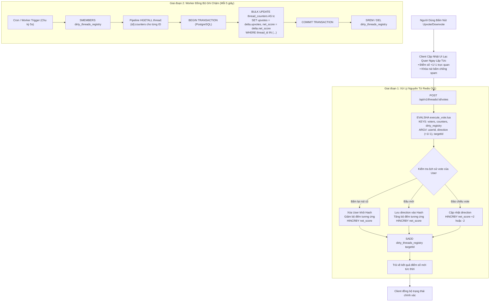

# Các Sơ Đồ Điều Phối Luồng Dữ Liệu DAG (Data Flow DAGs)

Tài liệu mô tả chi tiết các luồng xử lý dữ liệu phức tạp trong hệ thống dưới dạng đồ thị có hướng không chu trình (Directed Acyclic Graphs - DAGs).

---

## 1. LUỒNG XÁC THỰC KÉP & XOAY VÒNG REFRESH TOKEN (TOKEN ROTATION DAG)

```mermaid
sequenceDiagram
    autonumber
    actor Client as Trình Duyệt / App Client
    participant Interceptor as ClientAuthInterceptor (Mutex Lock)
    participant Gateway as API Gateway (apps/api)
    participant Auth as AuthService (TokenRotationService)
    participant Redis as Redis Session Store
    participant DB as PostgreSQL (Supabase)

    Note over Client, DB: Giai đoạn 1: Đăng Nhập & Cấp Token Ban Đầu
    Client->>Gateway: POST /api/v1/auth/login {email, password, deviceFingerprint}
    Gateway->>Auth: Xác thực mật khẩu (Argon2id/Scrypt)
    Auth->>Auth: Sinh Access Token (15m JWT) & Refresh Token (7d CSPRNG)
    Auth->>Redis: Lưu băm Token vào Redis Hash session:{userId}:{fingerprint}
    Auth->>DB: Ghi log LOGIN_SUCCESS vào auth_audit_logs
    Auth-->>Gateway: Trả về Tokens + Thiết lập HttpOnly Cookies (Lax/Strict)
    Gateway-->>Client: HTTP 200 OK + Set-Cookie

    Note over Client, DB: Giai đoạn 2: Gọi API & Tự Động Làm Mới Token Khi Hết Hạn
    Client->>Interceptor: Gọi API yêu cầu xác thực
    Interceptor->>Gateway: GET /api/v1/user/profile (Kèm Bearer Token)
    Gateway-->>Interceptor: HTTP 401 Unauthorized (Access Token hết hạn 15m)
    
    rect rgb(30, 41, 59)
    Note over Interceptor: Kích hoạt Mutex Lock: Chỉ 1 request được refresh, các request khác đưa vào hàng đợi
    Interceptor->>Gateway: POST /api/v1/auth/refresh (Kèm Refresh Token)
    Gateway->>Auth: refreshTokens(incomingRefreshToken, fingerprint)
    Auth->>Redis: So khớp SHA-256 hash
    alt Token khớp current_token_hash
        Auth->>Auth: Sinh cặp Tokens mới
        Auth->>Redis: Cập nhật current_token_hash, chuyển token cũ sang previous_token_hash (Grace Period 30s)
        Auth-->>Gateway: Trả về cặp Token mới
        Gateway-->>Interceptor: HTTP 200 OK + Cập nhật Cookies
        Interceptor->>Interceptor: Giải phóng Mutex Lock & Dispatch token mới cho các request đang chờ
    else Token khớp previous_token_hash trong vòng 30s (Grace Period)
        Auth-->>Gateway: Cấp lại Access Token mới (Không xoay vòng thêm Refresh Token)
        Gateway-->>Interceptor: HTTP 200 OK
    else Token không khớp bất kỳ hash nào (Token Reuse Attack Detected!)
        Auth->>Redis: DEL session:{userId}:* (Hủy toàn bộ cụm phiên của tài khoản)
        Auth->>DB: Ghi log an ninh TOKEN_REUSE_DETECTED
        Auth-->>Gateway: HTTP 403 Forbidden
        Gateway-->>Interceptor: HTTP 403 Forbidden
        Interceptor->>Client: Buộc đăng xuất & Điều hướng về /login
    end
    end
```



---

## 2. LUỒNG BẦU CHỌN NGUYÊN TỬ VÀ GHI CHẬM (WRITE-BEHIND VOTING DAG)

Nhằm đảm bảo API chịu tải hàng chục nghìn lượt vote mỗi giây mà không làm sập CSDL, thao tác bình chọn được xử lý tức thời trên Redis qua Lua script và ghi chậm bất đồng bộ xuống CSDL quan hệ:



---

## 3. LUỒNG TẢI FILE ĐA PHƯƠNG TIỆN ZERO-HOP (MEDIA PIPELINE DAG)

Mã nguồn frontend tải ảnh trực tiếp lên Object Storage (Cloudflare R2 / AWS S3) thông qua Presigned URL có chữ ký bảo mật, loại bỏ hoàn toàn gánh nặng băng thông trên máy chủ backend:

```mermaid
sequenceDiagram
    autonumber
    actor Client as Trình Soạn Thảo Tiptap (Client)
    participant API as Core Backend API
    participant Storage as Cloudflare R2 / AWS S3
    participant DB as PostgreSQL (Supabase)

    Client->>Client: Kéo thả file ảnh vào khung soạn thảo
    Client->>Client: Nén ảnh WebP trên trình duyệt & sinh mã băm Blurhash
    Client->>API: POST /api/v1/media/presigned-url {filename, mimeType, sizeBytes, blurhash}
    API->>API: Kiểm định định dạng ảnh hợp lệ (PNG, JPEG, WebP, GIF, < 10MB)
    API->>DB: Tạo bản ghi media_assets với status = 'PENDING'
    API->>Storage: Sinh Signed PUT URL có thời hạn sống 5 phút
    API-->>Client: Trả về {uploadUrl, fileKey, publicUrl}
    
    Client->>Storage: HTTP PUT [Dữ liệu nhị phân của ảnh] (Direct Upload)
    Storage-->>Client: HTTP 200 OK
    Client->>Client: Hiển thị ảnh kèm khung mờ Blurhash chống nhảy layout (CLS=0)
    
    Client->>API: POST /api/v1/threads {title, contentAst, mediaKeys: [fileKey]}
    API->>DB: INSERT INTO threads; UPDATE media_assets SET status = 'ATTACHED' WHERE key = fileKey;
    API-->>Client: HTTP 201 Created (Thread hoàn chỉnh)
```
