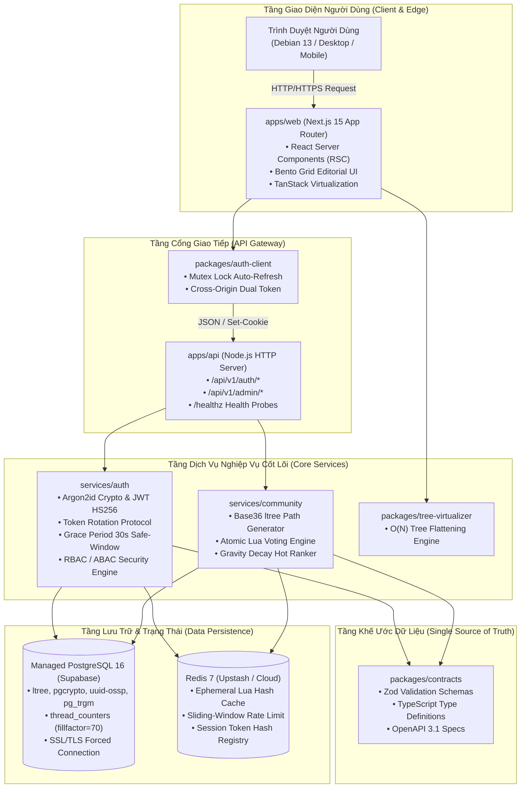

# Kiến Trúc Tổng Quan Hệ Thống (System Architecture Overview)

**Dự án:** Acad DevOps Project (Enterprise Community & Social Platform Monorepo)  
**Phiên bản:** 1.0.0  
**Kiến trúc:** Monorepo đa tầng (Multi-tier Workspace) với Clean Architecture  

---

## 1. TỔNG QUAN MÔ HÌNH VẬN HÀNH

Hệ thống được thiết kế theo mô hình lai (Hybrid Platform):
- **Phân luồng thảo luận sâu (kiểu Reddit / Discourse):** Cây bình luận đa tầng không giới hạn độ sâu qua PostgreSQL `ltree`, không gian phân quyền (Spaces), hệ thống điểm tín nhiệm (Karma) và kiểm duyệt nội dung (Trust & Safety).
- **Bảng tin tương tác tức thời (kiểu X / Bluesky):** Luồng bảng tin cá nhân hóa xếp hạng theo thuật toán Gravity Decay, tương tác Upvote/Downvote không độ trễ qua kịch bản nguyên tử Redis Lua Script $\mathcal{O}(1)$ và cập nhật giao diện lạc quan (Optimistic UI).



---

## 2. PHÂN TẦNG MONOREPO (MONOREPO TOPOLOGY)

Dự án sử dụng `pnpm workspace` quản lý mã nguồn tập trung, tuân thủ nghiêm ngặt nguyên tắc phụ thuộc một chiều:
**`packages/*` (Thư viện dùng chung) $\rightarrow$ `services/*` (Nghiệp vụ lõi) $\rightarrow$ `apps/*` (Ứng dụng chạy thực tế)**.

```
acad_devOps_project/
├── apps/                         # Ứng dụng thực thi (Applications)
│   ├── api/                      # Backend HTTP Gateway API (Port 8080)
│   └── web/                      # Frontend Next.js 15 App Router (Port 3000)
│
├── services/                     # Dịch vụ nghiệp vụ độc lập (Core Domain Services)
│   ├── auth/                     # Phân hệ Xác thực, Token Rotation, Redis Session, Postgres Repo
│   └── community/                # Phân hệ Cộng đồng, ltree Base36, Lua Voting, Gravity Decay
│
├── packages/                     # Thư viện dùng chung (Shared Packages)
│   ├── contracts/                # Single Source of Truth: Zod schemas, Types, OpenAPI 3.1
│   ├── auth-client/              # HTTP Client SDK với Mutex Lock chống gọi lặp token
│   ├── tree-virtualizer/         # Thuật toán trải phẳng cây bình luận ltree O(N)
│   └── ui-tokens/                # Hệ thống Design Tokens: Typography, Color Palette
│
└── deploy/                       # Cấu hình hạ tầng & triển khai (DevOps Infrastructure)
    ├── docker/                   # Docker Compose dev & Dockerfile production
    ├── migrations/               # PostgreSQL 16 DDL migration scripts
    ├── redis/                    # Kịch bản Lua script nguyên tử
    └── render/                   # Render Cloud Blueprint (Infrastructure-as-Code)
```

---

## 3. DANH MỤC THỰC THỂ NÚT MẠNG HẠ TẦNG (TOPOLOGY NODES)

| Nút Hạ Tầng | Vai Trò & Công Nghệ | Trách Nhiệm Kỹ Thuật Chính |
| :--- | :--- | :--- |
| **Edge Ingress** | Cloudflare CDN & WAF / Render Edge | Chấm dứt TLS 1.3, chống DDoS L3/L7, nén Brotli, Edge Cache tĩnh cho Next.js assets. |
| **Web Client** | Next.js 15 Node.js Standalone Runner | Render React Server Components (RSC), truyền dòng HTML qua Suspense Streaming, tối ưu hóa SEO. |
| **Core API Gateway** | Node.js HTTP Server (`apps/api`) | Điều hướng các endpoint `/api/v1/auth/*`, `/api/v1/admin/*`, `/healthz`, kiểm soát CORS, phân giải Cookies. |
| **Auth Subsystem** | `@acad/auth-service` | Băm mật khẩu Argon2id, phát hành JWT, xoay vòng Refresh Token (Token Rotation), quản lý phiên Redis/Postgres. |
| **Community Subsystem** | `@acad/community-service` | Sinh mã Base36 cho `ltree`, tính điểm thịnh hành Gravity Decay, thực thi Lua script bầu chọn. |
| **Relational DB** | Managed PostgreSQL 16 (Supabase) | Lưu trữ bền vững ACID: Users, Sessions, Spaces, Threads, Comments `ltree`, Thread Counters (`fillfactor=70`), Audit Logs. |
| **Cache & Session Store** | Redis 7 Cluster (Upstash / Local) | Lưu trữ phiên Hash, hàng đợi giới hạn tần suất (Sliding-window Rate Limiter), bộ đếm vote tạm thời. |

---

## 4. CHIẾN LƯỢC RENDERING HYBRID FRONTEND

Ứng dụng web áp dụng triệt để kiến trúc **React Server Components (RSC) kết hợp Partial Prerendering (PPR)**:
1. **Khung giao diện & Nội dung bài viết (Server Components - 0KB JS):**
   - Nội dung bài viết, Markdown tĩnh, thông tin tác giả, siêu dữ liệu SEO (JSON-LD, OpenGraph) được dựng sẵn từ máy chủ.
   - Bot tìm kiếm (Googlebot) nhận được file HTML hoàn chỉnh ngay lập tức (FCP < 0.8s).
2. **Đảo tương tác người dùng (Client Components):**
   - Chỉ nạp JavaScript cho các phần tử tương tác thực tế: Cụm nút Upvote/Downvote ([`VoteAction`](file:///home/debv/Documents/100_academy/acad_it_devOps/acad_devOps_project/apps/web/src/app/page.tsx)), Hộp soạn thảo bình luận phản hồi nhanh, Popover thông báo.
   - Ảo hóa cây bình luận thông qua `@tanstack/react-virtual` kết hợp thuật toán trải phẳng mảng $\mathcal{O}(N)$ từ `@acad/tree-virtualizer`.
