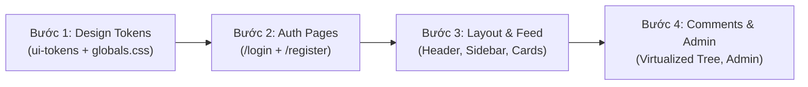

# Kế Hoạch Tái Thiết Kế Toàn Diện Giao Diện: Minimalist Brutalism Dark Mode

> **Mục tiêu:** Chuyển đổi toàn bộ ngôn ngữ thiết kế của Web Client (`apps/web`) và Design Tokens (`packages/ui-tokens`) từ phong cách Light Editorial sang **Brutalism Tối Giản (Minimalist Brutalism) - Dark Mode**, tuân thủ nghiêm ngặt tỷ lệ phân bổ 4 gam màu chủ đạo: `#222831` (40%), `#393E46` (25%), `#948979` (15%), `#DFD0B8` (15%).

---

## 1. Bản Đồ Phân Bổ 4 Gam Màu Cốt Lõi (Color Palette & Hierarchy)

```
[████████████████ #222831 (40% Canvas)]
[██████████ #393E46 (25% Surfaces & Containers)]
[██████ #948979 (15% Brutalist Borders & Metadata)]
[██████ #DFD0B8 (15% High-Contrast Text & Primary Action)]
```

| Mã Màu HEX | Tỷ Lệ | Tên Gọi Kỹ Thuật | Vai Trò & Vị Trí Áp Dụng Trong Giao Diện |
| :---: | :---: | :--- | :--- |
| **`#222831`** | **40%** | **Deep Void Charcoal** | **Nền chính (Canvas Background):** Toàn bộ body trang web, khoảng đệm giữa các widget, nền ngoài của modal, nền nền tảng toàn monorepo. |
| **`#393E46`** | **25%** | **Industrial Graphite** | **Bề mặt thành phần (Surface/Cards):** Khối thẻ bài viết (Thread Cards), thanh điều hướng (Navbar, Sidebar), khung chứa Form (`/login`, `/register`), hộp bình luận, bảng điều khiển Bento boxes. |
| **`#948979`** | **15%** | **Muted Earthy Taupe** | **Cấu trúc & Nhãn phụ (Borders & Metadata):** Đường viền dứt khoát brutalist (`border: 1px solid #948979` hoặc `2px solid`), đường gióng thụt lề cây bình luận, thời gian (timestamps), tác giả, icon phụ, divider lines. |
| **`#DFD0B8`** | **15%** | **Warm High-Contrast Parchment** | **Điểm nhấn thị giác & Tương phản (High-Contrast Hero):** Tiêu đề chính (`h1`, `h2`, `h3`), nút bấm CTA hành động chính (`background: #DFD0B8; color: #222831`), nhãn badge active, bóng đổ phẳng brutalist (`box-shadow: 3px 3px 0px #DFD0B8`). |

---

## 2. Triết Lý & Quy Chuẩn Thiết Kế Brutalism Tối Giản

1. **Hình Khối & Viền (Geometry & Borders):**
   - Triệt tiêu hoàn toàn góc bo tròn mềm mại (`border-radius: 0px` đến tối đa `2px`).
   - Mọi khối hộp đều có đường viền dứt khoát: `1px solid #948979` cho card thông thường, `2px solid #948979` cho header/container chính.
2. **Đổ Bóng Phẳng Độc Đáo (Hard Flat Shadows):**
   - Tuyệt đối không dùng blur shadow mờ nhạt (`box-shadow: 0 4px 6px rgba(...)`).
   - Sử dụng bóng đổ phẳng góc 45°:
     ```css
     box-shadow: 3px 3px 0px #948979; /* Trạng thái tĩnh */
     ```
   - Khi hover nút hoặc thẻ tương tác:
     ```css
     transform: translate(-1px, -1px);
     box-shadow: 4px 4px 0px #DFD0B8; /* Nổi bật tương phản */
     ```
3. **Typography & Biên Tập Kỹ Thuật (Typography):**
   - Font chính: `Inter` hoặc `Geist Sans` cho nội dung đọc (`color: #DFD0B8`).
   - Font kỹ thuật / Số liệu / Code: `JetBrains Mono` cho nhãn badge, điểm số voting, karma, đường dẫn URL (`color: #DFD0B8` hoặc `#948979`).
   - Tương phản tuyệt đối: Chữ màu kem ấm `#DFD0B8` trên nền than tối `#222831` / `#393E46` đảm bảo tỷ lệ WCAG AAA (> 7:1).

---

## 3. Bản Thiết Kế Chi Tiết Từng Màn Hình & Thành Phần (Component Blueprint)

### 3.1. Hệ Thống Design Tokens ([`packages/ui-tokens/src/tokens.ts`](file:///home/debv/Documents/100_academy/acad_it_devOps/acad_devOps_project/packages/ui-tokens/src/tokens.ts))
Định nghĩa bảng màu mới thay thế light theme:
```typescript
export const BRUTALIST_DARK_TOKENS = {
  canvas: '#222831',         // 40%
  surface: '#393E46',        // 25%
  border: '#948979',         // 15%
  highlight: '#DFD0B8',      // 15%
  
  // Biến thể chuyên biệt
  surfaceHover: '#444A53',
  borderStrong: '#DFD0B8',
  textPrimary: '#DFD0B8',
  textSecondary: '#948979',
  shadowBrutal: '3px 3px 0px #948979',
  shadowBrutalActive: '4px 4px 0px #DFD0B8',
} as const;
```

### 3.2. Cấu Hình Toàn Cục ([`apps/web/src/app/globals.css`](file:///home/debv/Documents/100_academy/acad_it_devOps/acad_devOps_project/apps/web/src/app/globals.css))
```css
:root {
  --color-canvas: #222831;
  --color-surface: #393E46;
  --color-surface-hover: #444A53;
  --color-border: #948979;
  --color-border-strong: #DFD0B8;
  
  --color-text-primary: #DFD0B8;
  --color-text-secondary: #948979;
  
  --color-accent-btn: #DFD0B8;
  --color-accent-text: #222831;
  
  --shadow-brutalist: 3px 3px 0px #948979;
  --shadow-brutalist-highlight: 4px 4px 0px #DFD0B8;
}

body {
  background-color: var(--color-canvas);
  color: var(--color-text-primary);
  font-family: var(--font-sans);
}
```

### 3.3. Thanh Điều Hướng (Top Navbar & Left Rail)
- **Top Header:** Chiều cao 56px, nền `#393E46`, viền đáy `2px solid #948979`.
- **Logo:** `ACAD.DEVOPS //` dạng chữ Monospace đậm, màu `#DFD0B8`, kèm badge nhỏ `[SYS_ONLINE]` màu `#948979`.
- **Left Rail (Menu):** Khối hình hộp chữ nhật sắc nét, các item có viền `1px solid #393E46`. Khi active: nền chuyển thành `#DFD0B8`, chữ thành `#222831`, viền `1px solid #DFD0B8`.

### 3.4. Thẻ Bài Viết Bảng Tin (Thread Cards & Bento Grid)
- **Cấu trúc Card:**
  - Nền `#393E46`, viền `1px solid #948979`, góc bo `0px`.
  - Bóng đổ tĩnh: `box-shadow: 3px 3px 0px #222831`.
  - Khi hover: `box-shadow: 4px 4px 0px #DFD0B8; transform: translate(-2px, -2px);`.
- **Thanh Bỏ Phiếu (Voting Column):**
  - Cụm Upvote/Downvote đặt bên trái, nút dạng hộp viền `#948979`.
  - Điểm số: Hiển thị font `JetBrains Mono` màu `#DFD0B8`.
- **Nội Dung:**
  - Tiêu đề `h2`: Màu `#DFD0B8`, font-weight 700.
  - Tag không gian (Space Badge): Nền `#222831`, viền `#948979`, chữ `#DFD0B8`.
  - Metadata: Ngày giờ, số bình luận hiển thị màu `#948979`.

### 3.5. Cây Bình Luận Ảo Hóa (Nested Comment Tree)
- **Đường Phân Cấp (Tree Threading Line):**
  - Đường kẻ thụt lề dứt khoát: `border-left: 2px solid #948979`.
- **Node Bình Luận:**
  - Nền `#393E46` cho bình luận gốc, `#222831` cho bình luận con (tạo độ sâu thị giác phân tầng).
  - Tác giả & Karma badge: `#DFD0B8` và `#948979`.
  - Nút trả lời (Reply): Nút phẳng tối giản viền `1px solid #948979`.

### 3.6. Màn Hình Đăng Nhập & Đăng Ký (`/login` & `/register`)
- **Khung Form (Form Container):**
  - Đặt giữa màn hình trên nền canvas `#222831`.
  - Khung chữ nhật nền `#393E46`, viền dày `2px solid #948979`, bóng đổ thô `4px 4px 0px #DFD0B8`.
- **Ô Nhập Liệu (Input Fields):**
  - Nền `#222831`, chữ `#DFD0B8`, viền `1px solid #948979`, không bo góc.
  - Khi focus: `border: 1px solid #DFD0B8; outline: 1px solid #DFD0B8;`.
- **Nút Hành Động (Submit Button):**
  - Nền `#DFD0B8`, chữ `#222831`, font-weight 700, chữ hoa (`UPPERCASE`).
  - Viền `2px solid #DFD0B8`, bóng đổ `3px 3px 0px #948979`.

---

## 4. Lộ Trình Triển Khai Kỹ Thuật (4-Step Execution Plan)



| Bước | Hạng Mục Cụ Thể | Tệp Mã Nguồn Thực Hiện |
| :---: | :--- | :--- |
| **B1** | Cập nhật bộ biến màu, typography, và quy tắc brutalist shadow | [`packages/ui-tokens/src/tokens.ts`](file:///home/debv/Documents/100_academy/acad_it_devOps/acad_devOps_project/packages/ui-tokens/src/tokens.ts), [`apps/web/src/app/globals.css`](file:///home/debv/Documents/100_academy/acad_it_devOps/acad_devOps_project/apps/web/src/app/globals.css) |
| **B2** | Thay đổi toàn bộ style form `/login` và `/register` sang Brutalist Dark | [`apps/web/src/app/login/page.tsx`](file:///home/debv/Documents/100_academy/acad_it_devOps/acad_devOps_project/apps/web/src/app/login/page.tsx), [`apps/web/src/app/register/page.tsx`](file:///home/debv/Documents/100_academy/acad_it_devOps/acad_devOps_project/apps/web/src/app/register/page.tsx) |
| **B3** | Cải tạo App Layout, Navbar, Sidebar Rail và Bento Thread Feed | [`apps/web/src/app/page.tsx`](file:///home/debv/Documents/100_academy/acad_it_devOps/acad_devOps_project/apps/web/src/app/page.tsx), Navigation Components |
| **B4** | Cải tạo Comment Virtualizer và Bảng Quản trị `/admin/users` | `apps/web/src/components/comments/*`, [`apps/web/src/app/admin/*`](file:///home/debv/Documents/100_academy/acad_it_devOps/acad_devOps_project/apps/web/src/app/admin) |
