# Kế Hoạch Hoàn Thiện Tính Năng Giai Đoạn 4 (Phase 4 Next Steps)

> **Mục tiêu:** Đưa Giai đoạn 4 từ 65% hoàn thành lên 100%, tập trung vào CMS Pipeline Zero-hop Media, Tích hợp UI Ảo hóa Bình luận (Comment Tree Virtualization), và SSE Realtime Stream cho Voting.

---

## 1. Hiện Trạng Giai Đoạn 4 (Audit Hiện Tại)

```
[===========================>                ] 65% Hoàn thành
```

| Phân hệ (Subsystem) | Trạng thái hiện tại | Hạng mục đã hoàn thành | Hạng mục cần thực hiện tiếp |
| :--- | :---: | :--- | :--- |
| **4.1. Auth & Session** | **100%** | Argon2id, JWT Rotation, 30s Grace Period, Token Reuse Detection, Redis Sessions, SSL auto-detect, InMemory fallback. | Hoàn tất & đã kiểm thử 100%. |
| **4.2. CMS & Media Pipeline** | **30%** | Sơ đồ luồng Zero-hop Presigned URL, hợp đồng API. | Tích hợp S3/R2 SDK, API sinh Presigned URL, Tiptap Editor, Orphan Cleanup Worker. |
| **4.3. Nested Comments** | **80%** | Base36 ltree generator, max depth 8, `flattenCommentTree` O(N) thuật toán tại `packages/tree-virtualizer`. | Kết nối giao diện Next.js với `@tanstack/react-virtual`, xử lý realtime comment input. |
| **4.4. Realtime Voting Hub** | **50%** | Redis Lua atomic voting script, batch flush worker. | Endpoint SSE (`/stream`) phát sóng biến động score tới các browser tab đang mở. |

---

## 2. Kế Hoạch Hành Động Chi Tiết (Action Items)

```mermaid
flowchart TD
    subgraph CMS_Media ["4.2 CMS & Zero-Hop Media"]
        M1["Cài đặt AWS SDK / S3 Client<br/>trong services/community"] --> M2["API GET /api/v1/media/presigned-url<br/>(Cấp link PUT trực tiếp tới R2)"]
        M2 --> M3["Tích hợp Tiptap Editor trên apps/web<br/>Kéo thả ảnh tải trực tiếp lên Cloud"]
        M3 --> M4["Worker Orphan Media Cleaner<br/>(Xóa ảnh tải lên nhưng không submit)"]
    end

    subgraph Tree_UI ["4.3 Comment Tree Virtualization UI"]
        C1["Import @acad/tree-virtualizer<br/>vào apps/web/src/components/comments"] --> C2["Tích hợp @tanstack/react-virtual<br/>(Chỉ render node hiển thị trong viewport)"]
        C2 --> C3["Thực thi Optimistic UI khi user gửi bình luận<br/>Hiển thị ngay trước khi server phản hồi"]
    end

    subgraph Realtime_SSE ["4.4 SSE Realtime Hub"]
        S1["Tạo Endpoint GET /api/v1/posts/:id/stream<br/>Server-Sent Events (SSE)"] --> S2["Lắng nghe Redis Pub/Sub kênh post_votes<br/>và phát event tới Frontend"]
        S2 --> S3["Hook usePostRealtimeVotes<br/>cập nhật điểm số mượt mà không reload"]
    end
```



---

## 3. Quy Trình Kỹ Thuật Chi Tiết

### 3.1. Phân hệ CMS & Zero-Hop Presigned URL
1. **Thư viện:** `@aws-sdk/client-s3` và `@aws-sdk/s3-request-presigner` (hỗ trợ Cloudflare R2, AWS S3, MinIO).
2. **Endpoint:**
   - `POST /api/v1/media/presigned-url`
   - Header: `Authorization: Bearer <jwt_access_token>`
   - Body:
     ```json
     {
       "filename": "screenshot.png",
       "fileType": "image/png",
       "fileSizeBytes": 1048576
     }
     ```
   - Logic kiểm tra: Chỉ cho phép định dạng ảnh (`image/jpeg`, `image/png`, `image/webp`, `image/gif`), dung lượng tối đa 10MB.
   - Response:
     ```json
     {
       "uploadUrl": "https://r2.acad.internal/uploads/2026/10/uuid.png?X-Amz-Signature=...",
       "publicUrl": "https://cdn.acad.internal/uploads/2026/10/uuid.png",
       "expiresInSeconds": 300
     }
     ```
3. **Frontend Tiptap Editor:**
   - Khi kéo thả ảnh hoặc paste clipboard, Frontend chặn mặc định, gọi API lấy `uploadUrl`, dùng `fetch(uploadUrl, { method: 'PUT', body: file })`.
   - Sau khi HTTP 200, chèn thẻ `` vào Tiptap.

### 3.2. Cây Bình Luận Ảo Hóa Trên Next.js Frontend
1. **Kiến trúc Component:**
   - File: `apps/web/src/components/comments/CommentVirtualizedTree.tsx`
   - Dùng hook `useWindowVirtualizer` hoặc `useVirtualizer` từ `@tanstack/react-virtual`.
2. **Luồng dữ liệu:**
   - Dữ liệu thô từ Server (`GET /api/v1/posts/:id/comments`) là mảng phẳng đã sắp xếp theo `ltree_path ASC`.
   - Chạy hàm `flattenCommentTree(comments, collapsedPathSet)` từ `@acad/tree-virtualizer`.
   - Kết quả trả về danh sách các node hiển thị, truyền vào Virtualizer:
     - Chiều cao ước tính: 96px mỗi comment node.
     - Overscan: 5 items để cuộn mượt mà không nhấp nháy.
     - Khoảng lùi lề trái: `paddingLeft = node.depth * 24px` (tối đa cấp 8 = 192px).

### 3.3. Server-Sent Events (SSE) Realtime Voting Hub
1. **Backend Endpoint:**
   - File: `services/community/src/routes/realtime-routes.ts`
   - `GET /api/v1/posts/:id/stream`
   - Thiết lập HTTP Headers:
     ```http
     Content-Type: text/event-stream
     Cache-Control: no-cache, no-transform
     Connection: keep-alive
     X-Accel-Buffering: no
     ```
2. **Redis Integration:**
   - Khi `execute_vote.lua` cập nhật điểm số, gửi event qua Redis Pub/Sub: `PUBLISH post_events:<post_id> '{"type":"vote_update","score":128}'`.
   - SSE handler lắng nghe và đẩy ngay tới subscriber: `data: {"score": 128}\n\n`.

---

## 4. Kế Hoạch Nghiệm Thu (Acceptance Criteria)

- [ ] **CMS:** Upload ảnh 5MB trực tiếp lên Cloudflare R2 qua Presigned URL thành công trong vòng < 2 giây. Không tải qua RAM của backend server.
- [ ] **Comments Virtualizer:** Render mượt mà 5,000 bình luận với tốc độ 60 FPS (Chrome DevTools Performance), DOM chỉ chứa tối đa 20 phần tử thực tế cùng lúc.
- [ ] **Realtime Voting:** Điểm số bài viết nhảy realtime trên trình duyệt khác trong vòng < 150ms khi có người thả upvote mà không cần F5 trình duyệt.
- [ ] **Tests & Types:** Toàn bộ test suite Vitest và TypeScript check đạt 100% không lỗi.
